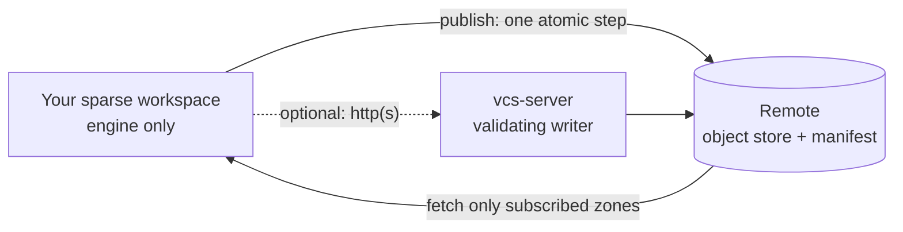

<div align="center">

# 🌳 allgit

**Version control for big repos where code, art, and docs shouldn't share one history.**

[](https://github.com/Bobliuuu/allgit/actions/workflows/ci.yml)


</div>

allgit is a version control tool (the command is `vcs`) written in Rust, for teams whose repository mixes very different things (say, game code, shaders, and gigabytes of art) and who want to download and work on only the parts they need. It is **not** a Git wrapper: it has its own storage and never calls Git.

> ⚠️ Early research project, no stable release yet. A lot works and is tested, but several pieces have only been run against fixtures or a single cloud account. See [what works today](#-what-works-today) and [what is not done or not verified](#-not-done-or-not-verified).

## 💡 The big idea

Imagine a game studio. Programmers touch `engine/`, artists touch `assets/`. With plain Git, everyone shares one history and downloads everything.

With allgit, each part of the repo is a **zone**:

- 🧩 Each zone has its **own branches and history**, so an artist's busy week doesn't clutter the programmers' log.
- 📦 You **subscribe** only to the zones you need. Skipped zones are never downloaded (and never "deleted", just not there).
- ⚛️ One commit can still change several zones **atomically**: either all of them move, or none do.

## 🚀 Try it in 60 seconds

You need [Rust](https://rustup.rs) 1.80+. Every command and output below was run for real.

**1. Build and make a repo**

```bash
cargo build --release
export PATH="$PWD/target/release:$PATH"
export VCS_AUTHOR_NAME=Ada VCS_AUTHOR_EMAIL=ada@example.com   # who you are

vcs init demo && cd demo
```
```text
Initialized empty vcs repository in /path/to/demo/.vcs
```

**2. Commit, change, and look at the history**

```bash
echo hello > hello.txt
vcs add hello.txt && vcs commit -m "Initial commit"
echo world >> hello.txt
vcs status && vcs diff
vcs add hello.txt && vcs commit -m "Update greeting"
vcs log
```
```text
staged 1 file(s), 0 removal(s)
[root/main 96d49f6fc5b5] Initial commit
zone root: branch main @ 96d49f6fc5b5
  not staged:
    modified:  hello.txt
diff --vcs a/hello.txt b/hello.txt
--- a/hello.txt
+++ b/hello.txt
@@ -1,1 +1,2 @@
 hello
+world
staged 1 file(s), 0 removal(s)
[root/main e670fef25d9b] Update greeting
commit e670fef25d9b260392538cebb7f2eb9ac9170237e51c90ab1019bc7a5eb23927
change e53b19aa3c7a90559906ac5a611c9321   zone root
Author: Ada <ada@example.com>
Date:   1793477306
    Update greeting

commit 96d49f6fc5b58621a3005c7c8508e00f5f64504fb533f219630c7954cd1e8850
change 58ff190e27c4bafe507dbedca2a01929   zone root
Author: Ada <ada@example.com>
Date:   1793477306
    Initial commit
```

**3. Split the repo into zones** (a commit touching both is one atomic transaction)

```bash
mkdir engine assets
echo 'fn main(){}' > engine/main.rs && echo bin > assets/logo.bin
vcs zone create engine --path engine
vcs zone create assets --path assets
vcs add engine assets && vcs commit -m "Add engine and assets"
vcs zone branch engine feature       # branch just the engine
vcs zone checkout engine feature     # assets stays on main
vcs zone list
vcs snapshot create v1 && vcs snapshot checkout v1   # every subscribed zone back to its pinned commit
vcs zone rename old new                 # zones without history only; vcs zone delete <name> [--force]
vcs branch -d feature                   # refuses the checked-out branch and unmerged work (--force to override)
```
```text
created zone engine owning engine/
created zone assets owning assets/
staged 2 file(s), 0 removal(s)
[assets/main 764099d40c74] Add engine and assets
[engine/main d4fbb8635c1d] Add engine and assets
atomic transaction 218e46ade70a covering 2 zones
created engine/feature at d4fbb8635c1d
zone engine: switched to feature
assets         assets               subscribed, on main; 1 branch(es)
engine         engine               subscribed, on feature; 2 branch(es)
root           (rest of repo)       subscribed, on main; 1 branch(es)
```

**4. Share it, then clone only the engine**

```bash
vcs zone checkout engine main        # back to main; publish sends every branch
vcs remote set ~/shared.vcs          # any directory works as a remote
vcs publish
cd .. && vcs clone ~/shared.vcs work --zone engine
cd work && vcs status
```
```text
zone engine: switched to main
remote set to /Users/you/shared.vcs
assets/main (none) -> dfd635917b38
engine/main (none) -> fd4d2ccc4144
published atomically (remote generation 1)
Cloned /Users/you/shared.vcs into work
downloaded zones: engine
skipped zones (not subscribed): assets, root
  add one later with `vcs zone add <name>` then `vcs fetch --zone <name>`
zone engine (engine/): branch main @ fd4d2ccc4144
not subscribed (not downloaded/materialized, NOT deleted): assets, root
clean
```

That's it: `work/` contains only `engine/`. Later, `vcs fetch` downloads updates and `vcs sync` fast-forwards when safe (it reports dirty or diverged zones instead of touching them). A publish that would overwrite someone else's work is refused with guidance.

**5. Everyday commands** (run inside `work/engine`; all verified)

```bash
vcs tag v1.0 && vcs tag               # lightweight tag, then list tags
vcs show                              # HEAD commit with its diff
vcs blame main.rs                     # per-line commit attribution
echo x >> main.rs
vcs stash push && vcs stash pop       # set changes aside, bring them back
vcs restore main.rs                   # discard working-tree changes (--staged to unstage)
vcs mv main.rs lib.rs && vcs commit -m mv
# also available: rm, revert, cherry-pick, rebase, resolve, config, import-git/export-git (see `vcs --help`)
vcs log --json                        # --json works on status, log, diff, branch, zone list, op log, conflict list
vcs gc --dry-run                      # report what GC would delete; plain `vcs gc` really deletes unreachable old objects
vcs repack && vcs fsck                # loose objects into one pack, then verify
vcs op log                            # operation log; `vcs op undo` reverts the last local operation
vcs lock --lease-secs 60 main.rs && vcs locks   # advisory lock recorded on the remote
```

> Hashes and timestamps differ on every run, and the outputs above are trimmed to the relevant lines. Step 4's output came from a separate fresh run of steps 1 to 3 (the hashes differ from step 3's).

## ✅ What works today

✅ done and tested · 🟡 partial or limited · ⬜ not built. "Tested" means an executable test in the repo; the last column says what was and was not run for real.

| Area | Status | Notes |
|---|---|---|
| Objects and format | ✅ | BLAKE3, domain-separated ids, canonical codec, strict decode, proptests; symlink entries; big files stored as **chunk manifests** (format v2) |
| Local VCS | ✅ | init, add, commit, status, diff, log, branch, switch, fsck, tags (lightweight and annotated), show, blame, restore, rm, mv, `.vcsignore`, stash, `config`, `--json` on read commands |
| Zones and snapshots | ✅ | non-overlapping zones, independent heads, sparse subscribe/unsubscribe, atomic multi-zone commit, rename/delete, snapshots |
| History editing | 🟡 | `cherry-pick`, `revert`, `rebase` (keeps change ids, linear ranges only), operation log with `op undo` (local state only) |
| Merge | 🟡 | three-way text and tree merge, conflict state, `resolve`, `--abort`. **Rename-aware merge** is opt-in (`--renames`). **Structural merge** (tree-sitter) for Rust, Python, TypeScript and Go sits behind cargo feature flags, off by default. Criss-cross and file/directory conflicts are errors |
| Assisted merge | 🟡 | `vcs merge --assist` plus the `vcs-assist-claude` helper. Fixture and mock tested; **never called against the live API** ([assist.md](docs/assist.md)) |
| Remote protocol | ✅ | single CAS manifest, idempotent publish, model-checked (about 1.7M crash and interleaving schedules); tags sync through publish/fetch/clone |
| Remote storage | 🟡 | directory remotes, `s3://` remotes (HTTP; HTTPS needs `--features tls`), `http(s)://` remotes served by `vcs-server`. **Remote packs**: one pack per publish, fetched by byte range |
| Sparse and lazy | ✅ | clone and fetch by zone (tests assert unsubscribed bytes are never read); **lazy blob fetch** with batched prefetch and `--stats` |
| Server | 🟡 | `vcs-server`: validating writer, bearer tokens and roles, path policy, lock enforcement, TLS (rustls, feature `tls`), tamper-evident audit log, rate limits, directory or S3 backend, deploy recipe ([server.md](docs/server.md), [deploy.md](docs/deploy.md)) |
| Login | ✅ | `vcs login`, `logout`, `auth`, and a credential helper; tokens stay out of the repo config |
| Locks | 🟡 | `lock`, `unlock`, `locks`; model-checked; **enforced only when you publish through `vcs-server`**; with a plain directory or bucket they are advisory |
| Packfiles | 🟡 | `repack` writes one pack plus index (loose objects stay readable); no delta compression; pack format has no compression yet |
| Garbage collection | 🟡 | `vcs gc` really deletes unreachable objects older than a grace period (local); `gc --remote --yes` works for **directory remotes only**. S3 and HTTP remote GC is not built ([gc.md](docs/gc.md)) |
| Git interop | 🟡 | `import-git` (fast-export, with symlinks and tags), `export-git` (incremental), and a `git-remote-allgit` helper so `git` can talk to an allgit repo ([interop.md](docs/interop.md)) |
| Perforce | 🟡 | `import-p4` reads recorded `p4` output from a fixture directory. Tested on hand-written fixtures only ([import-p4.md](docs/import-p4.md)) |
| Speed work | 🟡 | commit-graph cache, directory-listing cache for `status`, stat-cache `add`, cache-tree `commit`, parallel checkout/fsck. See [Performance](#-performance) |
| Hardening | 🟡 | fuzz targets for decoders, import and S3 list parsing; threat review in [security.md](docs/security.md) |
| Windows | ⬜ | CI only *compiles* for Windows (advisory job). The code has never been run there |

Known gaps are listed in [docs/architecture.md](docs/architecture.md#known-limitations-honest-list).

## 🔎 Not done or not verified

- **S3 was measured once**: one run against real AWS S3 (us-east-1) from a Mac, about 2,700 requests. Other clouds (R2, GCS, B2) are unmeasured.
- **No cloud TLS interop test.** HTTPS for `s3://` and for `vcs-server` is implemented with rustls, but only exercised against local servers, not against a real cloud endpoint or a public CA.
- **Perforce has never been run against a real server.** The importer only knows the fixtures we wrote.
- **Windows has never been run**, only compiled.
- **The Claude merge assistant has never been called live.** No quality or cost numbers exist.
- **Structural and rename-aware merge** are measured on generated and replayed histories, not on a large body of real-world merges.
- **No remote GC for S3/HTTP**, no pack compression or delta compression, no filesystem monitor, and `status` on 100k-file flat repos is still slower than git (see below).
- Locks are not enforced without `vcs-server` in front of the storage.

## ⚡ Performance

Numbers come from [docs/benchmarks.md](docs/benchmarks.md) and [docs/research/storage/s3-aws-results.md](docs/research/storage/s3-aws-results.md); nothing is estimated. Method, raw runs and caveats are there.

**100k files, vcs vs git** (Linux box, AMD EPYC 7J13, ext4, git 2.34.1, 5 runs, median, warm cache, 2026-11-01). The vcs runs happened at higher machine load than the git runs, so they are pessimistic for vcs. Median ms, git / vcs:

| workflow | flat | deep | binary (4 KiB files) |
|---|---|---|---|
| add . (fresh index) | 9,562 / 12,510 | 11,593 / 14,676 | 22,252 / 13,959 |
| commit (all staged) | 647 / 291 | 15,861 / 12,517 | 639 / 344 |
| status, clean | 106 / 188 | 1,032 / 508 | 104 / 521 |
| log (50 commits) | 19.9 / 4.3 | 35.0 / 4.5 | 21.4 / 4.1 |
| checkout (1% differ) | 584 / 285 | 748 / 497 | 577 / 297 |

So: vcs wins `commit`, `log` and `checkout` here, git still wins `add` on text and `status` on flat and binary. An earlier run on the same box had vcs 2x to 4x slower in several of these cells ([before and after](docs/benchmarks.md#100k-files-again-on-current-main-git-vs-vcs-2026-11-01-before-and-after)); that run was at different machine load, so treat the size of the gain as approximate.

**Real S3** (client on a Mac over home internet to us-east-1, one run, 20 to 40 requests per cell): every request costs about 150 ms regardless of kind or size (p50: HEAD 153, 1 KiB GET 156, manifest compare-and-swap 176 ms). That is why remote packs matter: a one-file publish into a 5,000-entry directory went from 5,009 to 6 requests in the counting harness (an in-memory count, not a timed publish). The same run found that S3's ETag repeats for identical bytes, which is safe only because the manifest embeds an ever-growing generation number.

## 🛡️ Why you can trust it

- **Integrity:** every read re-hashes the data; each object has exactly one valid encoding.
- **Atomic publishing:** a publish becomes visible at one instant. An executable model tries every interleaving of two writers with crashes and lost messages injected, and checks nothing is lost or applied twice.
- **Untrusted input:** paths like `..` or `.vcs` are rejected, checkout won't write through symlinks or overwrite untracked files, and the decoders are fuzzed.

Details: [architecture](docs/architecture.md), [security](docs/security.md).

## 🗺️ How the pieces fit



## 🧱 Code layout

| Crate | Role |
|---|---|
| `vcs-objects` | ids, canonical codec, object types, name/path validation (no I/O) |
| `vcs-store` | `ObjectStore` trait; memory and loose-object filesystem stores; packs |
| `vcs-repo` | zones, refs, index, workspace, commit/log/diff/status, snapshots, op log, locks, stash, rebase, GC, git and p4 import/export, fsck, publish/fetch/sync/clone |
| `vcs-remote` | `Backend` trait + conformance suite, manifest, publish step machine, remote packs, sparse and lazy fetch, model checker |
| `vcs-store-s3` | S3-compatible backend (hand-rolled SigV4, blocking, no async runtime) |
| `vcs-merge` | merge-base, diff3 text merge, tree merge, rename-aware merge, optional tree-sitter structural merge |
| `vcs-server` | the `vcs-server` binary: HTTP validating writer with auth, audit, rate limits, TLS |
| `vcs-assist-claude` | helper binary for `merge --assist` (calls the Anthropic API) |
| `vcs-bench` | seeded dataset generator, criterion benchmarks, `s3bench`, `storebench` |
| `vcs-cli` | the `vcs` and `git-remote-allgit` binaries |

`crates/vcs-storage-lab`, `vcs-storage-lab-packing` and `vcs-compress-lab` are research experiments and are **not** in the cargo workspace. `fuzz/` is a separate cargo-fuzz project.

## 📚 Learn more

- Documentation: **[User guide](docs/guide/README.md)** (install, daily workflow, zones, remotes, Git interop, locks, troubleshooting, full command reference)
- Start here: [CLI reference](docs/cli.md) · [Architecture](docs/architecture.md) · [Object model](docs/object-model.md) · [Roadmap](docs/roadmap.md) · [Install](docs/install.md)
- Features: [Zones](docs/zones.md) · [Merge](docs/merge.md) · [Assisted merge](docs/assist.md) · [Rebase](docs/rebase.md) · [Operations](docs/operations.md) · [Locks](docs/locks.md) · [Git import](docs/import-git.md) · [Perforce import](docs/import-p4.md) · [Interop](docs/interop.md) · [GC](docs/gc.md) · [Cache](docs/cache.md) · [Remote packs](docs/remote-packs.md) · [S3 backend](docs/s3.md)
- Server: [vcs-server](docs/server.md) · [Deploying](docs/deploy.md) · [Security](docs/security.md)
- Quality: [Benchmarks](docs/benchmarks.md)
- Research: [overview](docs/research.md) (the older notes there were written from memory and are unverified) · [storage engine study](docs/research/storage/README.md) with the [decision](docs/research/storage/architecture-decision.md), [results](docs/research/storage/results.md), [roadmap](docs/research/storage/implementation-roadmap.md) and [AWS S3 results](docs/research/storage/s3-aws-results.md)

## 🛠️ Contributing

```bash
cargo fmt --all --check
cargo clippy --workspace --all-targets -- -D warnings
cargo test --workspace                 # includes the ~20 s protocol model checker
VCS_TEST_S3_ENDPOINT=http://127.0.0.1:9000 cargo test -p vcs-store-s3   # MinIO, see docs/s3.md
```

The repository is [github.com/Bobliuuu/allgit](https://github.com/Bobliuuu/allgit). Work is tracked in [issues](https://github.com/Bobliuuu/allgit/issues); PRs use Conventional Commits and the template in `.github/`.

## 📄 License

Licensed under either of [Apache License 2.0](LICENSE-APACHE) or [MIT license](LICENSE-MIT) at your option (`MIT OR Apache-2.0`). Copyright (c) 2026 Jerry Zhu.
