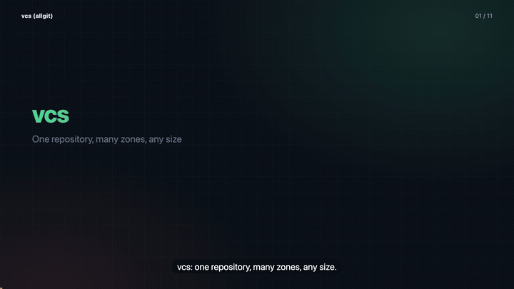
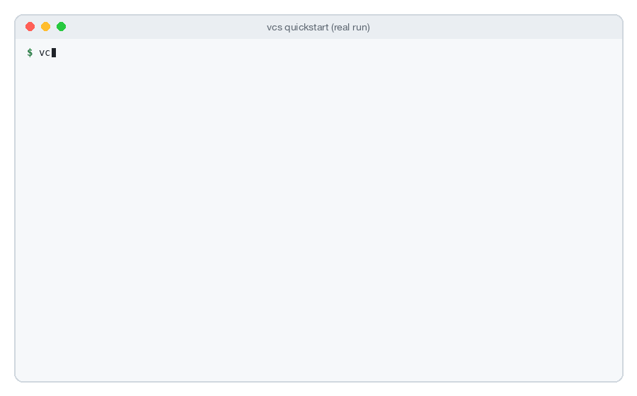
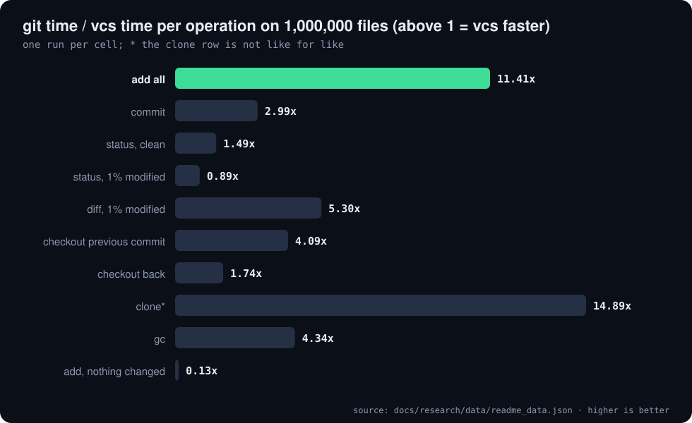
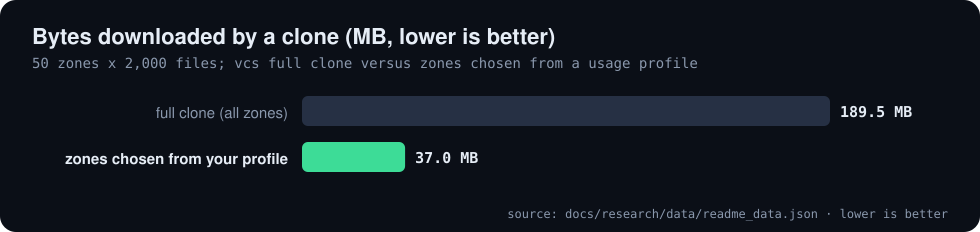
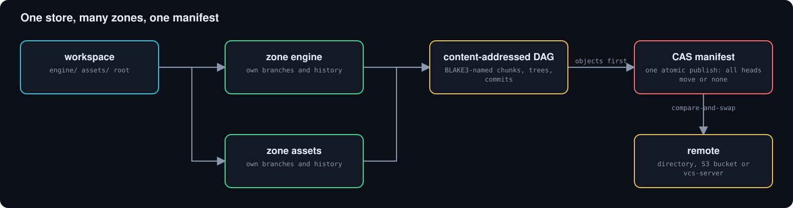

<div align="center">



# 🌳 vcs

**One repository, many zones, any size. A version control system written from scratch in Rust, with no git underneath**

[](https://github.com/Bobliuuu/allgit/actions/workflows/ci.yml)     [](https://github.com/Bobliuuu/allgit/releases/tag/v0.1.1)

[🎬 Video](#video) · [✨ What it is](#what-it-is) · [📊 Results](#results) · [🧩 Architecture](#architecture) · [🚀 Quickstart](#quickstart) · [🛠️ Install](#install) · [🚧 Limits](#caveats) · [📚 Docs](#documentation) · [🗺️ Repo map](#repo-map)

</div>

---

**Explainer video (with voice-over and subtitles): zones, atomic publish, and the measured results including where git wins**

[](video/allgit_explainer.mp4)

<a id="video"></a>
**vcs** is a version control system written from scratch in Rust, with **no git, no libgit2 and no Perforce underneath**. It is built for big repositories
where code, art and docs should not share one history, where nobody wants to download everything, and where many people (and agents) push at once to an S3 bucket.
The command is `vcs`; the repository is [Bobliuuu/allgit](https://github.com/Bobliuuu/allgit).

> 🐣 Early research software, with no on-disk format promise yet. Much of it is tested, but parts have only been run against fixtures, local servers or a single cloud account.
> Read [Limits](#caveats) before depending on it. The complete former front page (all benchmark tables, idea matrix, scoreboards) is kept in [docs/overview.md](docs/overview.md).

<p align="center"></p>
<p align="center"><sub>A real recorded run of the Quickstart ([provenance](docs/media/PROVENANCE.md)).</sub></p>

<a id="what-it-is"></a>

## ✨ What it is

```text
 one repo, many zones, each with its own history

   engine/  ──●──●──●──●        you subscribe to what you need
   assets/  ──●────●            (engine only? assets are never downloaded)
   root     ──●──●──────●
        \________|_________/
   one atomic publish: all heads move, or none
```
- 🧬 **One global content-addressed DAG.** Every object is named by its BLAKE3 hash and stored once, whichever zone or branch uses it.
- 🧩 **Zones.** A zone owns a path prefix and has its **own branches and history**. A busy art zone does not clutter the code log.
- 🎯 **Sparse subscription.** Zones you skip are never downloaded (and never "deleted").
- ⚛️ **Atomic cross-zone transactions.** `vcs publish` moves all the branch heads you publish in one step, or none of them.
- 🏠 **Local-first**, with an **operation log and undo**, **structured conflicts**, **locks** (advisory unless `vcs-server` is in front), a built-in **large-file engine** and `vcs gc`.
- 🪣 **S3-compatible authoritative remote** with a CAS manifest; the protocol is checked by an executable model that explores crashes and interleavings.

The full feature list, the idea matrix against other tools and every scoreboard are in [docs/overview.md](docs/overview.md).

<p align="center"></p>

<a id="results"></a>

## 📊 Results

Each number below is parsed from raw files committed in [`docs/research/data/`](docs/research/data) by [`tools/readme_data.py`](tools/readme_data.py).
They are one machine, one build and few runs each, not statements about other hardware; where git wins, the table says so.
The clone row is **not like for like** (see the [benchmark audit](docs/research/benchmark-audit.md)). Setup and caveats: [huge-scale](docs/research/huge-scale.md), [zone-profile-bench](docs/research/zone-profile-bench.md).

| add 1M files: vcs vs git | diff, 1% changed | gc | Bytes saved by profile-chosen zones | Test functions |
|:---:|:---:|:---:|:---:|:---:|
| **11x** | **5.3x** | **4.3x** | **80%** | **1,774** |

**1,000,000 files: wall seconds and peak memory (one run per cell, quiet box)**

| Operation | git (s) | vcs (s) | Faster | git RSS (MiB) | vcs RSS (MiB) |
| :--- | ---: | ---: | :--- | ---: | ---: |
| init | 0.02 | 0.17 | git faster | 4 | 8 |
| add all (1M files) | 215.45 | 18.88 | vcs faster | 210 | 1,004 |
| commit | 4.49 | 1.50 | vcs faster | 218 | 354 |
| status, clean | 0.76 | 0.51 | vcs faster | 220 | 357 |
| status, 1% modified | 1.83 | 2.06 | git faster | 220 | 284 |
| diff, 1% modified | 19.65 | 3.71 | vcs faster | 220 | 142 |
| checkout previous commit | 46.54 | 11.39 | vcs faster | 266 | 375 |
| checkout back | 28.55 | 16.41 | vcs faster | 266 | 322 |
| publish (local remote) | - | 11.22 | - | - | 2,256 |
| clone (local path; not like for like) | 603.11 | 40.50 | vcs faster | 136 | 1,319 |
| gc | 15.20 | 3.50 | vcs faster | 888 | 532 |
| add, nothing changed | 0.90 | 6.82 | git faster | 220 | 480 |

<sub>Source: `docs/research/data/readme_data.json`</sub>

**Zone-profile clone, 50 zones x 2,000 files (median of 3 runs)**

| Clone | Wall time |
| :--- | ---: |
| git full clone | 7.80 s |
| vcs full clone | 2.87 s |
| git partial + sparse clone | 3.68 s |
| vcs profile-chosen zones | 1.16 s |

<sub>Source: `docs/research/data/readme_data.json`</sub>

<p align="center"></p>

<p align="center"></p>

vcs is slower on `status` with 1% modified and on a no-op `add` (git's index stat cache wins), and uses more memory on `add`, `publish` and `clone`.
More measurements (many writers, real S3, soak with `kill -9`, other VCSs) with their own caveats: [docs/overview.md](docs/overview.md#-headline-numbers) and [docs/research/](docs/research).

<a id="architecture"></a>

## 🧩 Architecture

Objects are uploaded first, then one conditional write of the manifest makes the publish visible at a single instant.

<p align="center"></p>

<details>
<summary>Object model and atomic publish</summary>

<p align="center"></p><p align="center"></p>

</details>

<details>
<summary>Architecture overview</summary>

<p align="center"></p>

</details>

<a id="quickstart"></a>

## 🚀 Quickstart

```bash
export VCS_AUTHOR_NAME=Ada VCS_AUTHOR_EMAIL=ada@example.com
vcs init demo && cd demo
mkdir engine assets
echo 'fn main(){}' > engine/main.rs && echo bin > assets/logo.bin && echo hi > README.md
vcs zone create engine --path engine
vcs zone create assets --path assets
vcs add . && vcs commit -m "initial"      # one atomic transaction covering 3 zones
vcs zone list

vcs remote set ../shared.vcs
vcs publish                               # published atomically
cd .. && vcs clone shared.vcs work --zone engine
cd work && vcs status                     # assets and root: not subscribed, not downloaded, NOT deleted

echo x >> engine/main.rs
vcs git commit -am "edit"                 # git spelling; native: vcs add + vcs commit
vcs publish
vcs zone add assets && vcs fetch --zone assets
vcs op log                                # every local operation; `vcs op undo` reverts the last one
```
Coming from git or Perforce: [docs/git-to-vcs.md](docs/git-to-vcs.md), [docs/p4-to-vcs.md](docs/p4-to-vcs.md). The full tour is the [user guide](docs/guide/README.md).

<a id="install"></a>

## 🛠️ Install

Needs Rust 1.88 or newer.

```bash
git clone https://github.com/Bobliuuu/allgit && cd allgit
cargo build --release                                         # binaries in target/release
cargo install --path crates/vcs-cli --locked                  # or install `vcs` onto your PATH
vcs --help
```
Tagged releases publish tarballs; see [docs/install.md](docs/install.md) (also covers Windows, which is compile-checked only).

<a id="documentation"></a>

## 📚 Documentation

52 topic documents in [`docs/`](docs): [architecture](docs/architecture.md), [object model](docs/object-model.md), [CLI](docs/cli.md), [deploy](docs/deploy.md),
[operations](docs/operations.md), [durability](docs/durability.md), [benchmarks](docs/benchmarks.md), [known limits](docs/known-limits.md), plus the [user guide](docs/guide/README.md)
and the complete [overview](docs/overview.md). Also [CONTRIBUTING.md](CONTRIBUTING.md), [SECURITY.md](SECURITY.md), [CHANGELOG.md](CHANGELOG.md).

<a id="quick-start"></a>

## 🚀 Quick start

**Test and regenerate this page**

```bash
cargo test --workspace
python3 tools/readme_data.py
python3 ~/video-readme-maker/vrm.py all README.spec.yml
```

<a id="caveats"></a>

## ⚠️ Honest caveats

- Early research software: object ids changed between early format versions with no migration tool; expect more change before a stable release.
- Benchmarks are one machine, one build and few runs; git still wins several rows (status with 1% modified, no-op add) and uses less memory on add, publish and clone.
- The 1M-file clone row is not like for like (local path clone); see the benchmark audit.
- Windows is compile-checked in CI only; locks are advisory unless vcs-server is in front; other S3 providers than MinIO, RustFS and AWS S3 are untested.
- Assisted merge and `zone suggest --assist` are fixture and mock tested; the Claude helper has never been called against the live API.

<a id="repo-map"></a>

## 🗺️ Repo map

| Path | What it is |
|---|---|
| `crates/` | 16 crates: objects, store, merge, remote, repo, server, CLI, S3 store, watch daemon, bench, assist helpers and storage labs |
| `docs/` | topic documents, user guide, research with raw benchmark data, diagrams |
| `docs/overview.md` | the complete former front page: all tables, scoreboards and idea matrix |
| `docs/research/data/` | raw result files; readme_data.json is derived from them by tools/readme_data.py |
| `scripts/` | benchmark and media scripts |
| `deploy/` | Dockerfile, systemd unit, Prometheus and Grafana configs for vcs-server |
| `fuzz/` | fuzz targets |
| `README.spec.yml` | drives this README and the video |
| `video/` | explainer mp4, poster, preview gif, subtitles |
| `assets/` | generated hero, chart and diagram SVGs |

---

<div align="center"><sub>Generated with [video-readme-maker](https://github.com/Bobliuuu/video-readme-maker).</sub></div>
