# 🌳 vcs

*One repository, many zones, any size. Take only the slice you need, publish from as many hands as you like.* 🍰

[](https://github.com/Bobliuuu/allgit/actions/workflows/ci.yml)


**vcs** is a version control system written from scratch in Rust, with **no git, no libgit2 and no Perforce underneath**. It is
built for big repositories where code, art and docs should not share one history, where nobody wants to download everything,
and where many people (and agents) push at once to an S3 bucket. The command is `vcs`; the repository is
[Bobliuuu/allgit](https://github.com/Bobliuuu/allgit).

> 🐣 Early research software. There is no stable release and no on-disk format promise yet. Much of it is tested, but
> parts have only been run against fixtures, local servers or a single cloud account. Read
> [Status and limitations](#-status-and-limitations) before depending on it.

**Jump to:** [Headline numbers](#-headline-numbers) · [What is new](#-what-is-genuinely-new) · [Scalability](#-scalability) ·
[Wins and losses](#-wins-ties-and-losses-measured) · [Install](#-install-and-build) · [Quickstart](#-quickstart) ·
[git and p4 mapping](#-coming-from-git-or-perforce) · [Docs index](#-documentation)

## 🔢 Headline numbers

Every number below links to the document and raw data it came from. Each is one machine, one build and a small number of runs;
none is a statement about other hardware. Where vcs loses, it says so in the same table.

| claim | vcs | reference | source |
|---|---|---|---|
| **1,000,000 files**: `clone` (local path) | **40.5 s** | git 603.1 s | [huge-scale](docs/research/huge-scale.md) |
| 1M files: `add` all | **18.9 s** | git 215.5 s | same |
| 1M files: `diff` of a 1% change | **3.7 s** | git 19.7 s | same |
| 1M files: `add` with nothing changed | 6.8 s (**loss**) | git 0.9 s | same |
| 512 writers on one manifest, group commit on vs off | **69.7 vs 27.3 publishes/s**, p95 8.5 vs 37.2 s | (same server, feature off) | [scalability](docs/scalability.md) #6 |
| 128 pushers to S3-compatible storage | **42.2 pushes/s** | walgit 15.5 | [highload-matrix](docs/research/highload-matrix.md) |
| 128 pushers, local disk | 85.3 pushes/s (**loss**) | git 222.0 | same |
| 100,000 files `add` (flat, fresh index) | **538 ms** | git 4,810 ms | [command-scoreboard](docs/research/command-scoreboard.md) |
| `kill -9` of the server, 157 times in 14 min | **0 acknowledged files lost** | n/a | [box-harvest](docs/research/box-harvest.md) |
| Zones chosen from your usage profile | **37 MB** downloaded | 189.5 MB full clone | [zone-profile-bench](docs/research/zone-profile-bench.md) |

Scoreboard totals across all measured cells (mixed build dates, see [below](#-wins-ties-and-losses-measured)):
**166 wins, 81 ties, 37 losses** for vcs against git, Perforce, walgit, Jujutsu and Sapling. The 37 losses are listed in plain
text further down.

<p align="center"><picture><source media="(prefers-color-scheme: dark)" srcset="docs/img/charts/huge-scale-dark.svg">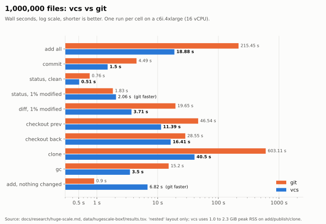</picture></p>

## 🏛️ Architecture at a glance

<p align="center">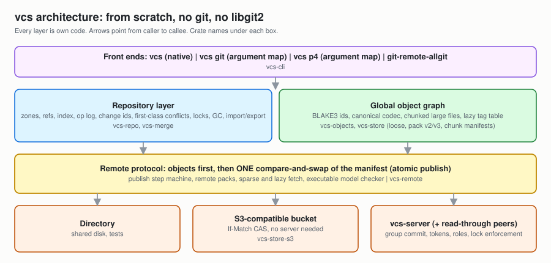</p>


## ✨ What it is, in one screen

```text
 one repo, many zones, each with its own history

   engine/  ──●──●──●──●        you subscribe to what you need
   assets/  ──●────●            (engine only? assets are never downloaded)
   root     ──●──●──────●
        \________|_________/
   one atomic publish: all heads move, or none
```

<p align="center"></p>
<p align="center"><sub>The object model: one store, per-zone histories, one manifest that orders publishes.</sub></p>

- 🧬 **One global content-addressed DAG.** Every object (file chunk, tree, commit, transaction, operation) is named by
  its BLAKE3 hash and stored once, whichever zone or branch uses it.
- 🧩 **Zones.** A zone owns a path prefix (say `engine/` or `assets/`) and has its **own branches and history**. Zones
  cannot overlap. A busy art zone does not clutter the code log.
- 🎯 **Sparse subscription.** You subscribe to the zones you need. Zones you skip are never downloaded (and never
  "deleted", they are just not there). Inside a zone, `vcs sparse` limits which paths are materialized.
- ⚛️ **Atomic cross-zone transactions.** One commit can change several zones; `vcs publish` moves all the branch heads
  you publish in one step, or none of them.
- 🏠 **Local-first.** Everything except sharing works offline. Sharing is `publish`, `fetch`, `sync` and `clone`.
- 🪣 **S3-compatible authoritative remote with a CAS manifest.** The remote is a directory, an S3-compatible bucket or
  a `vcs-server`. A single manifest object, replaced by compare-and-swap, is the source of truth. A publish becomes
  visible at one instant, and the protocol is checked by an executable model that explores crashes and interleavings.
- ⏪ **Operation log and undo.** `vcs op log` records every local change to branches and workspace; `vcs op undo` and
  `vcs op restore` go back.
- 🤝 **Structured conflicts.** A conflicted merge or rebase keeps conflicts as recorded state you can list, show and
  resolve (`vcs conflict`, `vcs resolve`), instead of leaving markers as the only record.
- 🔐 **Locks.** `vcs lock`, `unlock` and `locks` for files that cannot be merged. Enforced only when you publish
  through `vcs-server`; with a plain directory or bucket they are advisory.
- 📦 **Built-in large-file engine.** Big files are content-defined chunked, stored once, added and checked out by
  streaming, with no separate large-file tool. See [Large files](#-large-files).
- 🧹 **Garbage collection.** `vcs gc` deletes unreachable objects older than a grace period, locally and on remotes.

<p align="center"></p>
<p align="center"><sub>An atomic cross-zone publish (animated): objects first, then a single compare-and-swap of the manifest.</sub></p>

## 🧪 What is genuinely new

Individually, several of these ideas exist elsewhere: Jujutsu has change ids, an operation log and first-class conflicts; Perforce has
exclusive locks, atomic submits and client views; Sapling has sparse profiles. **What we believe is new is the combination, built on
one object model**, and three pieces that we have not seen in the others: *zones as independent histories inside one global object
graph*, *a zone ontology plus automatic zone selection for agents*, and *an S3 bucket as the only authority via a compare-and-swap
manifest, with group commit in front*. "Not seen" is our reading of their public documentation, not a test of those tools.

| idea | what it does here | doc |
|---|---|---|
| **No git underneath** | Own object format (BLAKE3, strict canonical codec), packs, index and wire protocol. A test checks the core crates have no git or p4 dependency. | [object-model](docs/object-model.md), [interop](docs/interop.md) |
| **Zones in one global object graph** | A zone owns a path prefix and has its own branches and history, but all objects live in one content-addressed store, deduplicated across zones. One commit may touch several zones and publishes atomically. | [zones](docs/zones.md) |
| **Zone ontology for agents** | `vcs zone describe/graph/explain/changes --json` computes purpose, owners, dependencies, impact and recent changes from state vcs already has. Nothing is stored or invented. | [zone-ontology](docs/zone-ontology.md) |
| **Auto zone selection** | `clone/sync --auto` picks zones from a local, privacy-limited usage profile (zone id + directory prefix only; no model, no upload). Skipped zones stay listed. | [zone-profile](docs/zone-profile.md) |
| **S3 as authority, CAS manifest** | Objects are uploaded first; one manifest object is replaced by conditional write. A publish is visible at one instant. The protocol is checked by an executable model that explores crashes and interleavings. | [s3](docs/s3.md), [manifest-scaling](docs/manifest-scaling.md) |
| **Group commit** | `vcs-server` merges disjoint publishes that arrive together into one manifest write; clients keep the txid protocol so a lost ack is safe. | [scalability](docs/scalability.md) #6 |
| **Change ids** | Each commit carries a stable `change_id`; `rebase` keeps it. | [architecture](docs/architecture.md#change-identity-impl-for-create-rebase-others-partial), [rebase](docs/rebase.md) |
| **Operation log** | `vcs op log / undo / restore` over branches and workspace. | [operations](docs/operations.md) |
| **First-class conflicts** | A conflicted merge or rebase is recorded state you can list, show and resolve (`vcs conflict`, `vcs resolve`). | [merge](docs/merge.md) |
| **Lease locks in the manifest** | Acquire, renew, release and break are transaction ops with fencing, atomic with publishes. Enforced when you publish through `vcs-server`; advisory on a plain bucket. | [locks](docs/locks.md) |
| **Lazy tag table** (PR #481, pending merge) | The tag table is validated without allocating and parsed only when a command looks at it; an untouched table is written back byte for byte. On 300,000 tags `log -n 1` went 0.307 to 0.062 s (loaded laptop). | [scalability](docs/scalability.md) |
| **Built-in large-file engine** | Content-defined chunking (kind 9, no format bump), streaming add and checkout, no separate LFS tool. | [object-model](docs/object-model.md#large-files-chunked-kind-9-no-format-bump) |
| **Pack formats** | v2 (zstd per object) ships; v3 (sketch-ordered deltas) is opt-in for transfers because it measured slower for clone wall time. | [remote-packs](docs/remote-packs.md), [delta-gate](docs/research/storage/delta-gate.md) |

### Idea matrix against other tools

`yes` = shipped and documented by that tool, `part` = something close exists with a different shape, `-` = we know of no such feature.
vcs cells say `yes` only for what has an executable test in this repository; "first version" is marked. Columns for other tools
reflect our reading of their documentation and were **not tested here**; corrections welcome.

| idea | vcs | git | Perforce | Sapling | Jujutsu | walgit |
|---|---|---|---|---|---|---|
| Own object model (not git's) | yes | (is git) | yes | part (own store, git interop) | part (git backend by default) | no (git) |
| Independent histories per path zone, one object graph | yes | - | part (depots, streams) | - | - | - |
| Sparse subscription to what you need | yes | part (partial clone + sparse-checkout) | yes (client views) | yes (sparse profiles) | part | - |
| Machine-readable zone ontology for agents | yes | - | - | - | - | - |
| Zone choice from a usage profile | yes (first version) | - | - | - | - | - |
| Object store as sole authority, CAS manifest | yes | - | - | - | - | part (S3-backed git) |
| Server-side group commit of publishes | yes | - | - | - | - | - |
| Atomic multi-area publish | yes | - | yes (changelist) | - | - | - |
| Stable change ids across rewrites | yes | - | - | part | yes | - |
| Operation log with undo | yes | part (reflog) | - | part (undo, journal) | yes | - |
| First-class conflicts | yes | - | - | - | yes | - |
| Exclusive locks / leases for unmergeable files | yes (lease, fencing) | part (LFS locks) | yes | - | - | - |
| Protocol checked by executable model | yes | - | - | - | - | - |
| Large files without an add-on | yes | part (LFS) | yes | part | - | - |


## 📈 Scalability

How it scales, and what was measured. Full audit with 14 findings and what stays open:
[docs/scalability.md](docs/scalability.md). Everything below is on loopback or local disk unless stated: **no result here is a
statement about a real WAN or about AWS S3 latency**.

**1M files.** On a c6i.4xlarge, one run per cell, a 4 GB tree of 1,000,000 files: `clone` 40.5 s vs git 603.1 s, `add` 18.9 s vs
215.5 s, `commit` 1.5 s vs 4.5 s, `diff` 3.7 s vs 19.7 s, `gc` 3.5 s vs 15.2 s, `publish` 11.2 s (git: n/a). vcs peaks at 1.0 to
2.3 GiB RSS on add, publish and clone, and a no-op `add` is about 7.6x slower than git's stat cache. The `diff` result uses all 16 cores
(51.9 s user for 3.7 s wall), so it shrinks on small machines. Layout tested: nested only. Details: [huge-scale](docs/research/huge-scale.md).

**Many pushers on one repository.** Every publish contends on one manifest key. Group commit in `vcs-server` merges disjoint
publishes. At 512 writers: 27.3 to 69.7 publishes/s, p95 37.2 to 8.5 s, requests per publish 67.8 to 5.3.

**Hundreds of writers on real S3 (us-east-1, c6i.4xlarge, one run per cell).** The old server did one conditional manifest PUT per
push, so disjoint writers capped at **19 to 22 pushes/s at any of 64 to 1024 writers** (p99 up to 54 s). A batch commit (one PUT carries
every write that queued during the previous one) gives **215 to 350 pushes/s at 256 to 1024 writers, p99 1.3 to 7.4 s**; soak with 177
server `kill -9`: 2,254 acked files, none lost. **One hot branch is still a retry storm** (6.7 pushes/s at 256 writers, tail 110 s);
use branches or zones per writer. SlowDown counts, replicas and git/walgit at this scale were not run.
[many-writers-s3](docs/research/many-writers-s3.md).

<p align="center"><picture><source media="(prefers-color-scheme: dark)" srcset="docs/img/charts/many-writers-scaling-dark.svg">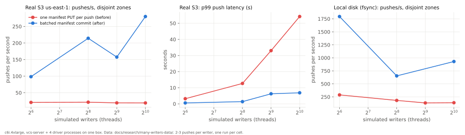</picture></p>

<p align="center">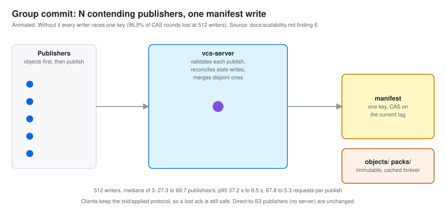</p>

<p align="center"><picture><source media="(prefers-color-scheme: dark)" srcset="docs/img/charts/group-commit-dark.svg">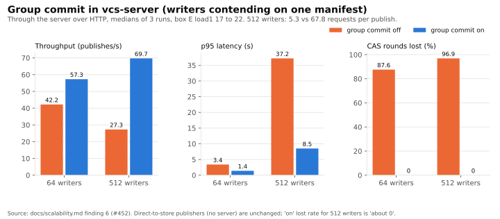</picture></p>

Against other tools on the same box (separate branches, 10 commits per pusher, 3 reps, every push verified by a fresh clone): on
S3-compatible storage vcs beats walgit in 8 of 9 cells and ties 1; on local disk **git is faster** in 6 of 9 cells (1 win, 2 ties;
the gap is mostly durability cost, since vcs fsyncs acknowledged objects; with `core.fsync=all` git drops from 289 to 120 pushes/s and the gap narrows to 15 to
25%). On the **same branch** at 32 pushers only vcs landed every commit (with `publish --auto-merge`); git landed 60 to 75 of 160
and walgit 35 of 160. See [highload-matrix](docs/research/highload-matrix.md).

<p align="center"><picture><source media="(prefers-color-scheme: dark)" srcset="docs/img/charts/highload-dark.svg">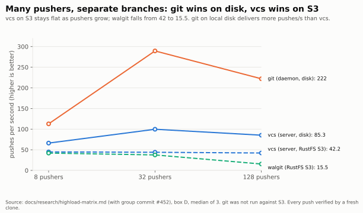</picture></p>

**S3-backed remotes and zones.** The remote is a directory, an S3-compatible bucket or `vcs-server`; the bucket needs conditional
writes (checked by a probe at connect). The manifest grows about 40 to 63 bytes per branch (1 MiB at 17 to 26k refs; 2.6 MB at 10k
zones x 5 branches), see [manifest-scaling](docs/manifest-scaling.md). Zones keep unrelated work from contending; a 50-zone repo
cloned by usage profile moved 37.0 MB instead of 189.5 MB.

<p align="center">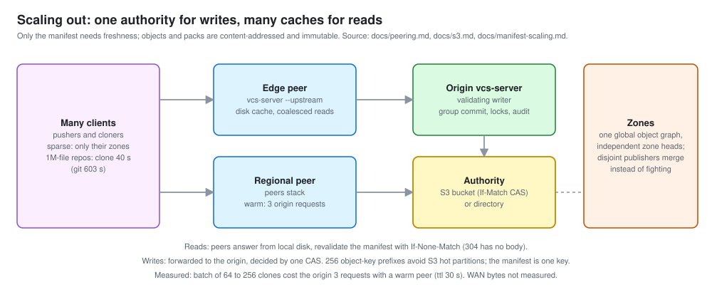</p>

**Peering and read-through.** `vcs-server --upstream` makes a disk-cached tier that forwards writes and serves immutable bytes
locally. A batch of 64 to 256 concurrent clones cost the origin 3 requests with a warm peer (manifest ttl 30 s) against 129 to 513
direct. Clone latency is a tie (the clients' own CPU dominates on loopback); bytes saved over a real WAN were not measured.
[peering](docs/peering.md).

<p align="center"><picture><source media="(prefers-color-scheme: dark)" srcset="docs/img/charts/peering-dark.svg">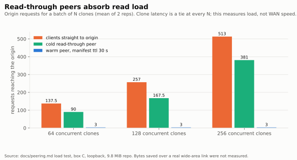</picture></p>

**Soak and chaos, zero data loss.** Writers pushed while the server was killed with `kill -9` 157 times in about 14 minutes. All 245
acknowledged files were present with correct content in a fresh clone, `fsck` was clean, and a clone of a copy of the store was
clean. This is a short run on one box: no memory or fd trend under kills (the sampler followed a dead pid), no kill during `gc`, and
the git comparison row was verify-only. [box-harvest](docs/research/box-harvest.md).

<p align="center"><picture><source media="(prefers-color-scheme: dark)" srcset="docs/img/charts/soak-chaos-dark.svg">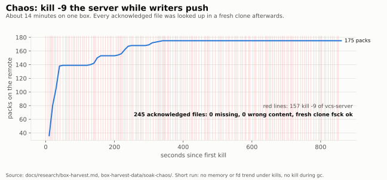</picture></p>

**Zones chosen for you.** `--auto` downloads 19.5% of the bytes of a full vcs clone and ties git partial+sparse on bytes while being
faster in wall time, but makes 71 requests instead of 28 and loses to `git pull` on incremental sync (0.78 s vs 0.29 s).

<p align="center">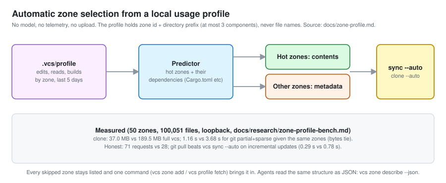</p>

<p align="center"><picture><source media="(prefers-color-scheme: dark)" srcset="docs/img/charts/zone-profile-dark.svg">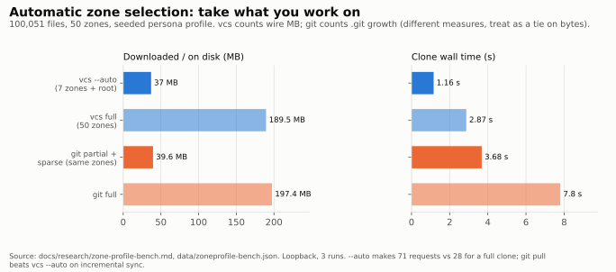</picture></p>

**Other limits, stated.** Refs are one file read whole: fine to about 100k refs; 1M tags cost seconds per command (the lazy tag table in PR #481 helps
once merged; the delta log is not built). `vcs-server` uses a thread per connection (256 default cap). First `status` after importing a
300,000-file wide tree took 22 s. Direct-to-store publishers (S3 without a server) get no group commit: keep fewer than 8 per
repository. Real S3 `SlowDown` counts under load were not captured (throughput on real S3 was measured). Not run: 10M files, 1M-commit history, remote GC concurrent with
pushes at scale. Full list: [scalability](docs/scalability.md#not-run).


## 🏆 Wins, ties and losses (measured)

vcs is **not uniformly faster**. Verdict rule: WIN = vcs at least 10% lower in both wall time and CPU, LOSS = at least 10% higher
in both, TIE = everything else and any difference under 2 ms. "Ties are within noise" is the rule, not a courtesy. Every cell
names its machine, build and run count in the linked document.

<p align="center"><picture><source media="(prefers-color-scheme: dark)" srcset="docs/img/charts/scoreboard-summary-dark.svg">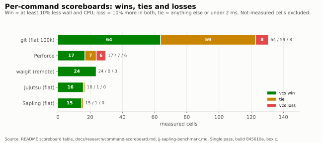</picture></p>

Summary (counts are cells, not importance; rows sharing a scenario count once per row; not-measured cells are excluded):

| tool | WIN | TIE | LOSS | where vcs is behind, plainly |
|---|---|---|---|---|
| git (flat 100k) | 46 | 68 | 17 | tiny metadata commands (`branch`, `tag`: 6 to 9 ms vs 1.4 ms), `ls-tree`, `bundle verify`/`create`, `log --stat`, `gc` CPU, `add -u` / `commit -a` after a one-file change, no-op `add` at 1M files, push throughput on local disk |
| Perforce (p4d on loopback) | 9 | 7 | 14 | one-file `submit`, `add`, `opened`, `revert`, `filelog`, full-tree `sync`: p4 thin client vs a server process |
| walgit (remote workflows) | 20 | 4 | 0 | older run; object-store request counts, client store size (1.5x) and server memory are worse |
| Jujutsu (3 layouts x 17 cells) | 43 | 2 | 6 | `commit` of a big staged tree, `switch`, deep `clone` |
| Sapling | 48 | 0 | 0 | none in measured cells (gc, describe, amend n/a) |
| **Total** | **166** | **81** | **37** | git and walgit were not both run on every box; jj/Sapling numbers mix sessions |

Beyond the scoreboards: 1M-file `clone`, `add`, `diff`, `checkout` and `gc` win against git; 100k-file `add`, `commit`, `switch`,
`grep` and `archive` win; `status` on a clean tree is a CPU tie; `log -n 5` is a tie (start-up cost under the 2 ms floor). Remote
workflows against walgit on a quiet box (100,000 files, 3 reps, loopback RustFS): initial push 788 ms vs 8,398, full clone warm 2,174
vs 3,392, no-op fetch 5 vs 19; warm one-commit fetch is a tie with git.

<p align="center"></p>

The detailed tables and per-tool scoreboards follow, unchanged in method from before this README was reworked.


### ⚡ Detailed performance tables

Short version: **vcs is not uniformly faster than git.** It is ahead in some cells and behind in others, and the
numbers below say which. Every number comes from a committed file or a merged PR, named next to it. Timing claims
carry machine, load, run count and version, and none of them is a general statement about other machines.

#### 🏁 Local commands against git, 100,000 files

Flat layout (`datagen flat 100000`, seed 42), warm cache, interleaved with git in random order per round, 5 runs (3 for
the slowest cells), medians, vcs divided by git, **below 1 means vcs used less**. Machine: AWS c6i.4xlarge (box E),
16 vCPU, load1 about 1.5 to 2.1 during the timed groups, git 2.43.0, run 2026-11-02, vcs release build of
`origin/main` at `8da0be2`. Wall and CPU are user+sys from `wait4`.

| cell (flat 100k) | git wall / CPU ms | vcs wall / CPU ms | wall ratio | CPU ratio |
|---|---|---|---|---|
| add (fresh index) | 4,810 / 4,751 | 538 / 1,772 | 0.11 | 0.37 |
| commit (all staged) | 357 / 459 | 227 / 92 | 0.45 | 0.20 |
| status, clean | 65 / 182 | 55 / 189 | 0.88 | **1.04** |
| log -n 5 | 1.4 / 1.3 | 2.1 / 2.1 | **1.54** | **1.58** |
| switch (1% of files differ) | 233 / 346 | 179 / 279 | 0.77 | 0.81 |

Source: [docs/research/data/command-scoreboard](docs/research/data/command-scoreboard) (`git-fresh.json`,
`git-clean.json`, `git-small.json`), rendered by `scripts/command_scoreboard_render.py`; the complete per-command table
is [docs/research/command-scoreboard.md](docs/research/command-scoreboard.md). The older interleaved harness
(`scripts/bench_compare.py`, [docs/research/interleaved-comparison.md](docs/research/interleaved-comparison.md)) has
other runs in `docs/research/interleaved-data/`; they predate the work in PRs #374 to #418 and are not quoted here.
`status` on a clean tree is a CPU tie with git (1.04x) and about 12% faster in wall time; `log` of a handful of
commits costs about 0.7 ms more process time than git (a start-up cost, below the 2 ms noise floor of the scoreboard,
so it is scored a TIE). Not measured here: cold cache, git with fsmonitor, the optional `watcher` feature, other
machines, deep and binary layouts for the per-command git/p4 scoreboards.

#### 🏆 Per-command scoreboards

Every row of the [git to vcs](docs/git-to-vcs.md) and [p4 to vcs](docs/p4-to-vcs.md) tables that has a vcs equivalent
was run against the real tool where a scenario exists; the rest is listed as NOT-MEASURED (never guessed). Verdicts:
WIN = vcs at least 10% lower in both wall and CPU, LOSS = at least 10% higher in both, TIE = everything else (and any
cell under 2 ms wall difference). Green is a win, amber a tie, red a loss. 🟢🟡🔴

<p align="center"></p>
<p align="center"></p>
<p align="center"></p>
<p align="center"></p>
<p align="center"></p>

| tool | 🟢 WIN | 🟡 TIE | 🔴 LOSS | not measured / n/a | how fresh |
|---|---|---|---|---|---|
| git (flat 100k, every doc row; rows sharing a scenario count once per row) | 46 | 68 | 17 | 93 not measured, 44 missing in vcs | 2026-11-02, build `8da0be2`, box E, interleaved |
| Perforce (p4d on loopback) | 9 | 7 | 14 | 27 not measured, 2 missing | 2026-11-02, build `8da0be2`, box E, interleaved |
| walgit (remote workflows) | 20 | 4 | 0 | 8 not measured | **older**: vcs build `84f3fa2`, box c, 3 reps, reused unchanged |
| Jujutsu (3 layouts x 17 cells) | 43 | 2 | 6 | describe and amend n/a | vcs `8da0be2` re-run, **jj numbers from the earlier `34315b6` run, not interleaved** |
| Sapling | 48 | 0 | 0 | gc, describe and amend n/a | same as Jujutsu |

Before this refresh (earlier same-day run, same scenarios): git 30 WIN / 52 TIE / 49 LOSS, Perforce 6 / 7 / 17. The
`diff`, `show`, `cat-file`, `reset`, `restore`, `rm` and `clone` rows moved from LOSS to WIN or TIE; the per-row
before and after ratios are in the scoreboard document. Caveats: load1 was 1.5 to 2.1 (a shared box), p4 CPU is a lower
bound (the p4d process is read in 10 ms ticks), p4 and jj/Sapling are different architectures than vcs, the git run is
flat 100k only, and the jj and Sapling cells mix sessions (see [the document](docs/research/jj-sapling-benchmark.md)).

🙈 **Where git (or walgit, or jj) still wins today**, from the same runs:

- **Tiny metadata commands cost vcs about 5x git's wall time** (`branch`, `tag`, `tag -d`, `branch -m`: 6 to 9 ms
  against 1.4 ms) even though CPU is within 1.5x. `vcs switch -c` is 65 ms against git's 1.8 ms.
- **`ls-tree HEAD` (non-recursive) is 19x git** (34 ms vs 1.8 ms), `bundle verify` is 370x (467 ms vs 1.3 ms),
  `ls-files` 1.24x wall and 2.2x CPU, `grep -- path` 1.7x, `log --stat` 1.8x, `gc` 1.8x, `bundle create` 1.6x.
- **`add -u`, `commit -a` and `add .` after a one-file change use 1.2 to 1.8x git's wall time**, and `mv` regressed (87 ms vs git's
  46 ms, was a tie at 43 ms).
- **vs Perforce**: `submit` of one file (115 ms vs 5.5 ms), `add`, `opened`, `revert`, `filelog` and `sync` of a full
  tree (2.3 s vs 1.5 s) are all slower than p4's thin client; p4d did the work in a server process.
- **vs Jujutsu**: `commit` of a big staged tree (1.1x to 1.9x), `switch` (1.4x to 1.5x, possible regression) and a deep
  `clone` (1.6x) are slower than jj. **vs Sapling**: no losses in the measured cells.
- **vs walgit** (older data, below): warm one-commit fetch is a tie, object-store request counts and client store size
  are worse for vcs.

#### 🌐 Remote workflows: vcs, git and walgit

[walgit](https://github.com/tobi/walgit) is a git server over S3-compatible storage (tool compared, not used by
vcs). Source: [docs/research/walgit-benchmark.md](docs/research/walgit-benchmark.md), section "quiet box, current vcs
build, flat 100k files", raw data in [docs/research/data/walgit-full-boxc](docs/research/data/walgit-full-boxc).
Machine: c6i.4xlarge, 16 vCPU, load1 1.33 to 1.19, dedicated, **3 reps only (read min and max, not just medians)**,
object store is a local RustFS on loopback (**nothing here says anything about real S3 or a network**), vcs build
`84f3fa2` default settings, walgit `80e9a20b29e2`, git 2.56.0 (local bare repo over `file://`, a lower bound with no
HTTP). Flat layout, 100,000 files (57.2 MiB). Wall ms, median.

| operation | git | walgit | vcs |
|---|---|---|---|
| initial push | 6,554 | 8,398 | 788 |
| 1-file push | 46 | 93 | 40 |
| full clone, warm | 4,023 | 3,392 | 2,174 |
| full clone, cold | 3,654 | 3,735 | 1,241 |
| zone / partial clone, warm | 1,266 | 814 | 414 |
| fetch 1 commit, warm | 84 | 101 | 85 |
| fetch 1 commit, cold | 710 | 1,206 | 218 |
| no-op fetch, warm | 14 | 19 | 5 |

🙈 Where git or walgit still win in that run (same file, scoreboards):

- **Warm fetch of one commit is a tie with git** (84 ms vs 85 ms for vcs, with wide min-max), and with the "pack v3"
  setting vcs is about 10 to 20% behind git there.
- **Object-store request counts:** warm full clone is 4 store requests for walgit against 28 for vcs (14 with pack
  v3); 1-file push is 7 against 13; warm zone clone 7 against 24.
- **Warm store traffic:** walgit's warm clone moves 0 MiB through the store (it serves from a local copy); vcs moves
  its pack set (46.5 MiB default).
- **Client store size:** 78.2 MiB for vcs against 51.0 MiB for git and walgit after a full clone (1.5x).
- **Server memory:** with pack v3, full-clone server RSS is 104 MiB for vcs against 76 MiB for walgit (default
  settings: 57 MiB).
- **Remote store size after the initial push:** 46.6 MiB (default) against 42.1 MiB for walgit and 42.5 MiB for git.

The 10k-file runs for all three layouts are older (Lambda box, load around 20, build before PRs #343 to #353) and are
in the same document. Deep and binary 100k were not run in the quiet-box pass.

#### 🔭 Other tools

Perforce, Jujutsu and Sapling are covered by the scoreboards above
([command-scoreboard](docs/research/command-scoreboard.md),
[jj and Sapling](docs/research/jj-sapling-benchmark.md)). Older whole-workflow comparisons with Perforce, Jujutsu,
Sapling, Mercurial, Subversion, Fossil, Breezy and Pijul exist ([perforce](docs/research/perforce-benchmark.md),
[jujutsu](docs/research/jujutsu-benchmark.md), [sapling](docs/research/sapling-benchmark.md),
[others](docs/research/other-vcs-benchmark.md)), but their vcs columns were measured with a build that predates the
current performance work and were not re-run; read those files with that in mind. More method notes:
[docs/benchmarks.md](docs/benchmarks.md).


## 🛠️ Install and build

Needs Rust 1.80 or newer.

```bash
git clone https://github.com/Bobliuuu/allgit && cd allgit      # any way of getting the sources works
cargo build --release                                         # binaries in target/release
cargo install --path crates/vcs-cli --locked                  # or install `vcs` onto your PATH
vcs --help
```

Tagged releases publish Linux and macOS tarballs with checksums; see [docs/install.md](docs/install.md), which also
covers Windows (compile-checked only) and the optional `git` shim (`--features git-shim`). HTTPS remotes are in the default build
(`tls` feature).

## 🚀 Quickstart

Set an identity, then make a repository with two zones (every command below was run against a current build):

```bash
export VCS_AUTHOR_NAME=Ada VCS_AUTHOR_EMAIL=ada@example.com
vcs init demo && cd demo
mkdir engine assets
echo 'fn main(){}' > engine/main.rs && echo bin > assets/logo.bin && echo hi > README.md
vcs zone create engine --path engine
vcs zone create assets --path assets
vcs add . && vcs commit -m "initial"      # one atomic transaction covering 3 zones (assets, engine, root)
vcs zone list
```

Share it through any directory, then clone only the engine zone:

```bash
vcs remote set ../shared.vcs
vcs publish                               # published atomically (remote generation 1)
cd .. && vcs clone shared.vcs work --zone engine
cd work && vcs status                     # assets and root: not subscribed, not downloaded, NOT deleted
```

Work, publish, and pull in another zone later:

```bash
echo x >> engine/main.rs
vcs git commit -am "edit"                 # git spelling; native: vcs add + vcs commit
vcs publish
vcs zone add assets && vcs fetch --zone assets
vcs op log                                # every local operation; `vcs op undo` reverts the last one
vcs gc --dry-run                          # reports what GC would delete
```

Not sure which zones you need? `vcs zone suggest` proposes boundaries from manifests and ownership files (read-only),
and `vcs clone <url> work --for path/or/symbol --dry-run` shows the smallest zone set, with dependencies, and how
much it would download. See [docs/zones-autodetect.md](docs/zones-autodetect.md). The full tour, with pasted output
from real runs, is the [user guide](docs/guide/README.md).

## 🔀 Coming from git or Perforce

vcs does not need git or p4 at runtime. Two front ends rewrite familiar command lines to native vcs:

```bash
vcs git log --oneline -5          # git spelling, runs the vcs equivalent
vcs git commit -am "fix"
vcs git --map                     # the whole git -> vcs table
vcs p4 --list                     # the p4 -> vcs table; vcs p4 --explain <args> prints the translation and runs nothing
```

| you type | native vcs |
|---|---|
| `git clone` / `p4 sync` | `vcs clone URL [--zone Z \| --for PATH \| --auto]` |
| `git add` + `git commit` / `p4 add` + `p4 submit` | `vcs add` + `vcs commit` (one atomic transaction over every zone touched) |
| `git push` / `p4 submit` | `vcs publish` (objects first, then one CAS of the manifest) |
| `git fetch` + `git merge --ff` | `vcs sync` |
| `git reflog` / `git reset` | `vcs op log` / `vcs op undo` |
| `p4 lock` | `vcs lock` |

Complete maps: [git to vcs](docs/git-to-vcs.md), [p4 to vcs](docs/p4-to-vcs.md), [vcs to git and p4](docs/vcs-to-git-p4.md).
History moves in with `vcs import-git` (reads a `git fast-export` stream you produce) and `vcs import-p4` (recorded `p4` output), and out with
`vcs export-git`: [import-git](docs/import-git.md), [import-p4](docs/import-p4.md), [interop](docs/interop.md). Object ids and pack
formats are **not** compatible with git.

<p align="center"></p>


## ☁️ Remotes and the server

<p align="center"></p>
<p align="center"><sub>Remote architecture (animated): clients, the optional vcs-server, the backend layout and the GC handshake.</sub></p>

A repository has one remote, set with `vcs remote set`:

| Kind | URL | Use |
|---|---|---|
| directory | `../shared`, `/srv/repo`, `file:///srv/repo` | shared disk, tests |
| S3-compatible | `s3://bucket/prefix?endpoint=URL&region=R` | object storage; credentials from `AWS_ACCESS_KEY_ID` and `AWS_SECRET_ACCESS_KEY`; the bucket must exist and support conditional writes |
| vcs-server | `http://host:port` or `https://...` (needs `--features tls`) | a team: tokens, roles, path policy, lock enforcement, audit log |

```bash
vcs-server hash-token <token>                                  # hash to put in the tokens file
vcs-server --root /srv/repo --tokens tokens.txt --listen 127.0.0.1:8480
vcs login http://host:8480 && vcs clone http://host:8480 work
```

<p align="center"></p>
<p align="center"><sub>Sparse subscription (animated): only the zones and paths you ask for are downloaded.</sub></p>

`vcs fetch` downloads and updates remote-tracking refs, `vcs sync` fetches and fast-forwards where safe (it reports
dirty or diverged zones instead of touching them), and a publish that would overwrite someone else's work is
refused. Offline: `vcs bundle`. Details: [docs/s3.md](docs/s3.md), [docs/server.md](docs/server.md),
[docs/deploy.md](docs/deploy.md), [docs/bundle.md](docs/bundle.md), [docs/remote-packs.md](docs/remote-packs.md),
[guide chapter 5](docs/guide/05-remotes.md), [guide chapter 10](docs/guide/10-operating-a-server.md).

## 🐘 Large files

<p align="center"></p>
<p align="center"><sub>Local store (animated): loose objects, pack v2, compaction, pack v3, and large-file chunking.</sub></p>

Files of 1 MiB and up are stored as chunk manifests; files of **16 MiB and up** use the large-file layout (kind 9):
content-defined chunks of 512 KiB to 8 MiB over ordinary blob objects, no format bump. Add, checkout and `restore`
stream with memory independent of file size; editing the middle of a file re-chunks only the changed stretch and
stores only the new chunks; `status` skips files whose size and times match the index; chunks upload and download in
parallel. Design and compatibility rules: [docs/object-model.md](docs/object-model.md#large-files-chunked-kind-9-no-format-bump).

Measured (source: [docs/research/large-files-bench.md](docs/research/large-files-bench.md)): one file of 1024 MiB
on a c6i.4xlarge (16 vCPU, ext4, warm cache), **one run each, no medians**, `git` 2.43 and `git-lfs` 3.6.1 run while
other jobs shared the box (load1 up to about 10, so their wall times are noisy; CPU is the robust column). Cells are
CPU s / wall s / peak RSS MiB; "vcs" is the large-file build measured in that document. It is a single-file test, not a
workload study.

| step (1024 MiB file) | git | git-lfs | vcs |
|---|---|---|---|
| add | 31.44 / 40.59 / 5 | 3.82 / 2.28 / 15 | 2.69 / 7.71 / 114 |
| status after touching the file | 27.48 / 27.49 / 5 | 7.89 / 7.99 / 28 | 0.94 / 0.07 / 126 |
| re-add after changing 3 MiB | 31.34 / 38.14 / 4 | 3.91 / 3.53 / 15 | 0.91 / 0.19 / 134 |
| switch back to v1 | 0.87 / 0.88 / 1029 | 2.51 / 1.50 / 1027 | 1.13 / 0.33 / 62 |
| store after two versions | 2048 MiB | 3072 MiB | 1039 MiB |

🙈 Where it does not win: for the first `add`, git-lfs has lower wall time (2.28 s against 7.71 s) and far lower peak
memory (15 against 114 MiB), and for `switch_v1` git uses less CPU (0.87 against 1.13 s). git-lfs push, clone and
fetch rows are not comparable in that run and are omitted; no claim is made about them. `git clone` of a local path
hardlinks objects, so its clone row is not a transfer cost. The 256 MiB and 4096 MiB tables are in the same file.

## 🚀 Recent performance work (merged)

Each row names its PR. All were measured on a loaded macOS host (load 17 to 100), so treat wall times as noisy and
CPU as more reliable; none of this is a general claim about other machines.

| change | measured effect | PR |
|---|---|---|
| lazy tag table, peel memo (300,000 tags) | `log -n 1` 0.307 to 0.062 s, `status` 0.187 to 0.055 s, `tag` list 7.46 to 1.15 s | #481 |
| gc reads each object once; `log --stat` skips diff text | `log --stat` 3789 to 1202 ms wall (0.59x git), gc wall 974 to 486 ms | #482 |
| small p4-mapped ops no longer scale with index size | `add` 36 to 24 ms, revert 59 to 44 ms, delete 53 to 44 ms; p4 parity not reached | #486 |
| bundle create forwards stored pack entries | bundle create CPU 2.2x git to 1.05-1.23x git | #496 |
| in-place create and parallel first scan (knobs `VCS_CHECKOUT_ATOMIC`, `VCS_STATUS_THREADS`) | clone from bundle 1.3-1.6x faster, first status after clone 3.5-4.8x faster (100k files) | #495 |
| materialized-tree snapshot cache (clonefile/FICLONE) | `worktree add` 8.6-9.6 s to 5.6-5.9 s at 100k files; Linux path untested | #497 |
| HTTPS remotes on by default (`tls` feature) | no timing; builds offline | #469 |
| lazy tags decision: pack v4 stays opt-in | v4 is 7.6x to 11.2x smaller than v2 but rewrite costs 9x to 14x v3 | #481 |

## 🔒 Security notes

- 🧾 **Integrity:** objects are re-hashed on read and each has one valid encoding (strict decode); decoders are fuzzed.
- 🚫 **Untrusted input:** paths such as `..` or `.vcs` are rejected, checkout refuses to write through symlinks or over
  untracked files, and symlink targets are accepted only if they stay inside the worktree.
- ⚛️ **Atomic publish:** a crash-and-interleaving model checker covers the manifest protocol, including locks.
- 🖥️ **Servers:** `vcs-server` validates every manifest update and supports bearer tokens with roles, path policy, rate
  limits, a tamper-evident audit log, TLS and optional mutual TLS (with `--features tls`). Without that feature it speaks
  plain HTTP, so use loopback, a private network or a TLS-terminating proxy.
- 🔑 **Credentials** stay out of the repository config; use `vcs login` and the credential helper. S3 secrets are never
  stored in `.vcs/remote`.
- 🤖 **Assisted merge** (`vcs merge --assist`) sends file contents to a third-party API if you enable it; it is opt-in.

Details and what is not defended: [docs/security.md](docs/security.md), [docs/security-review.md](docs/security-review.md),
[docs/signing.md](docs/signing.md) (Ed25519 signed commits and tags).

## 🗺️ Repository layout

| Crate | Role |
|---|---|
| `crates/vcs-objects` | ids, canonical codec, object types, name and path validation (no I/O) |
| `crates/vcs-store` | `ObjectStore` trait, memory and filesystem stores, packs, large-file chunking |
| `crates/vcs-repo` | zones, refs, index, workspace, commit, log, diff, status, snapshots, op log, locks, stash, rebase, GC, git and p4 import/export, fsck, publish, fetch, sync, clone |
| `crates/vcs-remote` | `Backend` trait and conformance suite, manifest, publish step machine, remote packs, sparse and lazy fetch, model checker |
| `crates/vcs-store-s3` | S3-compatible backend (SigV4, blocking, no async runtime) |
| `crates/vcs-merge` | merge base, text and tree merge, rename-aware merge, optional tree-sitter structural merge |
| `crates/vcs-server` | the `vcs-server` binary, an HTTP validating writer |
| `crates/vcs-assist-claude`, `crates/vcs-assist-openai` | helper binaries for opt-in `merge --assist` |
| `crates/vcs-bench` | seeded dataset generator, criterion benchmarks, `s3bench`, `storebench` |
| `crates/vcs-cli` | the `vcs` and `git-remote-allgit` binaries |

`crates/vcs-storage-lab*` and `crates/vcs-compress-lab` are research experiments outside the cargo workspace.
`fuzz/` is a separate cargo-fuzz project; `deploy/` holds the server deploy recipe; `scripts/` holds benchmark
harnesses.

## 📚 Documentation

- Start: [User guide](docs/guide/README.md) (12 chapters, outputs pasted from real runs) · [CLI](docs/cli.md) ·
  [Install](docs/install.md) · [Architecture](docs/architecture.md) · [Object model](docs/object-model.md) ·
  [Roadmap](docs/roadmap.md)
- Concepts: [Zones](docs/zones.md) · [Zone auto-detection](docs/zones-autodetect.md) · [Sparse paths](docs/sparse-paths.md) ·
  [Worktrees](docs/worktrees.md) · [Operations](docs/operations.md) · [Merge](docs/merge.md) · [Rebase](docs/rebase.md) ·
  [Locks](docs/locks.md) · [Shelves](docs/shelves.md) · [Hooks](docs/hooks.md) · [GC](docs/gc.md) · [Cache](docs/cache.md) ·
  [History walks](docs/history-walks.md) · [Bundles](docs/bundle.md)
- Coming from elsewhere: [git to vcs](docs/git-to-vcs.md) · [p4 to vcs](docs/p4-to-vcs.md) ·
  [vcs to git and p4](docs/vcs-to-git-p4.md) · [Interop](docs/interop.md) · [Import git](docs/import-git.md) ·
  [Import p4](docs/import-p4.md)
- Scale and novelty: [Scalability](docs/scalability.md) · [Manifest scaling](docs/manifest-scaling.md) · [Peering](docs/peering.md) · [Zone ontology](docs/zone-ontology.md) · [Zone profile](docs/zone-profile.md) · [High-load matrix](docs/research/highload-matrix.md) · [Locks](docs/locks.md)
- Remotes and servers: [S3](docs/s3.md) · [Remote packs](docs/remote-packs.md) · [Server](docs/server.md) ·
  [Deploy](docs/deploy.md) · [Security](docs/security.md)
- Assisted merge: [Claude](docs/assist.md) · [OpenAI](docs/assist-openai.md)
- Measurements and design studies: [Benchmarks](docs/benchmarks.md) · [Research index](docs/research.md) ·
  [Storage engine study](docs/research/storage/README.md). Older notes in `docs/research.md` were written from memory
  and are unverified.

## 🧪 Testing

```bash
cargo fmt --all --check
cargo clippy --workspace --all-targets -- -D warnings
cargo test --workspace                 # includes the protocol model checker (about 20 s)
VCS_TEST_S3_ENDPOINT=http://127.0.0.1:9000 cargo test -p vcs-store-s3   # MinIO, see docs/s3.md
```

After changing any CLI command or flag, run `scripts/gen_cli_reference.sh` and commit the regenerated chapter 12 of
the guide, or `cargo test --workspace` fails. PRs use Conventional Commits and the template in `.github/`.

## 🚧 Status and limitations

Early research software; tested means an executable test exists in the repository.

- ✅ **Solid and tested:** object format, local VCS (add, commit, status, diff, log, branches, tags, stash, blame, bisect,
  worktrees), zones and snapshots, atomic multi-zone commit, sparse and lazy fetch, remote protocol (model-checked),
  op log with undo, large-file engine, packs and GC.
- 🟡 **Partial:** history editing (`rebase` keeps change ids), structural merge (tree-sitter for a few languages, behind
  cargo features, off by default), locks (advisory unless `vcs-server` is in front), p4 import (checked once against
  real `p4d` output on a small history, otherwise fixtures).
- 🤖 **Assisted merge:** the Claude helper has never been called against the live API (fixture and mock tests only). The OpenAI helper had one small live run, documented in [docs/assist-openai.md](docs/assist-openai.md); there are no broader quality or cost numbers.
- 🪣 **S3:** exercised against MinIO, RustFS and one earlier run on real AWS S3 from a Mac; other providers and a public-CA
  HTTPS endpoint are untested.
- 🪟 **Windows:** only compile-checked in CI. The code has never been run there.
- ⚡ **Performance:** see above. git is still ahead on `status` CPU (about 1.1x), checkout and re-add in some measurements, on
  store request counts, warm store traffic, client store size and server memory in the walgit comparison, and on
  first-add wall time and peak memory against git-lfs for one 1 GiB file.
- 🧱 **Format:** object ids changed between early format versions with no migration tool; expect more change before a
  stable release.

Known gaps are listed in [docs/architecture.md](docs/architecture.md#known-limitations-honest-list).

## 📄 License

Licensed under either of [Apache License 2.0](LICENSE-APACHE) or [MIT license](LICENSE-MIT) at your option
(`MIT OR Apache-2.0`). Copyright (c) 2026 Jerry Zhu.
