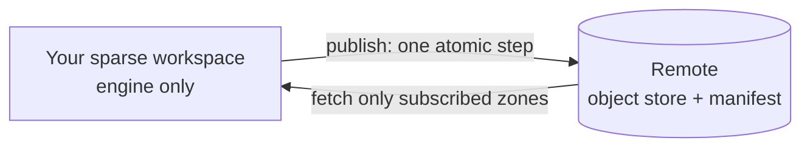

<div align="center">

# 🌳 all-git

**Version control for big repos where code, art, and docs shouldn't share one history.**

[](https://github.com/Bobliuuu/all-git/actions/workflows/ci.yml)


</div>

`vcs` is a version control tool written in Rust, for teams whose repository mixes very different things (say, game code, shaders, and gigabytes of art) and who want to download and work on only the parts they need. It is **not** a Git wrapper: it has its own storage and never calls Git.

> ⚠️ Early research project. It works and is tested, but expect rough edges. See [what works today](#-what-works-today).

## 💡 The big idea

Imagine a game studio. Programmers touch `engine/`, artists touch `assets/`. With plain Git, everyone shares one history and downloads everything.

With all-git, each part of the repo is an **zone**:

- 🧩 Each zone has its **own branches and history**, so an artist's busy week doesn't clutter the programmers' log.
- 📦 You **subscribe** only to the zones you need. Skipped zones are never downloaded (and never "deleted", just not there).
- ⚛️ One commit can still change several zones **atomically**: either all of them move, or none do.

## 🚀 Try it in 60 seconds

You need [Rust](https://rustup.rs) 1.80+. Every command and output below was run for real.

**1. Build and make a repo**

```bash
cargo build --release
export PATH="$PWD/target/release:$PATH"
export VCS_AUTHOR_NAME=Ada VCS_AUTHOR_EMAIL=ada@example.com   # who you are

vcs init demo && cd demo
```
```text
Initialized empty vcs repository in /path/to/demo/.vcs
```

**2. Commit, change, and look at the history**

```bash
echo hello > hello.txt
vcs add hello.txt && vcs commit -m "Initial commit"
echo world >> hello.txt
vcs status && vcs diff
vcs add hello.txt && vcs commit -m "Update greeting"
vcs log
```
```text
staged 1 file(s), 0 removal(s)
[root/main 96d49f6fc5b5] Initial commit
zone root: branch main @ 96d49f6fc5b5
  not staged:
    modified:  hello.txt
diff --vcs a/hello.txt b/hello.txt
--- a/hello.txt
+++ b/hello.txt
@@ -1,1 +1,2 @@
 hello
+world
staged 1 file(s), 0 removal(s)
[root/main e670fef25d9b] Update greeting
commit e670fef25d9b260392538cebb7f2eb9ac9170237e51c90ab1019bc7a5eb23927
change e53b19aa3c7a90559906ac5a611c9321   zone root
Author: Ada <ada@example.com>
Date:   1793477306
    Update greeting

commit 96d49f6fc5b58621a3005c7c8508e00f5f64504fb533f219630c7954cd1e8850
change 58ff190e27c4bafe507dbedca2a01929   zone root
Author: Ada <ada@example.com>
Date:   1793477306
    Initial commit
```

**3. Split the repo into zones** (a commit touching both is one atomic transaction)

```bash
mkdir engine assets
echo 'fn main(){}' > engine/main.rs && echo bin > assets/logo.bin
vcs zone create engine --path engine
vcs zone create assets --path assets
vcs add engine assets && vcs commit -m "Add engine and assets"
vcs zone branch engine feature       # branch just the engine
vcs zone checkout engine feature     # assets stays on main
vcs zone list
vcs snapshot create v1 && vcs snapshot checkout v1   # every subscribed zone back to its pinned commit
vcs zone rename old new                 # zones without history only; vcs zone delete <name> [--force]
vcs branch -d feature                   # refuses the checked-out branch and unmerged work (--force to override)
```
```text
created zone engine owning engine/
created zone assets owning assets/
staged 2 file(s), 0 removal(s)
[assets/main 764099d40c74] Add engine and assets
[engine/main d4fbb8635c1d] Add engine and assets
atomic transaction 218e46ade70a covering 2 zones
created engine/feature at d4fbb8635c1d
zone engine: switched to feature
assets         assets               subscribed, on main; 1 branch(es)
engine         engine               subscribed, on feature; 2 branch(es)
root           (rest of repo)       subscribed, on main; 1 branch(es)
```

**4. Share it, then clone only the engine**

```bash
vcs zone checkout engine main        # back to main; publish sends every branch
vcs remote set ~/shared.vcs          # any directory works as a remote
vcs publish
cd .. && vcs clone ~/shared.vcs work --zone engine
cd work && vcs status
```
```text
zone engine: switched to main
remote set to /Users/you/shared.vcs
assets/main (none) -> dfd635917b38
engine/main (none) -> fd4d2ccc4144
published atomically (remote generation 1)
Cloned /Users/you/shared.vcs into work
downloaded zones: engine
skipped zones (not subscribed): assets, root
  add one later with `vcs zone add <name>` then `vcs fetch --zone <name>`
zone engine (engine/): branch main @ fd4d2ccc4144
not subscribed (not downloaded/materialized, NOT deleted): assets, root
clean
```

That's it: `work/` contains only `engine/`. Later, `vcs fetch` downloads updates and `vcs sync` fast-forwards when safe (it reports dirty or diverged zones instead of touching them). A publish that would overwrite someone else's work is refused with guidance.

> Hashes and timestamps differ on every run, and the outputs above are trimmed to the relevant lines. Step 4's output came from a separate fresh run of steps 1 to 3 (the hashes differ from step 3's).

## ✅ What works today

| Zone | Status | Notes |
|---|---|---|
| Content-addressed objects | ✅ | BLAKE3, domain-separated, canonical codec, strict decode, proptests |
| Local VCS | ✅ | init / add / commit / status / diff / log / branch / switch / fsck |
| Zones & snapshots | ✅ | non-overlapping, independent heads, sparse subscribe/unsubscribe, atomic multi-zone commit |
| Remote protocol | ✅ | single CAS manifest, idempotent publish, **model-checked** (~1.7M crash/interleaving schedules) |
| Backends | ✅ | in-memory, filesystem, S3-compatible (tested on MinIO only, HTTP, no TLS) |
| Sparse fetch | ✅ | tests assert an unsubscribed zone's bytes are never read |
| Merge engine | 🟡 | `vcs-merge`: merge-base, diff3 (Myers/patience), structured tree conflicts; wired into `vcs merge` (fast-forward, three-way, conflict state, `--abort`); no rename detection, criss-cross and file/directory conflicts are errors |
| Benchmarks | 🟡 | first baseline in [docs/benchmarks.md](docs/benchmarks.md); `add` is currently **much slower than Git** (tracked in #21) |
| Operation log / undo, rebase | ⬜ | [#4](https://github.com/Bobliuuu/all-git/issues/4) |
| Locks & leases (server-enforced) | ⬜ | design first: [#7](https://github.com/Bobliuuu/all-git/issues/7) |
| Packfiles, chunking | ⬜ | [#9](https://github.com/Bobliuuu/all-git/issues/9) |
| Rebase with stable change ids | 🟡 | `vcs rebase <branch>` / `--continue` / `--abort`; keeps change ids, one undoable op; linear ranges only ([docs/rebase.md](docs/rebase.md)) |
| Semantic / AI-assisted merge | ⬜ | [#10](https://github.com/Bobliuuu/all-git/issues/10) |
| Git import/export, P4 | ⬜ | [#8](https://github.com/Bobliuuu/all-git/issues/8) |

Nothing here is claimed to work without an executable test. Known gaps are listed in [docs/architecture.md](docs/architecture.md#known-limitations-honest-list).

## 🛡️ Why you can trust it

- **Integrity:** every read re-hashes the data; each object has exactly one valid encoding.
- **Atomic publishing:** a publish becomes visible at one instant. An executable model tries every interleaving of two writers with crashes and lost messages injected, and checks nothing is lost or applied twice.
- **Untrusted input:** paths like `..` or `.vcs` are rejected, and checkout won't write through symlinks or overwrite untracked files.

Details: [architecture](docs/architecture.md).

## 🗺️ How the pieces fit



## 🧱 Code layout

| Crate | Role |
|---|---|
| `vcs-objects` | ids, canonical codec, object types, name/path validation (no I/O) |
| `vcs-store` | `ObjectStore` trait; memory + loose-object filesystem stores |
| `vcs-repo` | zones, refs, index, workspace, commit/log/diff/status, snapshots, fsck, publish/fetch/sync/clone |
| `vcs-remote` | `Backend` trait + conformance suite, manifest, publish step machine, sparse fetch, model checker |
| `vcs-store-s3` | S3-compatible backend (hand-rolled SigV4, blocking, no async runtime) |
| `vcs-merge` | merge-base, diff3 text merge, three-way tree merge with structured conflicts |
| `vcs-bench` | seeded dataset generator and criterion benchmarks |
| `vcs-cli` | the `vcs` binary |

## 📚 Learn more

[Architecture](docs/architecture.md) · [Object model](docs/object-model.md) · [Roadmap](docs/roadmap.md) · [Merge](docs/merge.md) · [Rebase](docs/rebase.md) · [S3 backend](docs/s3.md) · [Benchmarks](docs/benchmarks.md) · [Research notes](docs/research.md) *(from memory, unverified)*

## 🛠️ Contributing

```bash
cargo fmt --all --check
cargo clippy --workspace --all-targets -- -D warnings
cargo test --workspace                 # includes the ~20 s protocol model checker
VCS_TEST_S3_ENDPOINT=http://127.0.0.1:9000 cargo test -p vcs-store-s3   # MinIO, see docs/s3.md
```

Work is tracked in [issues](https://github.com/Bobliuuu/all-git/issues); PRs use Conventional Commits and the template in `.github/`.
