# 🌳 vcs

*Big repos, small downloads: take only the slice you need.* 🍰

[](https://github.com/Bobliuuu/allgit/actions/workflows/ci.yml)


**vcs** is a new version control system, written in Rust, for big repositories where code, art and docs should not
share one history and where nobody wants to download everything. The command is `vcs`; the repository is
[Bobliuuu/allgit](https://github.com/Bobliuuu/allgit).

> 🐣 Early research software. There is no stable release and no on-disk format promise yet. Much of it is tested, but
> parts have only been run against fixtures, local servers or a single cloud account. Read
> [Status and limitations](#-status-and-limitations) before depending on it.

## ✨ What it is

```text
 one repo, many zones, each with its own history

   engine/  ──●──●──●──●        you subscribe to what you need
   assets/  ──●────●            (engine only? assets are never downloaded)
   root     ──●──●──────●
        \________|_________/
   one atomic publish: all heads move, or none
```

<p align="center"></p>
<p align="center"><sub>The object model: one store, per-zone histories, one manifest that orders publishes.</sub></p>

- 🧬 **One global content-addressed DAG.** Every object (file chunk, tree, commit, transaction, operation) is named by
  its BLAKE3 hash and stored once, whichever zone or branch uses it.
- 🧩 **Zones.** A zone owns a path prefix (say `engine/` or `assets/`) and has its **own branches and history**. Zones
  cannot overlap. A busy art zone does not clutter the code log.
- 🎯 **Sparse subscription.** You subscribe to the zones you need. Zones you skip are never downloaded (and never
  "deleted", they are just not there). Inside a zone, `vcs sparse` limits which paths are materialized.
- ⚛️ **Atomic cross-zone transactions.** One commit can change several zones; `vcs publish` moves all the branch heads
  you publish in one step, or none of them.
- 🏠 **Local-first.** Everything except sharing works offline. Sharing is `publish`, `fetch`, `sync` and `clone`.
- 🪣 **S3-compatible authoritative remote with a CAS manifest.** The remote is a directory, an S3-compatible bucket or
  a `vcs-server`. A single manifest object, replaced by compare-and-swap, is the source of truth. A publish becomes
  visible at one instant, and the protocol is checked by an executable model that explores crashes and interleavings.
- ⏪ **Operation log and undo.** `vcs op log` records every local change to branches and workspace; `vcs op undo` and
  `vcs op restore` go back.
- 🤝 **Structured conflicts.** A conflicted merge or rebase keeps conflicts as recorded state you can list, show and
  resolve (`vcs conflict`, `vcs resolve`), instead of leaving markers as the only record.
- 🔐 **Locks.** `vcs lock`, `unlock` and `locks` for files that cannot be merged. Enforced only when you publish
  through `vcs-server`; with a plain directory or bucket they are advisory.
- 📦 **Built-in large-file engine.** Big files are content-defined chunked, stored once, added and checked out by
  streaming, with no separate large-file tool. See [Large files](#-large-files).
- 🧹 **Garbage collection.** `vcs gc` deletes unreachable objects older than a grace period, locally and on remotes.

<p align="center"></p>
<p align="center"><sub>An atomic cross-zone publish (animated): objects first, then a single compare-and-swap of the manifest.</sub></p>

### 🌱 It does not use git, Perforce or walgit

vcs has its own object format, packs, index and wire protocol. At runtime it needs no `git` binary, no libgit2, no
`p4` and no git server (walgit included). A test checks that the core crates have no git or p4 dependencies. Object
ids and pack formats are **not** compatible with git; see [docs/interop.md](docs/interop.md).

What it offers for people coming from those tools:

- 🔀 `vcs git <git-args>` runs a git command line as its vcs equivalent, for example `vcs git log --oneline -5` or
  `vcs git commit -am "fix"`. `vcs git --map` lists the table. When git has something vcs does not, it stops and
  names the native way. Map: [docs/git-to-vcs.md](docs/git-to-vcs.md).
- 🔀 `vcs p4 <p4-args>` does the same for Perforce (`vcs p4 --list` shows the map, `--explain` prints the translation
  and runs nothing). No p4 server or binary is involved. Map: [docs/p4-to-vcs.md](docs/p4-to-vcs.md).
- ↔️ The reverse table, from each vcs command to its git and p4 spelling:
  [docs/vcs-to-git-p4.md](docs/vcs-to-git-p4.md).
- 📥 Moving history: `vcs import-git` reads a `git fast-export` stream (you run git to produce it), `vcs export-git`
  writes one, `vcs import-p4` reads recorded `p4` output. See [docs/import-git.md](docs/import-git.md),
  [docs/import-p4.md](docs/import-p4.md) and [docs/interop.md](docs/interop.md).

<p align="center"></p>
<p align="center"><sub><code>vcs git</code> and <code>vcs p4</code> (animated): an argument rewrite to native vcs, no git or p4 involved.</sub></p>

## 🛠️ Install and build

Needs Rust 1.80 or newer.

```bash
git clone https://github.com/Bobliuuu/allgit && cd allgit      # any way of getting the sources works
cargo build --release                                         # binaries in target/release
cargo install --path crates/vcs-cli --locked                  # or install `vcs` onto your PATH
vcs --help
```

Tagged releases publish Linux and macOS tarballs with checksums; see [docs/install.md](docs/install.md), which also
covers Windows (compile-checked only) and the optional `git` shim (`--features git-shim`). HTTPS remotes need
`--features tls`.

## 🚀 Quickstart

Set an identity, then make a repository with two zones (every command below was run against a current build):

```bash
export VCS_AUTHOR_NAME=Ada VCS_AUTHOR_EMAIL=ada@example.com
vcs init demo && cd demo
mkdir engine assets
echo 'fn main(){}' > engine/main.rs && echo bin > assets/logo.bin && echo hi > README.md
vcs zone create engine --path engine
vcs zone create assets --path assets
vcs add . && vcs commit -m "initial"      # one atomic transaction covering 3 zones (assets, engine, root)
vcs zone list
```

Share it through any directory, then clone only the engine zone:

```bash
vcs remote set ../shared.vcs
vcs publish                               # published atomically (remote generation 1)
cd .. && vcs clone shared.vcs work --zone engine
cd work && vcs status                     # assets and root: not subscribed, not downloaded, NOT deleted
```

Work, publish, and pull in another zone later:

```bash
echo x >> engine/main.rs
vcs git commit -am "edit"                 # git spelling; native: vcs add + vcs commit
vcs publish
vcs zone add assets && vcs fetch --zone assets
vcs op log                                # every local operation; `vcs op undo` reverts the last one
vcs gc --dry-run                          # reports what GC would delete
```

Not sure which zones you need? `vcs zone suggest` proposes boundaries from manifests and ownership files (read-only),
and `vcs clone <url> work --for path/or/symbol --dry-run` shows the smallest zone set, with dependencies, and how
much it would download. See [docs/zones-autodetect.md](docs/zones-autodetect.md). The full tour, with pasted output
from real runs, is the [user guide](docs/guide/README.md).

## ☁️ Remotes and the server

<p align="center"></p>
<p align="center"><sub>Remote architecture (animated): clients, the optional vcs-server, the backend layout and the GC handshake.</sub></p>

A repository has one remote, set with `vcs remote set`:

| Kind | URL | Use |
|---|---|---|
| directory | `../shared`, `/srv/repo`, `file:///srv/repo` | shared disk, tests |
| S3-compatible | `s3://bucket/prefix?endpoint=URL&region=R` | object storage; credentials from `AWS_ACCESS_KEY_ID` and `AWS_SECRET_ACCESS_KEY`; the bucket must exist and support conditional writes |
| vcs-server | `http://host:port` or `https://...` (needs `--features tls`) | a team: tokens, roles, path policy, lock enforcement, audit log |

```bash
vcs-server hash-token <token>                                  # hash to put in the tokens file
vcs-server --root /srv/repo --tokens tokens.txt --listen 127.0.0.1:8480
vcs login http://host:8480 && vcs clone http://host:8480 work
```

<p align="center"></p>
<p align="center"><sub>Sparse subscription (animated): only the zones and paths you ask for are downloaded.</sub></p>

`vcs fetch` downloads and updates remote-tracking refs, `vcs sync` fetches and fast-forwards where safe (it reports
dirty or diverged zones instead of touching them), and a publish that would overwrite someone else's work is
refused. Offline: `vcs bundle`. Details: [docs/s3.md](docs/s3.md), [docs/server.md](docs/server.md),
[docs/deploy.md](docs/deploy.md), [docs/bundle.md](docs/bundle.md), [docs/remote-packs.md](docs/remote-packs.md),
[guide chapter 5](docs/guide/05-remotes.md), [guide chapter 10](docs/guide/10-operating-a-server.md).

## 🐘 Large files

<p align="center"></p>
<p align="center"><sub>Local store (animated): loose objects, pack v2, compaction, pack v3, and large-file chunking.</sub></p>

Files of 1 MiB and up are stored as chunk manifests; files of **16 MiB and up** use the large-file layout (kind 9):
content-defined chunks of 512 KiB to 8 MiB over ordinary blob objects, no format bump. Add, checkout and `restore`
stream with memory independent of file size; editing the middle of a file re-chunks only the changed stretch and
stores only the new chunks; `status` skips files whose size and times match the index; chunks upload and download in
parallel. Design and compatibility rules: [docs/object-model.md](docs/object-model.md#large-files-chunked-kind-9-no-format-bump).

Measured (source: [docs/research/large-files-bench.md](docs/research/large-files-bench.md)): one file of 1024 MiB
on a c6i.4xlarge (16 vCPU, ext4, warm cache), **one run each, no medians**, `git` 2.43 and `git-lfs` 3.6.1 run while
other jobs shared the box (load1 up to about 10, so their wall times are noisy; CPU is the robust column). Cells are
CPU s / wall s / peak RSS MiB; "vcs" is the large-file build measured in that document. It is a single-file test, not a
workload study.

| step (1024 MiB file) | git | git-lfs | vcs |
|---|---|---|---|
| add | 31.44 / 40.59 / 5 | 3.82 / 2.28 / 15 | 2.69 / 7.71 / 114 |
| status after touching the file | 27.48 / 27.49 / 5 | 7.89 / 7.99 / 28 | 0.94 / 0.07 / 126 |
| re-add after changing 3 MiB | 31.34 / 38.14 / 4 | 3.91 / 3.53 / 15 | 0.91 / 0.19 / 134 |
| switch back to v1 | 0.87 / 0.88 / 1029 | 2.51 / 1.50 / 1027 | 1.13 / 0.33 / 62 |
| store after two versions | 2048 MiB | 3072 MiB | 1039 MiB |

🙈 Where it does not win: for the first `add`, git-lfs has lower wall time (2.28 s against 7.71 s) and far lower peak
memory (15 against 114 MiB), and for `switch_v1` git uses less CPU (0.87 against 1.13 s). git-lfs push, clone and
fetch rows are not comparable in that run and are omitted; no claim is made about them. `git clone` of a local path
hardlinks objects, so its clone row is not a transfer cost. The 256 MiB and 4096 MiB tables are in the same file.

## ⚡ Performance

Short version: **vcs is not uniformly faster than git.** It is ahead in some cells and behind in others, and the
numbers below say which. Every number comes from a committed file or a merged PR, named next to it. Timing claims
carry machine, load, run count and version, and none of them is a general statement about other machines.

### 🏁 Local commands against git, 100,000 files

Flat layout (`datagen flat 100000`, seed 42), warm cache, interleaved with git in random order per round, 5 runs (3 for
the slowest cells), medians, vcs divided by git, **below 1 means vcs used less**. Machine: AWS c6i.4xlarge (box E),
16 vCPU, load1 about 1.5 to 2.1 during the timed groups, git 2.43.0, run 2026-11-02, vcs release build of
`origin/main` at `8da0be2`. Wall and CPU are user+sys from `wait4`.

| cell (flat 100k) | git wall / CPU ms | vcs wall / CPU ms | wall ratio | CPU ratio |
|---|---|---|---|---|
| add (fresh index) | 4,810 / 4,751 | 538 / 1,772 | 0.11 | 0.37 |
| commit (all staged) | 357 / 459 | 227 / 92 | 0.45 | 0.20 |
| status, clean | 65 / 182 | 55 / 189 | 0.88 | **1.04** |
| log -n 5 | 1.4 / 1.3 | 2.1 / 2.1 | **1.54** | **1.58** |
| switch (1% of files differ) | 233 / 346 | 179 / 279 | 0.77 | 0.81 |

Source: [docs/research/data/command-scoreboard](docs/research/data/command-scoreboard) (`git-fresh.json`,
`git-clean.json`, `git-small.json`), rendered by `scripts/command_scoreboard_render.py`; the complete per-command table
is [docs/research/command-scoreboard.md](docs/research/command-scoreboard.md). The older interleaved harness
(`scripts/bench_compare.py`, [docs/research/interleaved-comparison.md](docs/research/interleaved-comparison.md)) has
other runs in `docs/research/interleaved-data/`; they predate the work in PRs #374 to #418 and are not quoted here.
`status` on a clean tree is a CPU tie with git (1.04x) and about 12% faster in wall time; `log` of a handful of
commits costs about 0.7 ms more process time than git (a start-up cost, below the 2 ms noise floor of the scoreboard,
so it is scored a TIE). Not measured here: cold cache, git with fsmonitor, the optional `watcher` feature, other
machines, deep and binary layouts for the per-command git/p4 scoreboards.

### 🏆 Per-command scoreboards

Every row of the [git to vcs](docs/git-to-vcs.md) and [p4 to vcs](docs/p4-to-vcs.md) tables that has a vcs equivalent
was run against the real tool where a scenario exists; the rest is listed as NOT-MEASURED (never guessed). Verdicts:
WIN = vcs at least 10% lower in both wall and CPU, LOSS = at least 10% higher in both, TIE = everything else (and any
cell under 2 ms wall difference). Green is a win, amber a tie, red a loss. 🟢🟡🔴

<p align="center"></p>
<p align="center"></p>
<p align="center"></p>
<p align="center"></p>
<p align="center"></p>

| tool | 🟢 WIN | 🟡 TIE | 🔴 LOSS | not measured / n/a | how fresh |
|---|---|---|---|---|---|
| git (flat 100k, every doc row; rows sharing a scenario count once per row) | 46 | 68 | 17 | 93 not measured, 44 missing in vcs | 2026-11-02, build `8da0be2`, box E, interleaved |
| Perforce (p4d on loopback) | 9 | 7 | 14 | 27 not measured, 2 missing | 2026-11-02, build `8da0be2`, box E, interleaved |
| walgit (remote workflows) | 20 | 4 | 0 | 8 not measured | **older**: vcs build `84f3fa2`, box c, 3 reps, reused unchanged |
| Jujutsu (3 layouts x 17 cells) | 43 | 2 | 6 | describe and amend n/a | vcs `8da0be2` re-run, **jj numbers from the earlier `34315b6` run, not interleaved** |
| Sapling | 48 | 0 | 0 | gc, describe and amend n/a | same as Jujutsu |

Before this refresh (earlier same-day run, same scenarios): git 30 WIN / 52 TIE / 49 LOSS, Perforce 6 / 7 / 17. The
`diff`, `show`, `cat-file`, `reset`, `restore`, `rm` and `clone` rows moved from LOSS to WIN or TIE; the per-row
before and after ratios are in the scoreboard document. Caveats: load1 was 1.5 to 2.1 (a shared box), p4 CPU is a lower
bound (the p4d process is read in 10 ms ticks), p4 and jj/Sapling are different architectures than vcs, the git run is
flat 100k only, and the jj and Sapling cells mix sessions (see [the document](docs/research/jj-sapling-benchmark.md)).

🙈 **Where git (or walgit, or jj) still wins today**, from the same runs:

- **Tiny metadata commands cost vcs about 5x git's wall time** (`branch`, `tag`, `tag -d`, `branch -m`: 6 to 9 ms
  against 1.4 ms) even though CPU is within 1.5x. `vcs switch -c` is 65 ms against git's 1.8 ms.
- **`ls-tree HEAD` (non-recursive) is 19x git** (34 ms vs 1.8 ms), `bundle verify` is 370x (467 ms vs 1.3 ms),
  `ls-files` 1.24x wall and 2.2x CPU, `grep -- path` 1.7x, `log --stat` 1.8x, `gc` 1.8x, `bundle create` 1.6x.
- **`add -u`, `commit -a` and `add .` after a one-file change use 1.2 to 1.8x git's wall time**, and `mv` regressed (87 ms vs git's
  46 ms, was a tie at 43 ms).
- **vs Perforce**: `submit` of one file (115 ms vs 5.5 ms), `add`, `opened`, `revert`, `filelog` and `sync` of a full
  tree (2.3 s vs 1.5 s) are all slower than p4's thin client; p4d did the work in a server process.
- **vs Jujutsu**: `commit` of a big staged tree (1.1x to 1.9x), `switch` (1.4x to 1.5x, possible regression) and a deep
  `clone` (1.6x) are slower than jj. **vs Sapling**: no losses in the measured cells.
- **vs walgit** (older data, below): warm one-commit fetch is a tie, object-store request counts and client store size
  are worse for vcs.

### 🌐 Remote workflows: vcs, git and walgit

[walgit](https://github.com/tobi/walgit) is a git server over S3-compatible storage (tool compared, not used by
vcs). Source: [docs/research/walgit-benchmark.md](docs/research/walgit-benchmark.md), section "quiet box, current vcs
build, flat 100k files", raw data in [docs/research/data/walgit-full-boxc](docs/research/data/walgit-full-boxc).
Machine: c6i.4xlarge, 16 vCPU, load1 1.33 to 1.19, dedicated, **3 reps only (read min and max, not just medians)**,
object store is a local RustFS on loopback (**nothing here says anything about real S3 or a network**), vcs build
`84f3fa2` default settings, walgit `80e9a20b29e2`, git 2.56.0 (local bare repo over `file://`, a lower bound with no
HTTP). Flat layout, 100,000 files (57.2 MiB). Wall ms, median.

| operation | git | walgit | vcs |
|---|---|---|---|
| initial push | 6,554 | 8,398 | 788 |
| 1-file push | 46 | 93 | 40 |
| full clone, warm | 4,023 | 3,392 | 2,174 |
| full clone, cold | 3,654 | 3,735 | 1,241 |
| zone / partial clone, warm | 1,266 | 814 | 414 |
| fetch 1 commit, warm | 84 | 101 | 85 |
| fetch 1 commit, cold | 710 | 1,206 | 218 |
| no-op fetch, warm | 14 | 19 | 5 |

🙈 Where git or walgit still win in that run (same file, scoreboards):

- **Warm fetch of one commit is a tie with git** (84 ms vs 85 ms for vcs, with wide min-max), and with the "pack v3"
  setting vcs is about 10 to 20% behind git there.
- **Object-store request counts:** warm full clone is 4 store requests for walgit against 28 for vcs (14 with pack
  v3); 1-file push is 7 against 13; warm zone clone 7 against 24.
- **Warm store traffic:** walgit's warm clone moves 0 MiB through the store (it serves from a local copy); vcs moves
  its pack set (46.5 MiB default).
- **Client store size:** 78.2 MiB for vcs against 51.0 MiB for git and walgit after a full clone (1.5x).
- **Server memory:** with pack v3, full-clone server RSS is 104 MiB for vcs against 76 MiB for walgit (default
  settings: 57 MiB).
- **Remote store size after the initial push:** 46.6 MiB (default) against 42.1 MiB for walgit and 42.5 MiB for git.

The 10k-file runs for all three layouts are older (Lambda box, load around 20, build before PRs #343 to #353) and are
in the same document. Deep and binary 100k were not run in the quiet-box pass.

### 🔭 Other tools

Perforce, Jujutsu and Sapling are covered by the scoreboards above
([command-scoreboard](docs/research/command-scoreboard.md),
[jj and Sapling](docs/research/jj-sapling-benchmark.md)). Older whole-workflow comparisons with Perforce, Jujutsu,
Sapling, Mercurial, Subversion, Fossil, Breezy and Pijul exist ([perforce](docs/research/perforce-benchmark.md),
[jujutsu](docs/research/jujutsu-benchmark.md), [sapling](docs/research/sapling-benchmark.md),
[others](docs/research/other-vcs-benchmark.md)), but their vcs columns were measured with a build that predates the
current performance work and were not re-run; read those files with that in mind. More method notes:
[docs/benchmarks.md](docs/benchmarks.md).

## 🔒 Security notes

- 🧾 **Integrity:** objects are re-hashed on read and each has one valid encoding (strict decode); decoders are fuzzed.
- 🚫 **Untrusted input:** paths such as `..` or `.vcs` are rejected, checkout refuses to write through symlinks or over
  untracked files, and symlink targets are accepted only if they stay inside the worktree.
- ⚛️ **Atomic publish:** a crash-and-interleaving model checker covers the manifest protocol, including locks.
- 🖥️ **Servers:** `vcs-server` validates every manifest update and supports bearer tokens with roles, path policy, rate
  limits, a tamper-evident audit log, TLS and optional mutual TLS (with `--features tls`). Without that feature it speaks
  plain HTTP, so use loopback, a private network or a TLS-terminating proxy.
- 🔑 **Credentials** stay out of the repository config; use `vcs login` and the credential helper. S3 secrets are never
  stored in `.vcs/remote`.
- 🤖 **Assisted merge** (`vcs merge --assist`) sends file contents to a third-party API if you enable it; it is opt-in.

Details and what is not defended: [docs/security.md](docs/security.md), [docs/security-review.md](docs/security-review.md),
[docs/signing.md](docs/signing.md) (Ed25519 signed commits and tags).

## 🗺️ Repository layout

| Crate | Role |
|---|---|
| `crates/vcs-objects` | ids, canonical codec, object types, name and path validation (no I/O) |
| `crates/vcs-store` | `ObjectStore` trait, memory and filesystem stores, packs, large-file chunking |
| `crates/vcs-repo` | zones, refs, index, workspace, commit, log, diff, status, snapshots, op log, locks, stash, rebase, GC, git and p4 import/export, fsck, publish, fetch, sync, clone |
| `crates/vcs-remote` | `Backend` trait and conformance suite, manifest, publish step machine, remote packs, sparse and lazy fetch, model checker |
| `crates/vcs-store-s3` | S3-compatible backend (SigV4, blocking, no async runtime) |
| `crates/vcs-merge` | merge base, text and tree merge, rename-aware merge, optional tree-sitter structural merge |
| `crates/vcs-server` | the `vcs-server` binary, an HTTP validating writer |
| `crates/vcs-assist-claude`, `crates/vcs-assist-openai` | helper binaries for opt-in `merge --assist` |
| `crates/vcs-bench` | seeded dataset generator, criterion benchmarks, `s3bench`, `storebench` |
| `crates/vcs-cli` | the `vcs` and `git-remote-allgit` binaries |

`crates/vcs-storage-lab*` and `crates/vcs-compress-lab` are research experiments outside the cargo workspace.
`fuzz/` is a separate cargo-fuzz project; `deploy/` holds the server deploy recipe; `scripts/` holds benchmark
harnesses.

## 📚 Documentation

- Start: [User guide](docs/guide/README.md) (12 chapters, outputs pasted from real runs) · [CLI](docs/cli.md) ·
  [Install](docs/install.md) · [Architecture](docs/architecture.md) · [Object model](docs/object-model.md) ·
  [Roadmap](docs/roadmap.md)
- Concepts: [Zones](docs/zones.md) · [Zone auto-detection](docs/zones-autodetect.md) · [Sparse paths](docs/sparse-paths.md) ·
  [Worktrees](docs/worktrees.md) · [Operations](docs/operations.md) · [Merge](docs/merge.md) · [Rebase](docs/rebase.md) ·
  [Locks](docs/locks.md) · [Shelves](docs/shelves.md) · [Hooks](docs/hooks.md) · [GC](docs/gc.md) · [Cache](docs/cache.md) ·
  [History walks](docs/history-walks.md) · [Bundles](docs/bundle.md)
- Coming from elsewhere: [git to vcs](docs/git-to-vcs.md) · [p4 to vcs](docs/p4-to-vcs.md) ·
  [vcs to git and p4](docs/vcs-to-git-p4.md) · [Interop](docs/interop.md) · [Import git](docs/import-git.md) ·
  [Import p4](docs/import-p4.md)
- Remotes and servers: [S3](docs/s3.md) · [Remote packs](docs/remote-packs.md) · [Server](docs/server.md) ·
  [Deploy](docs/deploy.md) · [Security](docs/security.md)
- Assisted merge: [Claude](docs/assist.md) · [OpenAI](docs/assist-openai.md)
- Measurements and design studies: [Benchmarks](docs/benchmarks.md) · [Research index](docs/research.md) ·
  [Storage engine study](docs/research/storage/README.md). Older notes in `docs/research.md` were written from memory
  and are unverified.

## 🧪 Testing

```bash
cargo fmt --all --check
cargo clippy --workspace --all-targets -- -D warnings
cargo test --workspace                 # includes the protocol model checker (about 20 s)
VCS_TEST_S3_ENDPOINT=http://127.0.0.1:9000 cargo test -p vcs-store-s3   # MinIO, see docs/s3.md
```

After changing any CLI command or flag, run `scripts/gen_cli_reference.sh` and commit the regenerated chapter 12 of
the guide, or `cargo test --workspace` fails. PRs use Conventional Commits and the template in `.github/`.

## 🚧 Status and limitations

Early research software; tested means an executable test exists in the repository.

- ✅ **Solid and tested:** object format, local VCS (add, commit, status, diff, log, branches, tags, stash, blame, bisect,
  worktrees), zones and snapshots, atomic multi-zone commit, sparse and lazy fetch, remote protocol (model-checked),
  op log with undo, large-file engine, packs and GC.
- 🟡 **Partial:** history editing (`rebase` keeps change ids), structural merge (tree-sitter for a few languages, behind
  cargo features, off by default), locks (advisory unless `vcs-server` is in front), p4 import (checked once against
  real `p4d` output on a small history, otherwise fixtures).
- 🤖 **Assisted merge:** the Claude helper has never been called against the live API (fixture and mock tests only). The OpenAI helper had one small live run, documented in [docs/assist-openai.md](docs/assist-openai.md); there are no broader quality or cost numbers.
- 🪣 **S3:** exercised against MinIO, RustFS and one earlier run on real AWS S3 from a Mac; other providers and a public-CA
  HTTPS endpoint are untested.
- 🪟 **Windows:** only compile-checked in CI. The code has never been run there.
- ⚡ **Performance:** see above. git is still ahead on `status` CPU (about 1.1x), checkout and re-add in some measurements, on
  store request counts, warm store traffic, client store size and server memory in the walgit comparison, and on
  first-add wall time and peak memory against git-lfs for one 1 GiB file.
- 🧱 **Format:** object ids changed between early format versions with no migration tool; expect more change before a
  stable release.

Known gaps are listed in [docs/architecture.md](docs/architecture.md#known-limitations-honest-list).

## 📄 License

Licensed under either of [Apache License 2.0](LICENSE-APACHE) or [MIT license](LICENSE-MIT) at your option
(`MIT OR Apache-2.0`). Copyright (c) 2026 Jerry Zhu.
