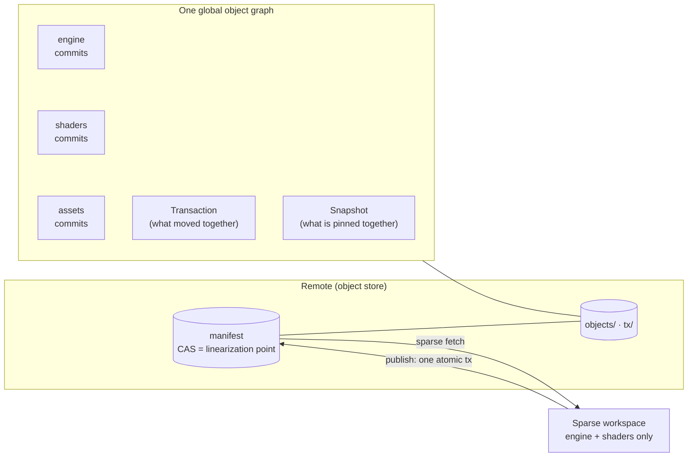

<div align="center">

# all-git

**A native, zone-aware version control system in Rust.**
Git's immutable history · Perforce-scale sparse workspaces · Jujutsu-style recoverability · object-storage-backed remotes.

[](https://github.com/Bobliuuu/all-git/actions/workflows/ci.yml)


</div>

> **Not a Git wrapper.** It has its own object model, commit graph, refs, workspace, and transaction protocol. Git is never invoked and is not the storage format.

## Why

Large repositories mix things with very different shapes: engine code, shaders, multi-gigabyte assets, docs. One linear history and one checkout is the wrong unit for all of them. all-git keeps **one global content-addressed object graph** but lets each **zone** evolve on its own branches, lets a developer **subscribe to only the zones they need**, and still makes a **cross-zone change atomic**.



## Quickstart

```bash
cargo build --release            # binary: target/release/vcs
export PATH="$PWD/target/release:$PATH"

vcs init demo && cd demo
echo hello > hello.txt
vcs add hello.txt && vcs commit -m "Initial commit"
echo world >> hello.txt
vcs status && vcs diff
vcs add hello.txt && vcs commit -m "Update greeting"
vcs log
```

Set `VCS_AUTHOR_NAME` / `VCS_AUTHOR_EMAIL` to control authorship.

### Zones: independent histories, one repository

```bash
mkdir engine assets
vcs zone create engine --path engine
vcs zone create assets --path assets

vcs zone branch engine feature          # branch only the engine zone
vcs zone checkout engine feature        # assets stays on main
vcs status                              # shows each zone's own branch + head
vcs zone list
```

Zones own non-overlapping path prefixes (enforced). A commit that touches several zones advances all their branch heads in **one atomic update**.

### Remotes: publish, sparse clone, sync

```bash
vcs remote set /srv/shared/game-engine.vcs     # directory remote (file://); S3 backend crate exists, CLI wiring pending
vcs publish                                    # all changed branches, ONE atomic remote transaction

vcs clone /srv/shared/game-engine.vcs work --zone engine --zone shaders
#   downloads and materializes only those zones; `assets` is "not subscribed", never "deleted"

vcs fetch      # download + update remote-tracking refs (local branches untouched)
vcs sync       # fetch, then fast-forward where safe; dirty or diverged zones are reported, not touched
```

A non-fast-forward publish is refused with guidance instead of overwriting remote work.

## What works today

| Zone | Status | Notes |
|---|---|---|
| Content-addressed objects | ✅ | BLAKE3, domain-separated, canonical codec, strict decode, proptests |
| Local VCS | ✅ | init / add / commit / status / diff / log / branch / switch / fsck |
| Zones & snapshots | ✅ | non-overlapping, independent heads, sparse subscribe/unsubscribe, atomic multi-zone commit |
| Remote protocol | ✅ | single CAS manifest, idempotent publish, **model-checked** (~1.7M crash/interleaving schedules) |
| Backends | ✅ | in-memory, filesystem, S3-compatible (tested on MinIO only, HTTP, no TLS) |
| Sparse fetch | ✅ | tests assert an unsubscribed zone's bytes are never read |
| Merge engine | 🟡 | `vcs-merge`: merge-base, diff3 (Myers/patience), structured tree conflicts; **not wired into the CLI yet** |
| Benchmarks | 🟡 | first baseline in [docs/benchmarks.md](docs/benchmarks.md); `add` is currently **much slower than Git** (tracked in #21) |
| Operation log / undo, rebase | ⬜ | [#4](https://github.com/Bobliuuu/all-git/issues/4) |
| Locks & leases (server-enforced) | ⬜ | design first: [#7](https://github.com/Bobliuuu/all-git/issues/7) |
| Packfiles, chunking | ⬜ | [#9](https://github.com/Bobliuuu/all-git/issues/9) |
| Semantic / AI-assisted merge | ⬜ | [#10](https://github.com/Bobliuuu/all-git/issues/10) |
| Git import/export, P4 | ⬜ | [#8](https://github.com/Bobliuuu/all-git/issues/8) |

Nothing here is claimed to work without an executable test. Known gaps are listed in [docs/architecture.md](docs/architecture.md#known-limitations-honest-list).

## How safety is established

- **Integrity:** every read re-hashes; objects have one canonical encoding (`decode(b) = o ⇒ encode(o) = b`).
- **Atomicity:** a publish becomes visible at exactly one point, the successful manifest compare-and-swap. The protocol is a step machine, and an executable model explores every interleaving of two writers with a crash or lost request/response injected at any step, checking *no lost update, exactly-once apply, dependency-closed remote objects, reported-success is durable*. The model is mutation-checked: removing the idempotency check or reversing upload order makes it fail.
- **Untrusted input:** path validation rejects `..`, absolute paths, and `.vcs` (case-insensitive); checkout refuses to write through symlinks or clobber untracked files; fetched objects are hash-verified before storage.

## Repository layout

| Crate | Role |
|---|---|
| `vcs-objects` | ids, canonical codec, object types, name/path validation (no I/O) |
| `vcs-store` | `ObjectStore` trait; memory + loose-object filesystem stores |
| `vcs-repo` | zones, refs, index, workspace, commit/log/diff/status, snapshots, fsck, publish/fetch/sync/clone |
| `vcs-remote` | `Backend` trait + conformance suite, manifest, publish step machine, sparse fetch, model checker |
| `vcs-store-s3` | S3-compatible backend (hand-rolled SigV4, blocking, no async runtime) |
| `vcs-merge` | merge-base, diff3 text merge, three-way tree merge with structured conflicts |
| `vcs-bench` | seeded dataset generator and criterion benchmarks |
| `vcs-cli` | the `vcs` binary |

## Docs

[Architecture](docs/architecture.md) · [Object model](docs/object-model.md) · [Roadmap](docs/roadmap.md) · [Merge](docs/merge.md) · [S3 backend](docs/s3.md) · [Benchmarks](docs/benchmarks.md) · [Research notes](docs/research.md) *(from memory, unverified)*

## Development

```bash
cargo fmt --all --check
cargo clippy --workspace --all-targets -- -D warnings
cargo test --workspace                 # includes the ~20 s protocol model checker
VCS_TEST_S3_ENDPOINT=http://127.0.0.1:9000 cargo test -p vcs-store-s3   # MinIO, see docs/s3.md
```

Work is tracked in [issues](https://github.com/Bobliuuu/all-git/issues); PRs use Conventional Commits and the template in `.github/`.
