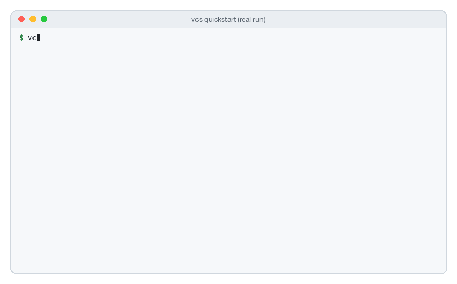
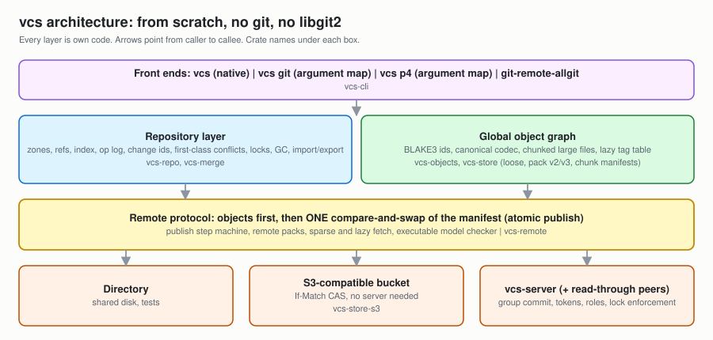
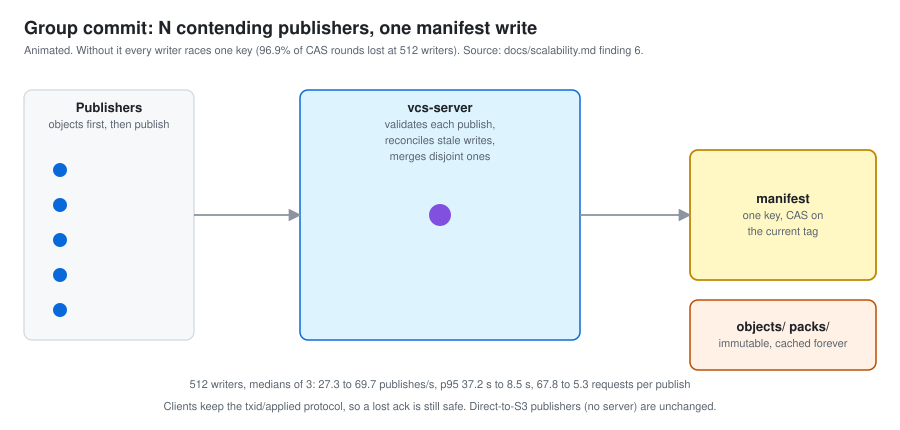
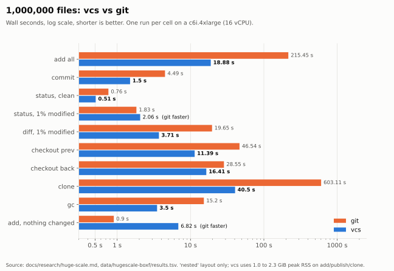
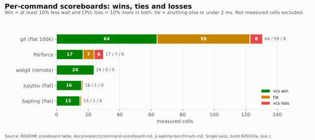

# I built my own version control system from scratch. Here is what it does, how it works, and where it loses.

*vcs: one repository, many zones, any size. Written in Rust, with no git, no libgit2 and no Perforce underneath.*



Most version control systems assume one thing: that everybody wants the whole repository.

That assumption is fine for a library with a few thousand files. It falls apart when the repo holds the game engine *and* ten gigabytes of art *and* the docs *and* the build tooling, when a hundred people (and a growing number of AI agents) push to it at the same time, and when the thing you actually need today is one folder.

So I built a version control system around a different assumption. It is called **vcs**, it lives at [github.com/Bobliuuu/allgit](https://github.com/Bobliuuu/allgit), and this is the story of how it works, what it is fast at, and, because I think that part matters more, where it is still slower than git.

## The idea in one picture

```text
 one repo, many zones, each with its own history

   engine/  ──●──●──●──●        you subscribe to what you need
   assets/  ──●────●            (engine only? assets are never downloaded)
   root     ──●──●──────●
        \________|_________/
   one atomic publish: all heads move, or none
```

A **zone** owns a path prefix, say `engine/` or `assets/`, and has its **own branches and history**. A busy art zone does not clutter the code log. You subscribe to the zones you need, and the ones you skip are never downloaded. They are not "deleted", they are simply not there.

And it is still one repository. One commit can change several zones, and `vcs publish` moves all the branch heads you publish in a single step, or none of them. No half-landed changes across your engine and your assets.

Here is the whole flow, straight from the quickstart (every command in it was run against a real build):

```bash
vcs init demo && cd demo
mkdir engine assets
echo 'fn main(){}' > engine/main.rs && echo bin > assets/logo.bin
vcs zone create engine --path engine
vcs zone create assets --path assets
vcs add . && vcs commit -m "initial"      # one atomic transaction covering 3 zones
vcs remote set ../shared.vcs
vcs publish                               # published atomically
cd .. && vcs clone shared.vcs work --zone engine
cd work && vcs status                     # assets: not subscribed, not downloaded, NOT deleted
```

Later you can pull in another zone with `vcs zone add assets && vcs fetch --zone assets`. In a 50-zone test repo, cloning by usage profile moved **37 MB instead of 189.5 MB** for a full clone.

## How it is built



There are five layers worth understanding.

### 1. One global, content-addressed object graph

Every object (a file chunk, a tree, a commit, a transaction, an operation) is named by its BLAKE3 hash and stored **once**, whichever zone or branch uses it. Zones have their own commit histories, but all of their objects live in one deduplicated store.



This is the design decision everything else leans on. Because the store is global and content-addressed, a file that appears in two zones costs one copy, and a commit that touches three zones is one transaction over one graph.

The object format, packs, index and wire protocol are all vcs's own. There is no git underneath, and a test checks that the core crates have no git or Perforce dependency. (Object ids and pack formats are **not** compatible with git. History moves in with `vcs import-git` and out with `vcs export-git`.)

### 2. An S3 bucket as the only authority

The remote can be a directory, an S3-compatible bucket, or a small `vcs-server`. In every case the source of truth is **one manifest object**, replaced by compare-and-swap.

A publish works like this: upload all the new objects first (they are immutable and content-addressed, so uploading them early is harmless), then replace the manifest with one conditional write. The publish becomes visible at a single instant.



There is no lock server and no database in the middle. And because "the protocol is correct" is the kind of claim that should make you suspicious, the protocol is checked by an **executable model that explores crashes and interleavings**.

### 3. Group commit, because one manifest key is a hot spot

If every publish contends on one manifest key, then a hundred writers means a hundred retries. That is the real scaling problem for a bucket-as-authority design, so `vcs-server` does group commit: it merges disjoint publishes that arrive together into one manifest write. Clients keep the transaction-id protocol, so a lost acknowledgement is safe to retry.

On real S3 (us-east-1, one run per cell), one conditional PUT carries every write queued during the previous one. That gives **157 to 348 pushes/s at 256 to 1,024 writers**, with p99 between 1.3 and 7.4 seconds. Without batching, disjoint writers cap at about 19 to 22 pushes/s at any of those writer counts.



### 4. Big files are a first-class citizen

Large files are content-defined chunked, stored once, and added and checked out by streaming. There is no separate large-file tool to install. In the monorepo stress test (more on that below), a 4 MiB edit to a 4 GiB file pushed in **0.03 s**, against **126 s** for git on the same bytes, and the remote stored 4.0 GiB against git's 8.0 GiB.

### 5. The things you wish your VCS had

A few ideas here exist elsewhere: Jujutsu has change ids, an operation log and first-class conflicts, Perforce has exclusive locks and atomic submits, Sapling has sparse profiles. What I believe is new is the **combination, on one object model**, plus three pieces I have not seen in the others: zones as independent histories inside one global graph, a zone ontology with automatic zone selection for agents, and an S3 bucket as the only authority behind a group-committing front end. ("Not seen" is my reading of their public docs, not a test of those tools.)

- **Operation log and undo.** `vcs op log` records every local change to branches and workspace. `vcs op undo` and `vcs op restore` go back.
- **Stable change ids.** Each commit carries a `change_id` that `rebase` keeps.
- **First-class conflicts.** A conflicted merge or rebase is recorded state you can list, show and resolve with `vcs conflict` and `vcs resolve`, not just markers in files.
- **Lease locks.** `vcs lock` for files that cannot be merged, with fencing, atomic with publishes. Enforced when you publish through `vcs-server`, advisory on a plain bucket.
- **A zone ontology for agents.** `vcs zone describe/graph/explain/changes --json` computes purpose, owners, dependencies, impact and recent changes from state vcs already has. Nothing is stored or invented.
- **Zones chosen for you.** `clone --auto` picks zones from a local, privacy-limited usage profile (zone id and directory prefix only, no model, no upload).

And if you are coming from git or Perforce, there are front ends that translate familiar command lines: `vcs git commit -am "fix"` runs the native equivalent, and `vcs git --map` prints the whole table.

## The numbers, with the losses in the same table

I want to be careful here, because benchmarks are where version control projects tend to embarrass themselves.

Every number below is from one machine, one build and a small number of runs. None of it is a statement about your hardware. Where vcs loses, it says so in the same table.

| | vcs | git |
|---|---|---|
| 1,000,000 files: `add` everything | **18.9 s** | 215.5 s |
| 1,000,000 files: `diff` of a 1% change | **3.7 s** | 19.7 s |
| 1,000,000 files: `clone` (local path, *not like for like*) | **40.5 s** | 603.1 s |
| 100,000 files: `add` (fresh index, 3 runs) | **733 ms** | 5,383 ms |
| 1,000,000 files: `add` with nothing changed | 6.8 s (**loss**) | 0.9 s |
| 128 pushers, local disk | 85.3 pushes/s (**loss**) | 222.0 pushes/s |



Two honest footnotes on that table. The 1M-file clone is not apples to apples: git cloned the same 1M files in 24 s in a different test, so treat the 603 s as a loose-objects worst case, not git's best. And on local disk, git is faster at pushing, mostly because vcs fsyncs every acknowledged object. With `core.fsync=all`, git drops from 289 to 120 pushes/s and the gap narrows to 15 to 25 percent.

Against other tools, on remote workflows (100,000 files, loopback RustFS, quiet box): initial push **788 ms vs 8,398 ms** for walgit, full warm clone **2,174 ms vs 3,392 ms**, no-op fetch **5 ms vs 19 ms**. On S3-compatible storage with 128 pushers, vcs managed **42.2 pushes/s against walgit's 15.5**.

And on the case that matters for agents, many writers on the **same branch**: at 32 pushers only vcs landed every commit (using `publish --auto-merge`). git landed 60 to 75 of 160, and walgit landed 35 of 160.

### The scoreboard

Rather than cherry-pick, I ran a per-command scoreboard against everything. The verdict rule is strict: a **win** is vcs at least 5% lower in both wall time and CPU, a **loss** is at least 5% higher in both, and anything else, including any gap inside the measurement noise, is a **tie**.

| tool | win | tie | loss |
|---|---|---|---|
| git (flat 100k files) | 64 | 59 | 8 |
| Perforce (p4d on loopback) | 17 | 7 | 6 |
| walgit (remote workflows) | 24 | 0 | 0 |
| Jujutsu | 16 | 1 | 0 |
| Sapling | 15 | 1 | 0 |
| **Total** | **136** | **68** | **14** |



So no, vcs is **not uniformly faster than git or Perforce**. It is ahead in most of the cells I measured, and the 14 losses are real. Against git they are mostly tiny metadata commands (`branch`, `tag` take 6 to 9 ms against git's 1.4 ms), `ls-tree`, `add -u` and `commit -a` after a one-file change, and the no-op `add` at a million files. Against Perforce, a one-file `submit` is 120 ms against 9 ms, because p4 is a thin client talking to a server process that is already running.

### `status`, measured fairly

`status` on a clean tree is where a naive comparison cheats, because vcs starts a background file watcher for big repositories. So I ran a fair version on a quiet 32-core box (100,000 files, 15 runs per arm, daemon CPU counted), against git in its default setup, with the untracked cache, and with an fsmonitor hook:

| clean tree, 100k files (median) | wall | total CPU |
|---|---|---|
| git, default | 86.1 ms | 184.5 ms |
| git, untracked cache | 20.3 ms | 118.6 ms |
| git, fsmonitor hook | 38.5 ms | 39.5 ms |
| vcs, watcher off | 15.6 ms | 117.3 ms |
| vcs, watcher on | **2.8 ms** | **2.3 ms** |

With the watcher off, vcs is a little faster than git's best wall time and level with it on CPU. With the watcher on, it is about 14x faster than git's fsmonitor hook on wall time and 17x on CPU. The git arm here is the script-based fsmonitor hook, not git's built-in daemon, which I did not test. Full table, including the 1%-modified case, in `docs/benchmarks.md`.

## Does it lose your data?

This is the part I care most about, because a fast VCS that eats commits is worthless.

- **157 `kill -9`s in 14 minutes.** Writers pushed while the server was killed 157 times. All acknowledged files were present with correct content in a fresh clone, `fsck` was clean, and a clone of a copy of the store was clean.
- **A 64.7 GB monorepo.** A synthetic monorepo of 1,000,659 files, 200,000 commits and 20 binaries of 1 to 5 GiB. 64, 128 and 256 CLI writers, a hot shared branch, 31 disjoint zones, lock cycles, 128 MiB file pushes, with the server `kill -9`ed eight times in each 256-writer run. **5,038 to 7,223 acknowledged files per run, none missing, none wrong.** The newest version of every big file was present, no client locks leaked, and `fsck` of a full clone (2,190,663 objects) was clean.

The same test also exposed losses that are still open: `blame` of a 10,000-revision file did not finish in 1,131 s (git: 3.7 s), and `fsck` needs 12.6 GiB at 200k commits where git needs 0.8 GiB.

## What is honestly unfinished

The repository README has a section that says "early research software", and I mean it.

- v0.1.0 is a first early release, not a stable one. There is **no on-disk format promise** yet, and object ids changed between early format versions with no migration tool.
- **Windows** is compile-checked in CI only. The code has never been run there.
- The **AI-assisted merge** and the opt-in `vcs zone suggest --assist` are mock-tested. The Claude helper has never been called against the live API.
- **One hot branch is still a retry storm** without per-writer branches or zones (6.7 pushes/s at 256 writers).
- Refs are one file read whole, which is fine to about 100k refs and slow past that.
- Not run at all yet: 10M files, remote GC concurrent with pushes at scale, and real-S3 `SlowDown` counts under load.
- Every benchmark is one machine and a few runs. If you reproduce one and get something different, that is a bug report I want.

## Try it

You need Rust 1.88 or newer.

```bash
git clone https://github.com/Bobliuuu/allgit && cd allgit
cargo build --release
cargo install --path crates/vcs-cli --locked
vcs --help
```

Tagged releases also publish Linux and macOS tarballs with checksums. The repo has a [60-second explainer video](docs/media/explainer.mp4), a user guide with pasted output from real runs, and a document for every claim above, each linking its raw data.

I started this because I wanted to pull one folder out of a huge repo without pulling the world, and because I wanted many people and agents to push at once without a server in the way. Zones and an object store with one compare-and-swap manifest turned out to answer both. The rest of the project is what it took to find out whether that was actually true, losses included.

**Repo:** [github.com/Bobliuuu/allgit](https://github.com/Bobliuuu/allgit) · MIT OR Apache-2.0
