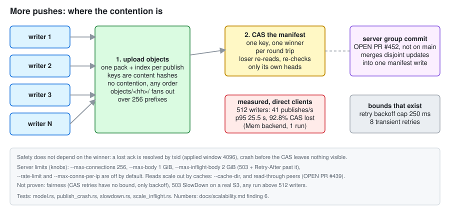
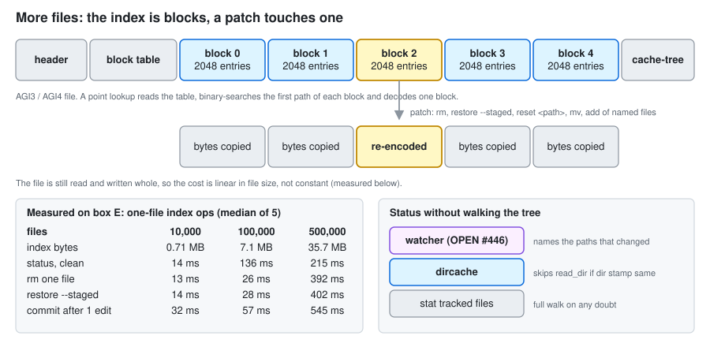
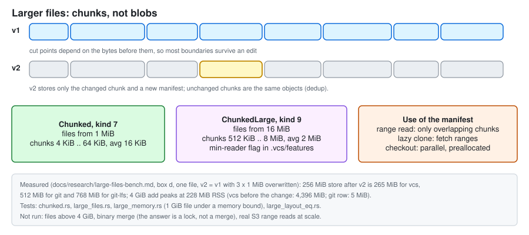
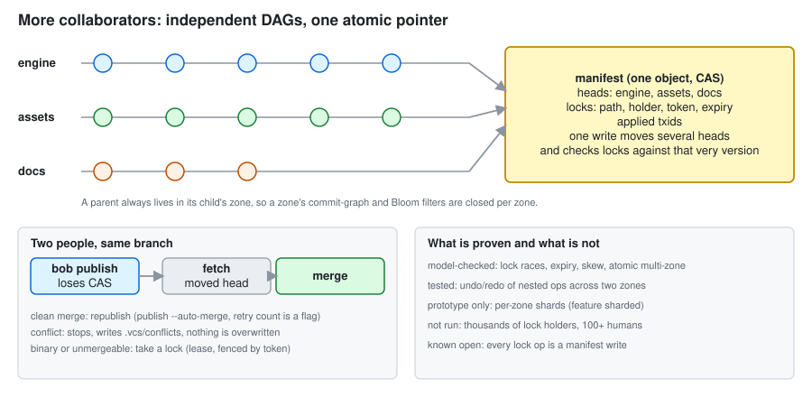
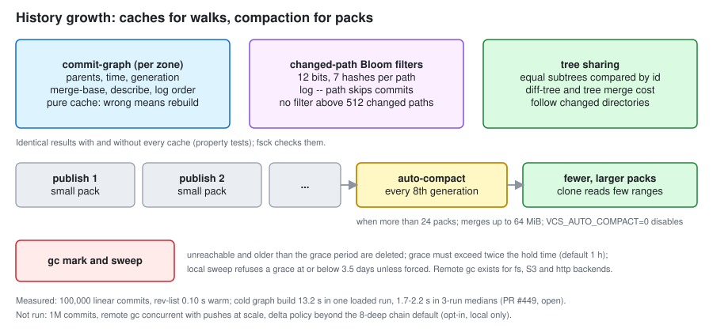

# How vcs scales, and why it should not break

This chapter explains, one axis at a time, what happens inside vcs when a repository or a team grows, which limit you
hit first, and what evidence backs each claim. It is an architecture explanation, not a benchmark report: numbers
come from the chapters it links (`docs/scalability.md`, `docs/manifest-scaling.md`, `docs/history-walks.md`,
`docs/research/*.md`) plus one new measurement made for this chapter (index patch cost, section b). Written against
`origin/main` at commit 21ae589.

## How to read the evidence

Every claim carries one of these tags. A claim with no tag is explanation, not evidence.

| Tag | Meaning |
|---|---|
| **M** | Measured: a number exists, with machine and run count in the linked chapter. |
| **T** | Tested: a named test checks behaviour or correctness (not speed). All tests named here passed on box E for this chapter (see "Reproduce"). |
| **D** | Designed only: a design document or a prototype, no test at scale. |
| **O** | Known open: we know it degrades, and what the fix would be. |
| **PR** | Work in an open pull request, not on main at the time of writing. Numbers quoted from a PR were not re-run here. |

Rule of the whole architecture: **a cache can only make an answer faster, never different.** The commit-graph, the
changed-path Bloom filters, the directory cache, the watcher state, the index cache and the pack index cache are all
discarded on any doubt and rebuilt, and property tests compare each against the uncached reference path.

## The shape of the system in one page

* Objects are immutable and content-addressed (BLAKE3). Writing one needs no coordination: the same bytes give the same
  key, so uploads from any number of writers never conflict.
* All mutable remote state is **one object, the manifest**: every zone's branch heads, tags, locks and the applied-txid
  window. A publish uploads objects first, then replaces the manifest with a compare-and-swap (CAS). Atomicity across
  zones, lock checks and branch updates all come from that one conditional write (`docs/architecture.md`,
  `docs/locks.md`).
* A zone is an independent commit DAG with its own commit-graph and path filters. Zones share the object store and
  the manifest but never each other's history.
* Local state is a block-structured index plus caches under `.vcs/`; large files are chunk manifests.

That gives a clean split of the question "what breaks": the immutable-object layer scales with the object store; the
single manifest key is the one serialization point; everything local is bounded by index size and tree shape.

---

## a. More load: more pushes, more clients

### What happens

A publish is: build one pack of the new objects, `PUT` pack then index (the pack becomes visible when its index
appears), one conditional write of the manifest. A one-file push costs at most 4 requests with sequential depth at most
3, no existence probes (T: `crates/vcs-remote/tests/publish_crash.rs::one_file_push_requests_and_depth`). Object
uploads never contend. Only step 3 does: one key admits one winner per round trip.

### Why it does not break (safety)

* A loser re-reads the manifest and re-validates only the heads it touches; disjoint zones both succeed, a race on one
  branch has exactly one winner, a duplicate submission applies once (T: `crates/vcs-remote/tests/model.rs`:
  `same_branch_race_exactly_one_wins`, `disjoint_zones_both_succeed`, `duplicate_submission_applies_once`,
  `multi_zone_is_atomic_against_single_zone`).
* A lost acknowledgement is resolved by transaction id, not guessed: the retry layer reads the key back and decides whether
  the write applied (`crates/vcs-remote/src/retry.rs`, window `MAX_APPLIED` = 4096 txids). A crash before the CAS leaves
  nothing visible and an index never lands before its pack (T: `publish_crash.rs`).
* GC cannot delete what a live writer is about to reference: grace period plus touch-on-dedup, model-checked with
  deliberately broken variants that must fail (T: `crates/vcs-remote/tests/model_gc.rs`).

### Why it does not break (throughput) and what actually degrades

The honest answer is that throughput on one manifest key does **not** grow with writers. Measured on the in-memory
backend, 1000 zones x 5 branches (249 KB manifest), one run per cell (M: `docs/scalability.md` finding 6):

| writers | publishes/s | p95 | CAS lost | retries per publish |
|---|---|---|---|---|
| 1 | 133 | n/a in chapter | 0 | 0 |
| 64 | 106 | 1.4 s | n/a in chapter | n/a in chapter |
| 256 | 86 | 6.4 s | 91.7 % | 11 |
| 512 | 41 | 25.5 s (p50 5.9 s, max 37 s) | 92.8 % | 12.9 |

All 1536 publishes at 512 writers completed, but liveness is only backoff: CAS-loss retries are not bounded (only
transient backend errors are, `MAX_RETRIES` = 8), with a jittered wait capped at 250 ms (`CAS_BACKOFF_CAP_MS`). There is
no fairness guarantee (listed under "Not yet proven").

What bounds the damage:

* **Group commit (PR #452, not on main).** The server queues disjoint transactions arriving within a few milliseconds
  and merges them into one manifest write. The PR reports (box E, shared, load1 17-22, 3 runs, medians, in-memory
  backend behind a real HTTP server): at 512 writers 69.7 publishes/s versus 27.3 without, CAS lost about 0 versus
  96.9 %, requests per publish 5.3 versus 67.8, p95 8.5 s versus 37.2 s. Test in the PR:
  `crates/vcs-server/tests/scale_groupcommit.rs`. Not measured: a real S3 backend. This is the planned fix for finding 6;
  until it lands, keep fewer than 8 concurrent direct (non-server) publishers per repository.
* **Per-zone shards (prototype).** The `sharded` feature removes the single key with a two-phase cross-zone commit and a
  decision record. It is model-checked and crash-tested (T: `tests/model_sharded.rs`, `tests/sharded_impl.rs`) but is not
  wired into `Publisher`, fetch or GC (D: `docs/manifest-scaling.md`, "The sharding gate").
* **Manifest size** grows linearly, about 40-63 bytes per branch, 1 MiB at 17-26k refs, 2.6 MB at 10k zones x 5 branches;
  decode plus validation is 39-59 ms at 10k zones x 5, depending on manifest version and tags (M: `docs/manifest-scaling.md`, medians of 5-21). The server keeps a
  cached copy up to 8 MiB.

### Server limits, backpressure, and who gets refused

| Limit | Default | Knob | Status |
|---|---|---|---|
| concurrent connections | 256 (extra get 503 + `Retry-After`) | `--max-connections` | T: `scale_inflight.rs::many_idle_connections_do_not_block_requests_and_cap_holds` |
| request body | 1 GiB each | `--max-body` | T: `crates/vcs-server/tests/hardening.rs::size_limits_give_clean_errors` |
| request bytes in flight, server-wide | 2 GiB; past it 503 + `Retry-After: 1` | `--max-inflight-body` | T: `scale_inflight.rs::inflight_body_budget_sheds_load_with_retry_after_and_recovers` |
| descriptor exhaustion | 50 ms accept back-off, no busy spin | none | T: `scale_inflight.rs::accept_loop_does_not_spin_when_descriptors_are_exhausted` (was 1 core of CPU) |
| connections per address | off | `--max-conns-per-ip` | T: `abuse_limits.rs` |
| failed-auth throttle | off | `--auth-fail-limit` | T: `abuse_limits.rs` |
| per-principal rate | off, no default on purpose | `--rate-limit burst,per-sec` | per process: N replicas allow N times the rate |
| thread per connection | the ceiling above | none | O: fine to a few hundred clients, redesign (readiness front) only designed |

Backpressure is always a **refusal the client understands** (503/429 with `Retry-After`), never unbounded queueing:
the client retry layer treats 5xx, 408 and 429 as retryable with jittered exponential backoff (default 3 retries,
`VCS_REMOTE_RETRIES`, at most 10), and never repeats a conditional write blind. Under an S3-style fault injector that
returns 503 SlowDown once a key prefix exceeds its budget (40 requests per 100 ms per prefix), 24 writers x 4 publishes all
completed and the manifest generation was exactly 96 (T: `crates/vcs-remote/tests/slowdown.rs::publishers_survive_slowdown_storms`;
the sweep test prints how far the budget can go but is not a gate). This is a fake backend, not a real S3 (see below).

### Reads, caches, peering

* Server disk cache: `--cache-dir`, `--cache-size` (default 8 GiB). Keys are content hashes, every entry carries a BLAKE3 over
  key, range and bytes checked on read; a bad entry is dropped and refetched. The manifest, listings and writes never
  use the cache, so a stale cache can cost a refetch but not a wrong answer (`docs/server.md`).
* Clients cache pack indexes (`crates/vcs-remote/src/idxcache.rs`, T: `crates/vcs-repo/tests/fetch_idx_cache.rs`) and read only
  the byte ranges they need from remote packs (T: `lazyfetch.rs`, `clone_requests.rs::a_big_pack_is_read_in_few_ranges`).
* **Read-through peers (PR #439, not on main):** `vcs-server --upstream` serves immutable keys from disk, coalescing
  concurrent misses to one upstream fetch, and revalidates only the manifest. The PR's tests: 64 concurrent misses give
  1 upstream fetch, no stale manifest after a push through the peer, corrupt objects refused, origin down still serves
  warm reads. Load numbers are in the separate open PR #460 and are not quoted here.

### S3 request shaping

Object keys fan out over 256 prefixes (`objects/<hh>/`), but `manifest` is one key and every publish writes it once.
Packs reduce requests: one pack plus index per publish instead of one object per file, and small packs are read two
requests each in one parallel wave (T: `clone_requests.rs::many_small_packs_cost_two_requests_each_in_one_wave`).
Automatic compaction (every 8th generation, only above 24 packs, merging up to 64 MiB; `VCS_AUTO_COMPACT=0` disables)
keeps the pack count flat so a clone does not pay hundreds of reads (T: `crates/vcs-remote/tests/autocompact.rs`).
Real S3, R2 or GCS throttling was **not** run: S3 credentials were not available for this work (O).

---

## b. More code and more files

### What happens

* **Index (`AGI3`/`AGI4`).** Entries are stored in blocks of 2048 behind a table of block lengths. A lookup reads the table,
  binary-searches the first path of each block, decodes one block. `rm`, `restore --staged`, `reset <path>`, `mv`, and
  `add`/`restore` of named files re-encode only touched blocks and copy the others as raw bytes, and write `AGI4` (blocks
  carry their own entry counts, so a removal leaves an uneven block). A torn write is detected and the index rebuilt,
  never read as empty (T: `crates/vcs-repo/tests/index_patch.rs`: `rm_and_restore_staged_on_a_multi_block_index`,
  `a_crash_while_writing_the_patched_index_keeps_the_old_one`, `a_torn_index_is_detected_and_rebuilt_at_open_never_read_as_empty`,
  `add_and_restore_of_named_files_patch_the_index_and_match_the_full_path`).
* **Directory cache.** `status` must list every directory for untracked files. `.vcs/dircache` remembers each listing with the
  directory's inode, mtime and ctime and skips `read_dir` when the stamp matches and is older than a 2 s racy window.
  ctime is in the stamp so `touch -r` cannot hide a new file (T: `crates/vcs-repo/tests/dircache.rs`, including a property test
  `cached_status_equals_full_status` and `restored_directory_mtime_does_not_hide_new_file`).
* **Watcher / fsmonitor.** A monitor answers "which paths may have changed since token T", and `status` trusts it only
  together with its own saved result; every doubt (unknown token, overflow, dead daemon, new epoch) falls back to the
  full scan. The interface and journal reader are on main behind the `watcher` feature; Linux inotify is the tested
  backend (T: `crates/vcs-repo/tests/fsmonitor.rs`, property test against the full scan; the daemon-backed cases need
  `--features watcher`, which the main run for this chapter did not enable). **PR #446** (open) turns it on by default for
  indexes of 1 MB or more (about 14k files), keeps the state across patched index writes, and reports on box E at 100k files
  `status` 928 ms before and 43 ms after (3 runs; not re-run here). macOS FSEvents is untested with auto-start.
* **Tree sharing.** Trees are objects; equal subtrees have equal ids and are never read twice. `diff-tree`, `merge`,
  `cherry-pick`, `rebase` and `stash pop` walk trees together and descend only where sides differ, so their cost follows the
  number of changed directories, not tracked files (`crates/vcs-repo/src/treemerge.rs`; T: tests compare against the flat
  merge on random trees, `crates/vcs-repo/tests/merge_big.rs`).
* **Sparse zones and sparse paths.** A workstation subscribes to the zones it needs (clone fetches only those; test
  `crates/vcs-repo/tests/remote.rs::sparse_clone_downloads_and_materializes_only_requested_zones`; a separate test bounds sparse-clone bytes by the asset size). Inside a zone, path-level sparse sets
  materialize only some prefixes; the index still holds every tracked path so `commit` carries the rest over unchanged.
  A randomized test proves sparse operations equal a full checkout restricted to the set (T: `sparse.rs`). **Limit (D9):**
  trees are still fetched and the index holds all paths of a zone, so a sparse set saves disk and blob traffic, **not** index
  size or tree traffic (`docs/sparse-paths.md`).
* **Wide and deep trees.** 300,000 files in 300 x 100 directories import in 29 s; deep and wide layouts are tested for
  correctness and ordering (T: `status_deep.rs`, `status_wide.rs`).

### Measured for this chapter: index patch cost versus file count

Box E (c6i.4xlarge, 16 vCPU, ext4 on EBS, load1 1.7-2.1, warm page cache), release build of `origin/main` 21ae589, medians
of 5 runs, wall ms, `datagen flat` (100 small files per directory), under `flock ~/bench.lock`. Raw output:
`docs/research/data/index-scale/box-e-2026-11-02.txt`; script `scripts/scalability/index_scale.sh`.

| files | index file | `status` clean | `add` one edited file | `rm` one file | `restore --staged` one file | `commit` after 1 edit |
|---|---|---|---|---|---|---|
| 10,000 | 0.71 MB | 14 ms | 10 ms | 13 ms | 14 ms | 32 ms |
| 100,000 | 7.1 MB | 136 ms | 21 ms | 26 ms | 28 ms | 57 ms |
| 500,000 | 35.7 MB | 215 ms | 136 ms | 392 ms | 402 ms | 545 ms |

Reading it honestly:

* The patch does not make these commands constant time. The file is still read and written whole, so cost tracks file size:
  about 2x from 10k to 100k files for `rm`, then **15x from 100k to 500k** (5x the files). That superlinear step is not
  explained: no profile was taken (O; the test that would explain it is in the "Not yet proven" table).
* Single-file commands stay interactive up to 100k files (under 60 ms here) and at 500k flat files are 0.14-0.55 s.
* The earlier whole-index decode/encode path is not compared in this table (not run); the claim "patching beats a full
  rewrite" rests on `docs/benchmarks.md` and the PRs that introduced it, not on this run.
* Single machine, no git comparison here, synthetic tiny files, one flat layout.

---

## c. Larger files

### What happens

A file of 1 MiB or more is stored as a chunk manifest (kind 7: 4-64 KiB chunks, average 16 KiB). From 16 MiB it is a
**ChunkedLarge** manifest (kind 9: 512 KiB-8 MiB chunks, average 2 MiB, no format bump, a min-reader flag in
`.vcs/features`). Cut points come from a gear hash over the preceding bytes, so editing the middle of a file moves only
nearby boundaries and every other chunk keeps its id: that is the deduplication. `add` streams the file in 64 MiB windows
(memory is constant, not file size), hashes chunks on all cores, and for a rewrite of the same length re-chunks only the
stretches whose chunks changed, up to 256 MiB of re-read before it gives up and does a full pass (`crates/vcs-store/src/bigfile.rs`).
Status verifies a large file by hashing chunk by chunk in parallel and stopping at the first mismatch.

Partial transfer: a lazy clone fetches HEAD blobs but not history blobs, and a missing one is fetched on first use; a byte-range
read touches only the overlapping chunks and a lazy fetch pulls just those; checkout writes a preallocated file with several
threads. Tests: `crates/vcs-repo/tests/chunked.rs` (`small_edit_to_a_big_file_adds_few_objects`,
`lazy_fetch_reads_one_chunk_from_a_remote_pack_by_range`, `fsck_reports_missing_and_corrupt_chunks_and_repack_keeps_it_valid`),
`large_files.rs` (`ranged_reads_touch_only_the_chunks_they_need_and_lazy_fetch_pulls_just_those`,
`checkout_with_a_missing_chunk_fails_without_touching_or_half_writing_the_file`,
`publish_clone_and_fetch_move_large_files_byte_identically`), `large_memory.rs`
(`one_gib_file_add_status_and_checkout_stay_under_a_memory_bound`), `lazyfetch.rs`
(`lazy_clone_downloads_fewer_bytes_than_eager_fetch`, `tampered_history_blob_is_rejected_and_not_stored`).
A hostile manifest cannot force a huge allocation (`91f7895`, capped; strict kind-9 decode).

### Evidence and limits

From `docs/research/large-files-bench.md` (M; box d c6i.4xlarge, one file, v1 random bytes, v2 = v1 with 3 x 1 MiB overwritten,
warm cache, load shared for the git rows): at 256 MiB the store after v2 is 265 MiB for vcs, 512 MiB for git, 768 MiB for git-lfs;
at 4 GiB, `add` of the edited file takes 0.27 s wall (3.4 s CPU) and peaks at 162 MiB RSS, and a clean `status` after a touch
takes 0.23 s wall. The "vcs before" column of that table, before the large layout, peaked at 4,396 MiB on the first add.

Limits: the manifest itself is linear in chunk count (a 4 GiB file is about 2,000 chunks at the 2 MiB average); chunk
sizes and the 16 MiB threshold are fixed by the object format. Dedup was measured on synthetic random data only (O). Binary
files do not merge; the answer is the lock service below, not a merge (`docs/locks.md`, "Lockable files").

---

## d. More collaborators

### What happens

* **Zones are independent DAGs.** Two people in different zones never touch the same branch head, history walk, commit-graph or
  Bloom file; a parent always lives in its child's zone (`crates/vcs-repo/src/cgraph.rs`; T: `commit_graph.rs::one_file_per_zone_and_a_commit_rewrites_only_its_zone`).
  They still share one manifest key, so the manifest CAS in section a is what they contend on; with group commit that
  contention disappears for disjoint zones.
* **Atomic cross-zone transactions.** One publish may move heads in several zones; the single manifest CAS makes it all-or-nothing
  (T: `model.rs::multi_zone_is_atomic_against_single_zone`, `locks.rs::rejected_multi_zone_tx_applies_nothing`,
  `lock_scenarios.rs::s6_rejected_multi_zone_tx_leaves_no_partial_effect`).
* **Operation log.** Every local mutation stores an immutable operation with the full local view and atomically moves a head
  pointer; undo and restore move only local refs, never the remote, and refuse a dirty affected zone (T: `crates/vcs-repo/tests/ops.rs`,
  15 tests including crash between object store and op head and undo of nested changes across two zones).
* **Leases and locks.** Locks live inside the manifest, so the lock check and the branch update are committed by one CAS: no
  check-then-act gap. A lease expires on the server's clock plus a skew allowance (`--skew-epsilon-ms`, choose at least twice the
  maximum skew); a token fences a stale holder; `--max-lease-secs` caps a lease (422 past it). Model-checked schedules include
  acquire races, expiry, break vs publish, clock jumps and replica skew, with six deliberately broken validators that the
  checker must catch (T: `crates/vcs-remote/tests/model_locks.rs`, `locks.rs`, `crates/vcs-server/tests/lock_scenarios.rs`,
  `crates/vcs-cli/tests/lockable_server.rs` for two users racing for one binary).
* **Conflicts and auto-merge.** When bob's publish loses because the branch moved, `publish --auto-merge[=N]` fetches, merges,
  and republishes only if the merge is clean; a conflict stops, leaves conflict records in `.vcs/conflicts` and overwrites nothing
  (T: `crates/vcs-cli/tests/force_push.rs::publish_auto_merge_merges_clean_and_leaves_conflicts_alone`). Merges are three-way on
  trees and text with structural conflict records (`docs/merge.md`; T: `merge.rs`, `merge_big.rs::wide_merge_keeps_both_sides_and_conflict_abort_restores_everything`).

### What degrades

* Every lock acquire, renew and release is a manifest publish (finding 12), and locks add bytes to the manifest. With a few
  hundred locks this is the same CAS story as pushes; with thousands of holders it is **not run** (D). Lock operations also
  bypass group commit in PR #452 (they fall back to the 412 path per the PR's caveats).
* Auto-merge is tested for one clean and one conflicting case, not for many simultaneous publishers on one branch. The harness
  `scripts/highload_bench/highload.py` has a `same` scenario for that (N pushers on one branch with recovery); no results are checked in.
* Per-principal rate limiting is per process (N replicas allow N times the rate).

---

## e. History growth

### What happens

* **Commit-graph, one file per zone.** Parents, author time and generation numbers live in `.vcs/commit-graphs/<zone>`, so
  `merge-base`, `describe`, `HEAD~N` and `log` order do not decode commits one by one. A commit rewrites only its own zone's file.
  Wrong, stale or corrupt means ignore and rebuild; `fsck` flags a graph that lies (T: `commit_graph.rs`: `stale_graph_is_extended_not_trusted`,
  `corrupt_graph_is_ignored_rebuilt_and_flagged_by_fsck`, `fsck_catches_a_well_formed_graph_that_lies`, and proptests
  `identical_with_and_without_graph`, `identical_with_and_without_per_zone_graphs`).
* **Changed-path Bloom filters.** Per commit and parent, a filter (12 bits and 7 hashes per path, file paths plus their directories)
  answers "does this commit touch `a/b`?" with a certain no or a maybe settled against real entries. Commits changing more than 512
  paths get none. Pure cache, built lazily by the first long path walk (T: `history_walks.rs`:
  `filters_are_a_cache_that_is_persisted_checked_and_rebuilt`, `log_paths_equals_filtering_the_walk`).
* **Pack compaction.** Each publish adds one small pack; every 8th manifest generation the publisher runs one bounded tiered pass if
  the remote holds more than 24 packs (T: `autocompact.rs`; compaction rules C1-C5 in `crates/vcs-remote/src/compact.rs`, tests
  `compact_real.rs`, `compact_v3.rs`). Locally, loose objects are packed automatically above a threshold and a held lock skips
  it (T: `crates/vcs-repo/tests/autorepack.rs`).
* **GC.** Mark and sweep with a grace period: unreachable and older than the grace. Local sweep refuses a grace at or below 3.5 days
  (the touch-on-dedup threshold) unless forced; remote needs grace above twice `--hold-secs` (default 1 h) and a backend that can
  delete and report time. Remote GC exists for directory, S3 and HTTP backends (T: `gc.rs`, `gc_real.rs`, `model_gc.rs`).
* **Delta policy.** Pack v4 delta entries are opt-in and local only; chains are at most 8 deep and a delta is kept only if it beats the
  whole payload (`docs/object-model.md`, `docs/research/storage/delta-gate.md`). Automatic remote compaction writes v2 packs (per-object entries).

### Evidence (M)

* 100,000 linear commits (`docs/scalability.md` finding 9, one run, loaded box): import 83.7 s; first `rev-list HEAD` 13.2 s (builds the
  graph), later `rev-list HEAD` 0.10 s, `log -n 20` 0.01 s, `merge-base` 0.02 s, `gc` 9.6 s. PR #449 (open) warms the graph after
  import and gc; it reports (box E, load1 17-22, 3 runs) first `rev-list` 1.78 s before versus 0.103 s after at 100k commits, and
  says this supersedes the 13.2 s single run.
* `docs/history-walks.md`: at 20,000 commits and 20,000 files, `log -n20 -- file` is 45 ms versus git's 94 ms for a default git
  repository, but slower than git with its own commit-graph and changed-path filters (24 ms); `merge-base`, `describe`, `blame` and
  `--name-status` are slower than git-with-caches. Medians of 9, shared box (load1 15-25).

### What degrades (O)

Refs live in one file read and rewritten whole: 1M tags make a tag create 1.85 s and `log --oneline -n 1` 1.1 s (finding 8; fine to about
100k refs). Cold graph build is linear (about 0.1 ms per commit). 1M-commit history and remote GC concurrent with pushes at scale were
not run.

---

## f. What breaks first: failure modes, limits, and their status

| # | Failure mode | Where it bites | Limit and number | Knob | Status |
|---|---|---|---|---|---|
| 1 | CAS storm on the manifest | many concurrent direct publishers | 512 writers: 41 publishes/s, p95 25.5 s, 92.8 % lost | keep fewer than 8 direct writers; group commit (PR #452) | **M** + **PR** |
| 2 | Manifest too big to cache or decode | tens of thousands of zones or refs | 1 MiB at 17-26k refs; 2.5-3.8 MB, 39-59 ms decode at 10k zones x 5; server copy cap 8 MiB | sharding (prototype) | **M**, **D** |
| 3 | Server overload | many clients | 256 connections, 1 GiB body, 2 GiB in flight; thread per connection | `--max-connections`, `--max-body`, `--max-inflight-body` | **T** limits, **O** thread model |
| 4 | Abusive client | one address or token | throttles off by default | `--max-conns-per-ip`, `--auth-fail-limit`, `--rate-limit` | **T** |
| 5 | Descriptor exhaustion | accept loop | 50 ms back-off | none | **T** |
| 6 | Storage rate limits (503 SlowDown) | S3 prefixes | 256 object prefixes, one manifest key | `VCS_REMOTE_RETRIES` (3, max 10) | **T** with a fake, **O** real S3 |
| 7 | Whole-index read/write per command | 500k+ files | rm one file 13 / 26 / 392 ms at 10k / 100k / 500k | (watcher PR #446) | **M**, superlinear step unexplained |
| 8 | First `status` after import of a wide tree | many directories | 22.2 s at 300k files in 30k dirs versus 6.2 s flat | none | **M**, **O** |
| 9 | Refs file | 100k+ refs | 1M tags: tag create 1.85 s, 522 MB RSS | none | **M**, **O** |
| 10 | Cold commit-graph | first walk after import | 0.1 ms per commit; warm at import in PR #449 | none | **M**, **PR** |
| 11 | Large-file memory | multi-GiB add | 228 MiB RSS at 4 GiB (was 4,396 MiB) | `VCS_THREADS` | **M**, **T** |
| 12 | Many small packs | long-lived remote | compaction above 24 packs, every 8th generation, 64 MiB cap | `VCS_AUTO_COMPACT` | **T** |
| 13 | GC deleting live data | writer stalls longer than grace | grace above 3.5 days local, above 2x hold remote | `--grace`, `--hold-secs` | **T** (model-checked) |
| 14 | Lock lease with skewed clocks | multi-replica servers | epsilon at least 2x max skew | `--skew-epsilon-ms`, `--max-lease-secs` | **T** (model-checked) |
| 15 | Lock service under thousands of holders | very large teams | each op is a manifest write | none | **D** |

### Not yet proven

Each row is a claim or fear with no test or number today, and the test that would settle it.

| Claim or open question | Test that would prove it |
|---|---|
| Group commit helps against a real object store | `manifestbench publish` with the `http` and `httpnogc` backends over RustFS or real S3 at 64 and 512 writers (PR #452 only used an in-memory backend). |
| No publisher starves under CAS storms (retries are unbounded) | Record the maximum and 99th percentile retry count and wall time per publisher at 512 writers; assert a bound, or add one. |
| Index patch cost is linear, and why 100k to 500k is 15x | `perf record` of `vcs rm` at 500k files; then a byte-level patch that rewrites only the touched block and table, with a format story, and the same table again. |
| Patching beats a full index rewrite | Run `scripts/scalability/index_scale.sh` on a build from before the patched-index commits (for example the parent of `17cb479`) and on main, interleaved, same box. |
| Watcher keeps `status` fast on macOS and past the inotify watch limit | A `--features watcher` test on a Mac for FSEvents, and a test that sets a tiny `fs.inotify.max_user_watches` and checks the fallback to a full scan. |
| First `status` after import of 10M files is bearable | Extend `scripts/scalability/gen.py` to 10M files, time first `status`; the 74 us per file cost in finding 10 predicts about 12 min. |
| Real S3, R2 and GCS shaping (SlowDown, prefix limits) | `s3bench`/`s3e2e` with credentials; compare with `slowdown.rs` assumptions. Credentials were not available. |
| Chunk dedup on real binaries, not random bytes | Repeat `large-files-bench` on a corpus of real files (database, archive, media project) with real edit patterns. |
| Thousands of lock holders | Extend `manifestbench` with 1k-10k live locks and acquire/release rate; compare against the sharded prototype. |
| Auto-merge with many simultaneous publishers on one branch | `scripts/highload_bench/highload.py --scenarios same --n 8,32` and record failed or looping recoveries. |
| Remote GC while pushes run, at scale | A soak on the directory backend that runs `gc --remote` repeatedly against 32 publishers and then fscks the closure; `model_gc.rs` covers correctness on small models only. |
| 1M-commit history, 10M-file tree | `scripts/scalability/gen.py deep|wide` at that size; time `rev-list`, `merge-base`, `gc`, `status`, and record RSS. |
| Thread-per-connection ceiling | Run `scale_inflight.rs` variants with 2,000 connections and record RSS and latency. |
| Peering reduces origin load at scale | Open PR #460 (loopback, same box, so latency is a tie); needs a multi-host run. |
| Sparse zones for a monorepo zone of millions of paths | D9 says whole tree and index per zone; test a zone of 5M paths with a 1k-path sparse set and measure index size and clone bytes. |

## Reproduce

Test sets named in this chapter (box E, release builds, passed on 21ae589 for this chapter): `cargo test --release -p vcs-repo --test
index_patch --test dircache --test commit_graph --test history_walks --test chunked --test large_files --test sparse --test ops
--test autorepack --test lazyfetch --test merge_big --test status_wide --test status_deep --test fsmonitor`;
`-p vcs-remote --test model --test model_locks --test locks --test slowdown --test publish_crash --test autocompact --test model_gc --test sharded_impl --features sharded`;
`-p vcs-server --test scale_inflight --test lock_scenarios --test abuse_limits`; `-p vcs-cli --test force_push`. The index table:
`scripts/scalability/index_scale.sh 10000 100000 500000` with release `vcs` and `datagen`. Everything else is quoted from the linked
chapters and was not re-run here. Related chapters: [scalability.md](scalability.md), [manifest-scaling.md](manifest-scaling.md),
[history-walks.md](history-walks.md), [locks.md](locks.md), [gc.md](gc.md), [sparse-paths.md](sparse-paths.md),
[research/large-files-bench.md](research/large-files-bench.md), [research/commit-graph.md](research/commit-graph.md),
[research/storage/concurrency-and-correctness.md](research/storage/concurrency-and-correctness.md).
