# Jujutsu and Sapling benchmark, per command (vcs refreshed on 8da0be2)

Status: **PARTIAL REFRESH, 2026-11-02.** The original run (vcs `34315b6`, box c, jj 0.46.0, Sapling 0.2.20261028) measured
all three tools interleaved. Since then `origin/main` gained many speed fixes (#400 to #418). This refresh **re-ran only
the vcs side** on a build of `origin/main` at `8da0be2` (on box E, a different c6i.4xlarge instance than the original run's box c; same `scripts/bench_jj_sl.py`, same datasets, 5 runs,
`TOOLS=vcs`). **jj and Sapling were not re-run**: their official prebuilt binaries are installed only on box c, not on box E and the
download was not permitted from the agent session. Their numbers are carried over unchanged from the `34315b6` run.
So every ratio below is vcs-after against jj/sl-before from **different sessions, not interleaved**; treat close
calls (inside about 20 percent) as unresolved. The raw data of both runs is kept: the old run in
[jj-sapling-raw/](jj-sapling-raw/) (`flat/deep/binary.json`), the vcs re-run in
[jj-sapling-raw/vcs-refresh-8da0be2/](jj-sapling-raw/vcs-refresh-8da0be2/), the merged set used for the tables in
`jj-sapling-raw/merged-8da0be2/` (made by `scripts/jj_sl_merge_refresh.py`). This replaces the earlier single-layout notes in
[jujutsu-benchmark.md](jujutsu-benchmark.md) and [sapling-benchmark.md](sapling-benchmark.md) (kept for history and for the feature comparison). Nothing was estimated.

The charts below are of this partial refresh (3 layouts, 10% tie band). The final flat-100k run on build `845610a` (5% band with MAD noise, jj and Sapling re-run interleaved) is in [jj-sl-final.md](jj-sl-final.md) and drives `docs/img/scoreboard-jj.svg` and `scoreboard-sapling.svg`, the ones the README shows.

Scoreboards (green = vcs WIN, amber = TIE, red = vcs LOSS, grey = N/A):

## Setup

| item | value |
|---|---|
| machine | original run: AWS box c: c6i.4xlarge; vcs refresh: box E (c6i.4xlarge, 16 vCPU, ext4, same instance type, different instance, hostname ip-172-31-8-192); Intel Xeon Platinum 8375C, 16 vCPU, ext4, Linux 7.0.0-1014-aws x86_64. Shared box: only one benchmark at a time under `flock ~/bench.lock`, but other jobs and builds run outside the lock. load1 sampled before and after every cell is in the raw JSON (typical 1 to 5, a few cells up to ~12) |
| vcs | `vcs 0.1.0`, release build (`cargo build --release -p vcs-cli`): original run `origin/main` at `34315b6`; **refresh (the vcs columns below) at `8da0be2`**, 2026-11-02, load1 2.5 (flat), 2.0 (deep), 3.9 (binary) at the start of each layout |
| jj | `jj 0.46.0-7d382314f9420b4b8d932245b49c99492c812b9f`, official prebuilt `jj-v0.46.0-x86_64-unknown-linux-musl.tar.gz`, SHA256 `fce0271158e665ceb82dc66c5eb95b1728649094e9133074f3b5baece345fc08`, user-space install under `~/rt-jjsl-tools/jj` |
| Sapling | `Sapling 0.2.20261028-123539+7415fb2f`, official prebuilt `sapling-...-linux-x64.tar.xz` (latest release at run time), SHA256 `9504b9514ed16dce3b5443811f7625742a363e66a44b316bcaad70a9d013b274`, user-space install under `~/rt-jjsl-tools/sl`, `sl init --git` (Git-backed store), no watchman, no EdenFS |
| git | 2.43.0 (used only for the bare Git remotes jj and sl push to) |
| jj layout | `jj git init --no-colocate` / `jj git clone --no-colocate` (jj store only). No fsmonitor |
| datasets | `datagen flat|deep|binary 100000`, seed 42 (same generator as `scripts/bench_scale.sh`) |
| config | `GIT_CONFIG_GLOBAL/SYSTEM=/dev/null`, `JJ_CONFIG=/dev/null`, identity from env or `--config ui.username`, no hooks |
| method | per cell: untimed prep, then the timed command; tools are visited in a rotating order inside every run (interleaved); wall ms and CPU ms (user+sys of the child tree, `wait4`) per run. Slow cells are cut to 3 runs when the first run (prep plus timed) exceeded 150 s (jj add/commit on deep and binary); `n` is in the tables |
| reproduce | `VCS_BIN=... DATAGEN=... JJ_BIN=... SL_BIN=... OUT=flat.json python3 -I scripts/bench_jj_sl.py flat 100000 5` for each layout, then `python3 scripts/jj_sl_scoreboard.py <dir with flat/deep/binary.json> docs/img tables.md` |

One-off smoke runs of the harness at 3,000 files (to debug commands) ran on the same box outside the lock; they are not in any number here.

## How to read the tables

- `ratio = other tool's median wall ms / vcs median wall ms`. Above 1 means vcs is faster.
- **TIE threshold: within 10 percent.** WIN: ratio >= 1.10. LOSS: ratio <= 0.91 (vcs slower by more than 10 percent). TIE: in between. The verdict uses wall time; CPU ms is shown in brackets.
- N/A: the command does not exist for vcs or for the other tool, or the command failed. N/A is never counted as a WIN.
- Each cell is at 100k files (flat = one directory, deep = nested directories, binary = binary blobs).

### What each cell times

| cell | vcs | jj | sl |
|---|---|---|---|
| init | `vcs init` in a directory holding the dataset | `jj git init --no-colocate` | `sl init --git` |
| add/track | `vcs add .` (fresh repo) | first snapshot `jj status` (jj has no staging area; any command tracks every file) | `sl add .` |
| commit | `vcs commit -m c` after `add` | `jj commit -m c` after the snapshot above (the snapshot cost is in the **add/track** row, not here) | `sl commit -m c` after `add` |
| describe | N/A (`vcs describe` is git-describe, not message editing) | `jj describe -m xN` | `sl metaedit -m xN` |
| status clean / 1% | `vcs status` | `jj status` (1%: each run snapshots 1,000 rewritten files) | `sl status` |
| diff (1% modified) | `vcs diff` | `jj diff --git` | `sl diff --git` |
| log | `vcs log -n 50` | `jj log --no-graph -n 50` | `sl log -l 50 --template ...` |
| blame/annotate | `vcs blame <file>` | `jj file annotate <file>` | `sl annotate <file>` (one small file, 8 lines) |
| branch/bookmark | `vcs branch bmN` | `jj bookmark create bmN -r @-` | `sl bookmark bmN` |
| checkout/switch | `vcs switch main` from `side` (1% of files differ) | `jj edit main` | `sl goto main` |
| amend | N/A (no amend command in vcs) | `jj squash -u` after editing one file | `sl amend` after editing one file |
| undo | `vcs op undo` after a one-file commit | `jj undo` | `sl undo -f` |
| merge | `vcs merge fN` (one commit on `side`, disjoint file) | `jj new main fN` (a two-parent commit) | `sl merge fN` plus `sl commit` (sl leaves the merge uncommitted) |
| rebase | `vcs rebase main` on the checked-out branch | `jj rebase -b rN -d main` | `sl rebase -s rN -d main` |
| push | `vcs publish` (directory remote), 1 new commit | `jj git push --remote origin -b main` (bare Git repo) | `sl push --to main -r main origin` (bare Git repo) |
| clone | `vcs clone <published dir>` full history (50 commits plus pushes) | `jj git clone --no-colocate <bare repo>` | `sl clone --git <bare repo>` |
| fetch/pull | `vcs fetch` in a clone; untimed prep pushes 1 commit | `jj git fetch` | `sl pull` |
| gc | `vcs gc` (local, default 14-day grace) | `jj util gc` | N/A: `sl gc` prints "no longer supported" |

History: 1% of files modified and committed, then 48 single-file commits, so `main` has 50 commits on top of a base commit named `side`.

## Summary

- vs jj: 43 WIN, 2 TIE, 6 LOSS (51 cells where both tools ran; describe and amend are N/A). Before the refresh: 41 WIN, 4 TIE, 6 LOSS.
- vs sl: 48 WIN, 0 TIE, 0 LOSS (48 cells; gc, describe and amend are N/A). Before: 47 WIN, 0 TIE, 1 LOSS.
- Biggest change: `diff (1% modified)` went from 643/759/815 ms (flat/deep/binary) to 29/71/29 ms (PR #409), flipping three LOSSes to WINs.
- Provisional, see the Status paragraph: jj and sl were not re-measured.

## REMAINING LOSSES (vcs slower than jj by more than 10 percent; this list drives the next optimization round)

| command | layout | vs | vcs ms (before -> after) | jj ms | vcs slower by (after) |
|---|---|---|---|---|---|
| commit (all files) | deep | jj | 544 -> 521 | 268 | 1.94x |
| commit (all files) | flat | jj | 102 -> 93 | 82 | 1.13x |
| checkout/switch (1% differ) | flat | jj | 152 -> 360 | 239 | 1.51x |
| checkout/switch (1% differ) | binary | jj | 161 -> 349 | 244 | 1.43x |
| init (empty dir) | deep | jj | 15 -> 46 | 30 | 1.54x |
| clone (local remote, full history) | deep | jj | 25,562 -> 23,931 | 14,973 | 1.60x |

Vs Sapling: none. Close TIEs vs jj: status (clean) deep 0.97, commit (all files) binary 1.01.

**Possible regressions to look at first.** In this refresh vcs `checkout/switch (1% differ)` is 2.3x slower than in the 34315b6 run on all three layouts (152 -> 360, 170 -> 371, 161 -> 349 ms) and `init (empty dir)` deep 15 -> 46 ms, `rebase` deep 58 -> 85, `merge` deep 122 -> 146, `undo` deep 91 -> 111. These are cross-session vcs-vs-vcs comparisons on a box with load1 2 to 4, so noise is possible, but the switch change is consistent in three layouts. The per-command git scoreboard (`switch_side`, 1% differ, flat 100k) did **not** show it (178 ms vs git 233 ms), so the jj harness's switch scenario (switch back to `main` from `side` after the history setup) should be diffed against that one first. Not investigated.

## Before and after, vcs side (wall ms medians; ratio = other tool / vcs, W/T/L at the 10 percent band)

| cell | layout | vcs before ms | vcs after ms | jj ms | sl ms | ratio jj/vcs before -> after | ratio sl/vcs before -> after |
|---|---|---|---|---|---|---|---|
| init (empty dir) | flat | 15 | 10 | 27 | 229 | 1.85 W -> 2.67 W | 15.53 W -> 22.39 W |
| add/track (all files) | flat | 588 | 529 | 94,761 | 6,134 | 161.18 W -> 179.08 W | 10.43 W -> 11.59 W |
| commit (all files) | flat | 102 | 93 | 82 | 13,341 | 0.81 L -> 0.88 L | 130.85 W -> 143.25 W |
| status (clean) | flat | 49 | 46 | 51 | 216 | 1.04 T -> 1.12 W | 4.41 W -> 4.75 W |
| status (1% modified) | flat | 50 | 46 | 507 | 222 | 10.12 W -> 10.92 W | 4.44 W -> 4.79 W |
| diff (1% modified) | flat | 643 | 29 | 550 | 779 | 0.85 L -> 18.78 W | 1.21 W -> 26.60 W |
| log (50 commits) | flat | 4 | 4 | 54 | 248 | 13.43 W -> 14.49 W | 61.14 W -> 65.96 W |
| blame/annotate (1 file) | flat | 9 | 8 | 67 | 227 | 7.38 W -> 8.21 W | 24.85 W -> 27.65 W |
| branch/bookmark (create) | flat | 16 | 7 | 80 | 231 | 5.15 W -> 12.11 W | 14.91 W -> 35.06 W |
| checkout/switch (1% differ) | flat | 152 | 360 | 239 | 440 | 1.57 W -> 0.66 L | 2.90 W -> 1.22 W |
| undo (last commit) | flat | 66 | 60 | 73 | 610 | 1.11 W -> 1.21 W | 9.31 W -> 10.15 W |
| merge (disjoint files) | flat | 98 | 104 | 252 | 1,061 | 2.58 W -> 2.42 W | 10.88 W -> 10.19 W |
| rebase (1 commit onto main) | flat | 41 | 38 | 250 | 874 | 6.06 W -> 6.53 W | 21.15 W -> 22.79 W |
| push (1 new commit) | flat | 13 | 11 | 124 | 279 | 9.90 W -> 11.55 W | 22.32 W -> 26.03 W |
| clone (local remote, full history) | flat | 1,060 | 1,032 | 5,013 | 2,931 | 4.73 W -> 4.86 W | 2.77 W -> 2.84 W |
| fetch/pull (1 new commit) | flat | 23 | 22 | 126 | 284 | 5.53 W -> 5.74 W | 12.52 W -> 13.00 W |
| gc (local) | flat | 1,134 | 1,133 | 2,478 | N/A | 2.18 W -> 2.19 W | N/A |
| init (empty dir) | deep | 15 | 46 | 30 | 240 | 2.01 W -> 0.65 L | 16.22 W -> 5.24 W |
| add/track (all files) | deep | 1,307 | 1,241 | 428,123 | 8,069 | 327.55 W -> 344.86 W | 6.17 W -> 6.50 W |
| commit (all files) | deep | 544 | 521 | 268 | 21,250 | 0.49 L -> 0.51 L | 39.05 W -> 40.81 W |
| status (clean) | deep | 206 | 228 | 222 | 526 | 1.08 T -> 0.97 T | 2.56 W -> 2.31 W |
| status (1% modified) | deep | 212 | 232 | 983 | 543 | 4.64 W -> 4.23 W | 2.56 W -> 2.34 W |
| diff (1% modified) | deep | 759 | 71 | 974 | 1,087 | 1.28 W -> 13.65 W | 1.43 W -> 15.25 W |
| log (50 commits) | deep | 5 | 4 | 230 | 246 | 48.80 W -> 54.26 W | 52.07 W -> 57.91 W |
| blame/annotate (1 file) | deep | 7 | 6 | 230 | 223 | 31.74 W -> 38.44 W | 30.83 W -> 37.35 W |
| branch/bookmark (create) | deep | 10 | 8 | 251 | 233 | 24.99 W -> 32.48 W | 23.23 W -> 30.19 W |
| checkout/switch (1% differ) | deep | 170 | 371 | 480 | 797 | 2.83 W -> 1.30 W | 4.70 W -> 2.15 W |
| undo (last commit) | deep | 91 | 111 | 250 | 1,165 | 2.75 W -> 2.24 W | 12.82 W -> 10.46 W |
| merge (disjoint files) | deep | 122 | 146 | 477 | 1,934 | 3.89 W -> 3.27 W | 15.80 W -> 13.29 W |
| rebase (1 commit onto main) | deep | 58 | 85 | 470 | 1,653 | 8.10 W -> 5.54 W | 28.50 W -> 19.47 W |
| push (1 new commit) | deep | 13 | 11 | 390 | 355 | 29.91 W -> 34.62 W | 27.22 W -> 31.50 W |
| clone (local remote, full history) | deep | 25,562 | 23,931 | 14,973 | 78,734 | 0.59 L -> 0.63 L | 3.08 W -> 3.29 W |
| fetch/pull (1 new commit) | deep | 32 | 29 | 397 | 379 | 12.26 W -> 13.75 W | 11.69 W -> 13.11 W |
| gc (local) | deep | 1,791 | 1,599 | 4,339 | N/A | 2.42 W -> 2.71 W | N/A |
| init (empty dir) | binary | 14 | 11 | 29 | 237 | 1.97 W -> 2.62 W | 16.40 W -> 21.82 W |
| add/track (all files) | binary | 2,754 | 3,189 | 97,500 | 6,078 | 35.40 W -> 30.57 W | 2.21 W -> 1.91 W |
| commit (all files) | binary | 177 | 94 | 95 | 22,365 | 0.53 L -> 1.01 T | 126.34 W -> 238.45 W |
| status (clean) | binary | 49 | 46 | 51 | 210 | 1.04 T -> 1.12 W | 4.27 W -> 4.62 W |
| status (1% modified) | binary | 51 | 47 | 550 | 223 | 10.70 W -> 11.82 W | 4.34 W -> 4.79 W |
| diff (1% modified) | binary | 815 | 29 | 563 | 626 | 0.69 L -> 19.21 W | 0.77 L -> 21.34 W |
| log (50 commits) | binary | 4 | 4 | 56 | 251 | 12.71 W -> 15.34 W | 56.93 W -> 68.72 W |
| blame/annotate (1 file) | binary | 10 | 8 | 69 | 231 | 7.17 W -> 8.48 W | 24.13 W -> 28.54 W |
| branch/bookmark (create) | binary | 12 | 7 | 78 | 236 | 6.28 W -> 11.62 W | 19.01 W -> 35.22 W |
| checkout/switch (1% differ) | binary | 161 | 349 | 244 | 450 | 1.52 W -> 0.70 L | 2.80 W -> 1.29 W |
| undo (last commit) | binary | 70 | 61 | 74 | 622 | 1.05 T -> 1.20 W | 8.91 W -> 10.12 W |
| merge (disjoint files) | binary | 101 | 85 | 248 | 1,094 | 2.47 W -> 2.92 W | 10.86 W -> 12.85 W |
| rebase (1 commit onto main) | binary | 40 | 38 | 250 | 880 | 6.27 W -> 6.53 W | 22.10 W -> 23.05 W |
| push (1 new commit) | binary | 14 | 11 | 125 | 278 | 9.26 W -> 11.49 W | 20.51 W -> 25.45 W |
| clone (local remote, full history) | binary | 4,164 | 3,331 | 9,463 | 9,598 | 2.27 W -> 2.84 W | 2.31 W -> 2.88 W |
| fetch/pull (1 new commit) | binary | 22 | 22 | 126 | 292 | 5.81 W -> 5.74 W | 13.49 W -> 13.32 W |
| gc (local) | binary | 1,625 | 1,573 | 5,920 | N/A | 3.64 W -> 3.76 W | N/A |

## Notes and caveats (read before quoting any number)

- **jj commit is not comparable to vcs commit.** jj has no staging area: its `add/track` cell is the first working-copy snapshot and costs 95 s (flat), 428 s (deep, 3 runs) and 98 s (binary); the later `jj commit` only rewrites a commit that already exists. vcs pays for the add in `add` and then commits staged state. Read the add/track and commit rows together: the sum add+commit is where vcs is far ahead (about 0.7 s vs 95 s on flat). The commit LOSS rows are real for the command as timed, but they move cost between the two rows.
- **diff** LOSSes: `vcs diff` has CPU time about equal to wall time (643 ms wall, 657 ms CPU on flat), while jj's CPU exceeds its wall (550 ms wall, 802 ms CPU), which suggests jj spreads work across threads. That is a hypothesis from the CPU columns, not a profile.
- **clone (deep) LOSS vs jj** and the clone cells in general compare different transports: vcs clones its own published directory format, jj and sl clone a bare Git repository. The sl deep clone shows 78.7 s wall but 13.7 s CPU; load1 rose from 3.9 to 11.7 during that cell, so its wall time is inflated by other jobs on the shared box (it is a WIN either way, since vcs took 25.6 s).
- **Sapling is run without watchman or EdenFS**, which is how Sapling is normally deployed at scale; its status/diff/commit numbers here are for its plain Git-backed working copy. They say nothing about the Meta-internal setup.
- **jj** was run non-colocated and without fsmonitor; a colocated or watchman-backed jj was not measured.
- **Cut runs:** `add/track` and `commit` on the deep layout have n=3 (jj and sl first run exceeded 150 s with prep). With 3 runs the median is the middle run.
- **N/A rows:** `describe` (vcs has no message-edit command; `vcs describe` is the git-describe analogue), `amend` (vcs has no amend command), `gc` for sl (`sl gc` prints "no longer supported"). The jj/sl absolute numbers for these are in the tables.
- **undo**: jj `undo` and vcs `op undo` are operation-log undos; `sl undo -f` is Sapling's own undo of the last commit, not an op log.
- **merge/rebase** are single-commit, non-conflicting. Conflicting merges, large histories and `jj`'s automatic descendant rebasing were not measured.
- **blame** is on a small file (8 lines, a handful of commits); long-history blame was not measured.
- **push/fetch** use local bare repositories or directory remotes; no network, no S3, no SSH.
- **describe** was re-run on its own (`CELLS=describe`, the first run reused one message for every run and sl's `metaedit` rejected the repeat); the table uses the re-run, merged by `scripts/jj_sl_scoreboard.py`'s `desc-*.json` rule.
- The box is shared. The lock serialises benchmarks but not builds or other jobs; check each cell's load1 in the raw JSON before relying on a close call.
- **Refresh caveat:** the vcs and jj/sl samples in the tables are from different sessions (jj/sl: the 34315b6 run, vcs: 8da0be2). Different instances (c vs E) and different load; the load1 of each cell is in the respective raw JSON.
- Not run: git itself in this harness (ratios are against vcs only), the 10k size, other machines, repeated sessions on different days.

## Per-command results (vcs after the refresh; jj and sl from the 34315b6 run)

### vcs vs Jujutsu (jj)

| command | layout | jj wall ms (cpu) | vcs wall ms (cpu) | ratio jj/vcs | result | runs |
|---|---|---|---|---|---|---|
| init (empty dir) | flat | 27 (11) | 10 (2) | 2.67 | WIN | 5/5 |
| init (empty dir) | deep | 30 (11) | 46 (2) | 0.65 | LOSS | 5/5 |
| init (empty dir) | binary | 29 (11) | 11 (2) | 2.62 | WIN | 5/5 |
| add/track (all files) | flat | 94,761 (96,028) | 529 (1,814) | 179.08 | WIN | 5/5 |
| add/track (all files) | deep | 428,123 (429,350) | 1,241 (2,463) | 344.86 | WIN | 3/5 |
| add/track (all files) | binary | 97,500 (99,020) | 3,189 (4,468) | 30.57 | WIN | 5/5 |
| commit (all files) | flat | 82 (412) | 93 (89) | 0.88 | LOSS | 5/5 |
| commit (all files) | deep | 268 (2,101) | 521 (508) | 0.51 | LOSS | 3/5 |
| commit (all files) | binary | 95 (421) | 94 (90) | 1.01 | TIE | 5/5 |
| status (clean) | flat | 51 (397) | 46 (184) | 1.12 | WIN | 5/5 |
| status (clean) | deep | 222 (2,063) | 228 (1,373) | 0.97 | TIE | 5/5 |
| status (clean) | binary | 51 (400) | 46 (184) | 1.12 | WIN | 5/5 |
| status (1% modified) | flat | 507 (756) | 46 (192) | 10.92 | WIN | 5/5 |
| status (1% modified) | deep | 983 (2,432) | 232 (1,325) | 4.23 | WIN | 5/5 |
| status (1% modified) | binary | 550 (769) | 47 (192) | 11.82 | WIN | 5/5 |
| diff (1% modified) | flat | 550 (802) | 29 (164) | 18.78 | WIN | 5/5 |
| diff (1% modified) | deep | 974 (2,489) | 71 (745) | 13.65 | WIN | 5/5 |
| diff (1% modified) | binary | 563 (808) | 29 (163) | 19.21 | WIN | 5/5 |
| log (50 commits) | flat | 54 (403) | 4 (4) | 14.49 | WIN | 5/5 |
| log (50 commits) | deep | 230 (2,094) | 4 (4) | 54.26 | WIN | 5/5 |
| log (50 commits) | binary | 56 (409) | 4 (4) | 15.34 | WIN | 5/5 |
| blame/annotate (1 file) | flat | 67 (413) | 8 (8) | 8.21 | WIN | 5/5 |
| blame/annotate (1 file) | deep | 230 (2,091) | 6 (6) | 38.44 | WIN | 5/5 |
| blame/annotate (1 file) | binary | 69 (419) | 8 (8) | 8.48 | WIN | 5/5 |
| describe/metaedit (message) | flat | 90 (421) | N/A | N/A (vcs has no equivalent command) | N/A | 5/- |
| describe/metaedit (message) | deep | 266 (2,108) | N/A | N/A (vcs has no equivalent command) | N/A | 5/- |
| describe/metaedit (message) | binary | 79 (417) | N/A | N/A (vcs has no equivalent command) | N/A | 5/- |
| branch/bookmark (create) | flat | 80 (414) | 7 (3) | 12.11 | WIN | 5/5 |
| branch/bookmark (create) | deep | 251 (2,104) | 8 (3) | 32.48 | WIN | 5/5 |
| branch/bookmark (create) | binary | 78 (420) | 7 (3) | 11.62 | WIN | 5/5 |
| checkout/switch (1% differ) | flat | 239 (563) | 360 (277) | 0.66 | LOSS | 5/5 |
| checkout/switch (1% differ) | deep | 480 (2,320) | 371 (864) | 1.30 | WIN | 5/5 |
| checkout/switch (1% differ) | binary | 244 (562) | 349 (283) | 0.70 | LOSS | 5/5 |
| amend (1 file) | flat | 95 (416) | N/A | N/A (vcs has no equivalent command) | N/A | 5/- |
| amend (1 file) | deep | 260 (2,118) | N/A | N/A (vcs has no equivalent command) | N/A | 5/- |
| amend (1 file) | binary | 95 (418) | N/A | N/A (vcs has no equivalent command) | N/A | 5/- |
| undo (last commit) | flat | 73 (415) | 60 (189) | 1.21 | WIN | 5/5 |
| undo (last commit) | deep | 250 (2,112) | 111 (810) | 2.24 | WIN | 5/5 |
| undo (last commit) | binary | 74 (417) | 61 (188) | 1.20 | WIN | 5/5 |
| merge (disjoint files) | flat | 252 (559) | 104 (222) | 2.42 | WIN | 5/5 |
| merge (disjoint files) | deep | 477 (2,298) | 146 (880) | 3.27 | WIN | 5/5 |
| merge (disjoint files) | binary | 248 (562) | 85 (221) | 2.92 | WIN | 5/5 |
| rebase (1 commit onto main) | flat | 250 (560) | 38 (176) | 6.53 | WIN | 5/5 |
| rebase (1 commit onto main) | deep | 470 (2,295) | 85 (728) | 5.54 | WIN | 5/5 |
| rebase (1 commit onto main) | binary | 250 (567) | 38 (176) | 6.53 | WIN | 5/5 |
| push (1 new commit) | flat | 124 (465) | 11 (6) | 11.55 | WIN | 5/5 |
| push (1 new commit) | deep | 390 (2,244) | 11 (6) | 34.62 | WIN | 5/5 |
| push (1 new commit) | binary | 125 (470) | 11 (6) | 11.49 | WIN | 5/5 |
| clone (local remote, full history) | flat | 5,013 (5,104) | 1,032 (2,686) | 4.86 | WIN | 5/5 |
| clone (local remote, full history) | deep | 14,973 (7,424) | 23,931 (4,992) | 0.63 | LOSS | 5/5 |
| clone (local remote, full history) | binary | 9,463 (9,058) | 3,331 (3,805) | 2.84 | WIN | 5/5 |
| fetch/pull (1 new commit) | flat | 126 (465) | 22 (19) | 5.74 | WIN | 5/5 |
| fetch/pull (1 new commit) | deep | 397 (2,247) | 29 (27) | 13.75 | WIN | 5/5 |
| fetch/pull (1 new commit) | binary | 126 (463) | 22 (19) | 5.74 | WIN | 5/5 |
| gc (local) | flat | 2,478 (2,868) | 1,133 (1,156) | 2.19 | WIN | 5/5 |
| gc (local) | deep | 4,339 (7,145) | 1,599 (1,656) | 2.71 | WIN | 5/5 |
| gc (local) | binary | 5,920 (4,444) | 1,573 (1,597) | 3.76 | WIN | 5/5 |

Totals vs jj: 43 WIN, 2 TIE, 6 LOSS.

LOSSES vs jj (vcs slower by more than 10%):

| command | layout | vcs ms | jj ms | vcs slower by |
|---|---|---|---|---|
| init (empty dir) | deep | 46 | 30 | 1.54x |
| commit (all files) | flat | 93 | 82 | 1.13x |
| commit (all files) | deep | 521 | 268 | 1.94x |
| checkout/switch (1% differ) | flat | 360 | 239 | 1.51x |
| checkout/switch (1% differ) | binary | 349 | 244 | 1.43x |
| clone (local remote, full history) | deep | 23,931 | 14,973 | 1.60x |

### vcs vs Sapling (sl)

| command | layout | sl wall ms (cpu) | vcs wall ms (cpu) | ratio sl/vcs | result | runs |
|---|---|---|---|---|---|---|
| init (empty dir) | flat | 229 (221) | 10 (2) | 22.39 | WIN | 5/5 |
| init (empty dir) | deep | 240 (231) | 46 (2) | 5.24 | WIN | 5/5 |
| init (empty dir) | binary | 237 (229) | 11 (2) | 21.82 | WIN | 5/5 |
| add/track (all files) | flat | 6,134 (6,478) | 529 (1,814) | 11.59 | WIN | 5/5 |
| add/track (all files) | deep | 8,069 (9,494) | 1,241 (2,463) | 6.50 | WIN | 3/5 |
| add/track (all files) | binary | 6,078 (6,429) | 3,189 (4,468) | 1.91 | WIN | 5/5 |
| commit (all files) | flat | 13,341 (13,949) | 93 (89) | 143.25 | WIN | 5/5 |
| commit (all files) | deep | 21,250 (24,297) | 521 (508) | 40.81 | WIN | 3/5 |
| commit (all files) | binary | 22,365 (22,207) | 94 (90) | 238.45 | WIN | 5/5 |
| status (clean) | flat | 216 (557) | 46 (184) | 4.75 | WIN | 5/5 |
| status (clean) | deep | 526 (1,991) | 228 (1,373) | 2.31 | WIN | 5/5 |
| status (clean) | binary | 210 (562) | 46 (184) | 4.62 | WIN | 5/5 |
| status (1% modified) | flat | 222 (588) | 46 (192) | 4.79 | WIN | 5/5 |
| status (1% modified) | deep | 543 (1,997) | 232 (1,325) | 2.34 | WIN | 5/5 |
| status (1% modified) | binary | 223 (574) | 47 (192) | 4.79 | WIN | 5/5 |
| diff (1% modified) | flat | 779 (1,123) | 29 (164) | 26.60 | WIN | 5/5 |
| diff (1% modified) | deep | 1,087 (2,490) | 71 (745) | 15.25 | WIN | 5/5 |
| diff (1% modified) | binary | 626 (971) | 29 (163) | 21.34 | WIN | 5/5 |
| log (50 commits) | flat | 248 (248) | 4 (4) | 65.96 | WIN | 5/5 |
| log (50 commits) | deep | 246 (246) | 4 (4) | 57.91 | WIN | 5/5 |
| log (50 commits) | binary | 251 (251) | 4 (4) | 68.72 | WIN | 5/5 |
| blame/annotate (1 file) | flat | 227 (228) | 8 (8) | 27.65 | WIN | 5/5 |
| blame/annotate (1 file) | deep | 223 (224) | 6 (6) | 37.35 | WIN | 5/5 |
| blame/annotate (1 file) | binary | 231 (232) | 8 (8) | 28.54 | WIN | 5/5 |
| describe/metaedit (message) | flat | 255 (243) | N/A | N/A (vcs has no equivalent command) | N/A | 5/- |
| describe/metaedit (message) | deep | 244 (234) | N/A | N/A (vcs has no equivalent command) | N/A | 5/- |
| describe/metaedit (message) | binary | 249 (240) | N/A | N/A (vcs has no equivalent command) | N/A | 5/- |
| branch/bookmark (create) | flat | 231 (226) | 7 (3) | 35.06 | WIN | 5/5 |
| branch/bookmark (create) | deep | 233 (228) | 8 (3) | 30.19 | WIN | 5/5 |
| branch/bookmark (create) | binary | 236 (229) | 7 (3) | 35.22 | WIN | 5/5 |
| checkout/switch (1% differ) | flat | 440 (817) | 360 (277) | 1.22 | WIN | 5/5 |
| checkout/switch (1% differ) | deep | 797 (2,396) | 371 (864) | 2.15 | WIN | 5/5 |
| checkout/switch (1% differ) | binary | 450 (851) | 349 (283) | 1.29 | WIN | 5/5 |
| amend (1 file) | flat | 662 (1,458) | N/A | N/A (vcs has no equivalent command) | N/A | 5/- |
| amend (1 file) | deep | 1,247 (4,478) | N/A | N/A (vcs has no equivalent command) | N/A | 5/- |
| amend (1 file) | binary | 669 (1,434) | N/A | N/A (vcs has no equivalent command) | N/A | 5/- |
| undo (last commit) | flat | 610 (1,244) | 60 (189) | 10.15 | WIN | 5/5 |
| undo (last commit) | deep | 1,165 (3,870) | 111 (810) | 10.46 | WIN | 5/5 |
| undo (last commit) | binary | 622 (1,273) | 61 (188) | 10.12 | WIN | 5/5 |
| merge (disjoint files) | flat | 1,061 (2,067) | 104 (222) | 10.19 | WIN | 5/5 |
| merge (disjoint files) | deep | 1,934 (6,131) | 146 (880) | 13.29 | WIN | 5/5 |
| merge (disjoint files) | binary | 1,094 (2,098) | 85 (221) | 12.85 | WIN | 5/5 |
| rebase (1 commit onto main) | flat | 874 (1,990) | 38 (176) | 22.79 | WIN | 5/5 |
| rebase (1 commit onto main) | deep | 1,653 (6,172) | 85 (728) | 19.47 | WIN | 5/5 |
| rebase (1 commit onto main) | binary | 880 (2,005) | 38 (176) | 23.05 | WIN | 5/5 |
| push (1 new commit) | flat | 279 (281) | 11 (6) | 26.03 | WIN | 5/5 |
| push (1 new commit) | deep | 355 (357) | 11 (6) | 31.50 | WIN | 5/5 |
| push (1 new commit) | binary | 278 (279) | 11 (6) | 25.45 | WIN | 5/5 |
| clone (local remote, full history) | flat | 2,931 (5,218) | 1,032 (2,686) | 2.84 | WIN | 5/5 |
| clone (local remote, full history) | deep | 78,734 (13,738) | 23,931 (4,992) | 3.29 | WIN | 5/5 |
| clone (local remote, full history) | binary | 9,598 (10,922) | 3,331 (3,805) | 2.88 | WIN | 5/5 |
| fetch/pull (1 new commit) | flat | 284 (281) | 22 (19) | 13.00 | WIN | 5/5 |
| fetch/pull (1 new commit) | deep | 379 (375) | 29 (27) | 13.11 | WIN | 5/5 |
| fetch/pull (1 new commit) | binary | 292 (287) | 22 (19) | 13.32 | WIN | 5/5 |
| gc (local) | flat | N/A | 1,133 (1,156) | N/A (no sl result) | N/A | -/5 |
| gc (local) | deep | N/A | 1,599 (1,656) | N/A (no sl result) | N/A | -/5 |
| gc (local) | binary | N/A | 1,573 (1,597) | N/A (no sl result) | N/A | -/5 |

Totals vs sl: 48 WIN, 0 TIE, 0 LOSS.

LOSSES vs sl (vcs slower by more than 10%):

none
