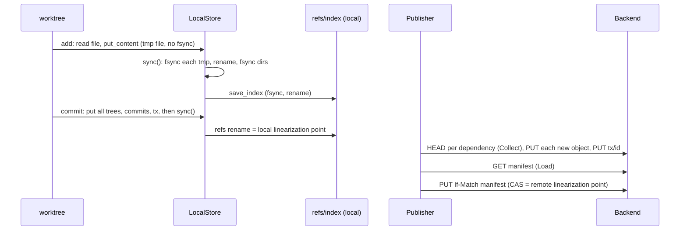

# Storage architecture audit: every byte from worktree to persistent storage

Issue #178 (epic #190). Date of all measurements and source accesses: **2026-10-31**.

Status labels used throughout:

- **CONFIRMED**: backed by a measurement, counter or deterministic test run in this audit (data under `docs/research/storage/data/`).
- **HYPOTHESIS**: read in the source (or inferred) but not independently measured here. Treat as a lead for the follow-up issues (#183 to #186), not as a fact.
- **[unverified]**: a claim taken from the issue text or a code comment that this audit did not re-check.

No external web sources were used. Every claim cites this repository at the base commit below.

## 0. Base and environment

| Item | Value |
|---|---|
| Base commit | `cd0fd091238efbd08fe3ba5f472b1d5ecf516107` (`origin/research/storage-engine`, fix(repo): keep cache writes out of crash injection) |
| Audit branch | `research/storage-audit` (docs plus one read-only probe binary, `crates/vcs-bench/src/bin/auditprobe.rs`; no production code changed) |
| Machine | Lambda box `lambda-final`: AMD EPYC 7J13, 30 vCPU, 216 GiB RAM, ext4 on virtio disk (`/dev/vda1`), kernel `6.8.0-1046-nvidia` x86_64 |
| Load during runs | **busy and shared**: load average 21 to 38 at the start of each run (`uptime` recorded). Wall times are therefore noisy; syscall, request and hash counts are deterministic and are the primary evidence |
| Toolchain | rustc/cargo 1.99.1, `cargo build --release` with `CARGO_PROFILE_RELEASE_DEBUG=1`; strace 5.16; valgrind 3.18.1 (callgrind); Python 3.10.12 |
| Not available | `perf` (kernel.perf_event_paranoid=4, no sudo), so no sampling profiles and no cold-cache runs (cannot drop the page cache). All timings are **warm page cache** |
| Datasets | Deterministic generators in `crates/vcs-bench/src/lib.rs` (`flat`: 100 files per directory; `deep`: depth 8, fan-out 4; `bigdir`: one directory), 100 to 1100 byte text files, seed 42 unless stated |

Remote backends tested: `MemBackend` wrapped in a per-method counter (the existing `CountingBackend` only keeps one request total; `auditprobe` has a typed twin, `Typed`), and `FsBackend` through the CLI. No S3, MinIO, HTTP or cloud resource was used; S3 findings come from reading `vcs-store-s3` and from request counts.

## 1. Architecture diagram

```text
 WORKTREE (files)                                 .vcs/ (local repository)                                REMOTE (Backend trait)
 -----------------                                -------------------------                               ----------------------
 d1/f1.txt  --stat--> index (.vcs/index)           index   AGIX frame, ONE file, rewritten whole          Backend: get, get_range, exists(HEAD),
    |        stat cache: size,mtime,mode           refs    one file, atomic rename = local commit point              put_if_absent, put_if_match(CAS), list
    | fs::read (whole file)   racy window 2 s      workspace, zones, op_head, remote-refs, commit-graph,     (no delete, no conditional GET, no batch)
    v                                              dircache (pure caches)
 size < 1 MiB ?                                                                                              impls: FsBackend (hard_link + fsync, CAS =
   | yes: Blob                                    OBJECT STORE  LocalStore (vcs-store)                              O_EXCL lock file), S3Backend (ureq, SigV4,
   | no:  gear-hash CDC chunks (min 4K avg 16K    ---------------------------------                                no connection reuse), HttpBackend -> vcs-server,
   |        max 64K) -> Blob per chunk + Chunked   put(): encode -> id = BLAKE3                                     MemBackend (tests)
   |        manifest (ordered chunk ids+lens)         derive_key("all-git 2026 object identity v3")
   v                                                  over  kind||version||payload  (no compression, no delta)   KEYS
 id = BLAKE3-256(kind||ver||payload)               loose: objects/aa/<62 hex>   (one file per object,            objects/aa/<62 hex>   one object per key
   kind byte: Blob Tree Commit Snapshot                   tmp/ -> fsync -> rename -> fsync dirs (sync())         tx/<txid>             Transaction (immutable)
   Transaction Operation Chunked Tag              packs: pack/pack-<h>.pack + .idx  (manual `vcs repack`;        packs/<n>.pack|.idx   read path exists,
 Tree = sorted (name, mode, id) entries                  sorted by id, u32-len framed, no delta,                                       NO production writer
 Commit = zone, parents, root tree, change id,           idx = 44 B/entry, binary search)                      manifest              ONE object, CAS target:
          author, message                          get(): open loose -> ENOENT -> scan packs linearly                             generation, branches{(zone,branch)->commit},
 Transaction = sorted RefUpdate{zone,branch,       verify: BLAKE3(bytes) == id on EVERY read                                       snapshots, applied[<=4096 txids], zones,
          old,new}, author, message, lock ops                                                                                       labels, locks, next_token, time_hw

 WRITE PATH                               commit                                                publish (Publisher step machine)
 add -> put_content -> tmp file           treeops::build(index)  -> put EVERY tree              Collect: post_order walk, HEAD per dependency, stop where present
   (no fsync) ... sync(): fsync each      Commit per zone, Transaction                          Upload : GET local object again, PUT if-absent, one at a time
   tmp, rename, fsync dirs                sync(); refs <- write_atomic (LINEARIZATION POINT)    PutTx  : PUT tx/<txid>
 save_index(): sync + fsync'd rewrite     record_op: Operation(full branch view); op_head       Load   : GET manifest, check txid applied, check every old==current
                                                                                                Cas    : put_if_match(manifest)   <-- LINEARIZATION POINT (all zones)

 READ PATH
 status: stat every tracked file (racy => read+hash), DirCache for untracked, diff_index vs HEAD trees
 sparse clone: GET manifest -> for wanted zones only: post_order GET commit/tree objects (no blobs, `skip_files`)
               -> prefetch_files: LIST packs/ + one GET per missing blob -> zone_add materializes worktree
 lazy fetch  : StoreError::NotFound -> fetch_object (1 GET) -> verify -> put + sync -> rerun command
```

The same, as the main ownership and ordering rules (Mermaid):



## 2. Source map (symbol and line, base commit)

| Step | Where |
|---|---|
| Identity | `vcs-objects/src/object.rs`: `FORMAT_VERSION` 3, `HASH_CONTEXT`; `id_of_parts` 52, `id_of_encoded` 60, `blob_id` 66, `content_id` 73; `Object::encode` 410, `Object::decode` 499 (Blob arm 507 copies payload with `to_vec`) |
| Chunking | `object.rs` `CHUNK_THRESHOLD` = 1 MiB (13), `CHUNK_MIN/AVG/MAX` = 4/16/64 KiB (15 to 17), `ChunkedBlob::plan` 96; gear CDC in `vcs-objects/src/chunk.rs` `chunk_ends` 36 |
| Encoding | `vcs-objects/src/codec.rs`: minimal LEB128 varints, strict decode; no compression anywhere |
| Local store | `vcs-store/src/lib.rs`: trait `ObjectStore` 38; `put_blob` 62; `put_content` 67; `decode_verified` 122; `LocalStore` 185; `open` 275; `load_packs` 299; `packed` 313; `repack` 326; `get` 357; `put` 370; `sync` 413; `contains` 458; `list` 478 |
| Packs | `vcs-store/src/pack.rs`: `PackIndex::parse` 31 (BLAKE3 over whole idx at 37), `Pack::open` 86, `Pack::read` 110, `Pack::verify` 130, `write_pack` 179 |
| Staging and commit | `vcs-repo/src/repo.rs`: `add` 361, `add_dir` 485, `stage_files` 561, `wt_state` 620, `status_with` 667, `commit` 952 (`treeops::build` at 986, `sync` 1025, refs write 1026, `record_op` 1031), `save_index` 328, `fsck` 1456; `treeops.rs`: `build` 52, `write_dir` 72, `hash_dir` 93 |
| Atomic state files | `vcs-repo/src/meta.rs` `write_atomic_inner` 27 (file `sync_all` 40, rename 42); `ops.rs` `record_op` 68, `write_op_head` 81, `current_view` 56 |
| Remote protocol | `vcs-remote/src/protocol.rs`: `Publisher::step` 269 (Collect 272, Upload 302, PutTx 318, Load 331, Cas 415), `post_order` 136, `fetch_object` 537, `load_manifest` 525, `fetch_heads_impl` 590; `manifest.rs` (`MAX_APPLIED` 13, `encode` 80); `backend.rs` trait 24 |
| Remote packs | `vcs-remote/src/packfetch.rs`: `fetch_from_any_pack` 31, `fetch_many` 50 (LIST at 57), `upload_pack` 114 |
| Backends | `fsbackend.rs` (`get` 87, `tmp_file` 33, `put_if_absent` 108, `list` 133), `vcs-store-s3/src/lib.rs` (`max_idle_connections(0)` 123, payload SHA-256 212, `send` 200), `membackend.rs`, `stats.rs` (`CountingBackend`) |
| Sync | `vcs-repo/src/sync.rs`: `publish_as` 179, `fetch_locked` 365, `fetch_missing` 406, `prefetch_files` 433, `with_lazy_fetch` 479, `clone_from` 550 |
| GC and fsck | `vcs-repo/src/gc.rs` `gc_plan_at` 39, `gc_roots` 82; `repo.rs` `remote_closure` 1441 |

## 3. The questions in the issue

### 3.1 Is identical data stored twice?

- **Within one store: no.** CONFIRMED (`audit_misc.jsonl`, `dedup`): one 5000 byte file added at four paths in the root zone and two other zones produced exactly 1 blob object. A 3 MiB random file produced 153 chunk-related objects (manifest plus chunks) and **no** whole-file blob; adding a second identical copy created 0 new objects. A chunk is a plain `Blob` with the same id a standalone file of the same bytes would have, so chunks also dedup against small files.
- A dedup hit still costs encode, BLAKE3 and one `statx` per object (CONFIRMED: 20000 dedup `put_blob` calls issued 20002 `statx` and no write syscalls, `audit_strace_store.txt`). It does not touch the object when it is younger than 3.5 days (`DEFAULT_TOUCH_AFTER`); older objects get their mtime refreshed (`touch`, lib.rs 269, one open and one `utimens`) so GC sees them as young.
- **Duplication that does exist** (by design or by crash):
  - An old object that lives in a pack is re-adopted as a fresh loose copy when re-added (lib.rs 391 to 411; the test `local_put_dedup_readopts_old_packed_object` pins this). HYPOTHESIS that this accumulates loose copies of hot content; not measured.
  - `repack` writes the pack, then deletes loose files (lib.rs 339 to 343). A crash between leaves both. No cleanup exists (HYPOTHESIS, follows from section 3.7 result).
  - Local store versus remote: by design.
  - Every `Operation` object embeds the complete branch view (section 4, F13), so branch pointers are stored once per operation.
  - Block-level waste: loose objects occupy a 4 KiB ext4 block each (F6).

### 3.2 How packs are built and read

Build (`LocalStore::repack`, lib.rs 326 to 345, `pack::write_pack` 179 to 222):

1. `sync()`, list loose objects, `fs::read` each, verify its hash (`decode_verified`), collect `(id, bytes)` in memory.
2. Sort by id, write `VCSPACK1` header, then for each object a `u32` length and the encoded bytes, then a BLAKE3 of the whole pack as trailer. The whole pack is built in a `Vec` (HYPOTHESIS: memory is O(pack size)).
3. Write the index (`VCSPIDX1`, 44 bytes per entry: id, offset, length, sorted by id, BLAKE3 trailer). `.pack` and `.idx` are written to `tmp/`, `sync_all`'d, renamed (pack first, index last), directory fsync is best effort.
4. Delete the loose files (errors ignored).

Properties (code): no delta, no compression, objects ordered by id (so related objects are not adjacent), only loose objects are ever packed (existing packs are never merged or rewritten), and `repack` runs only when a user runs `vcs repack` (`vcs-cli/src/main.rs` 1547; no automatic trigger found by grep).

Read (`LocalStore::get`, lib.rs 357 to 368): try the loose path (`fs::read`), on `NotFound` scan `packs` linearly and binary-search each index; then hash-verify and decode. `Pack::read` (pack.rs 110) opens the pack file, seeks, and `take(len).read_to_end` on a growing `Vec` on every call, with no fd cache or mmap.

Measured read cost (CONFIRMED, 20000 `get` calls, 300 byte objects, `auditprobe getall`, warm cache):

| Layout | syscalls per get (strace -c -f) | wall per get, 5 runs | 
|---|---|---|
| loose | 5: openat, statx, read x2, close | median 7.8 us (7.8 to 8.7) |
| packed (1 pack) | 9: failed openat of the loose path, openat pack, lseek, **read x5**, close | median 12.0 us (12.0 to 12.7) |

**Negative result:** packing does not make warm local reads faster here; it is about 1.5x slower, because the loose path is tried first and `read_to_end` issues five `read` calls for a 300 byte object. The benefit of packs shown by this audit is disk space (F6) and file count, not read latency. Cold-cache behaviour was not measured.

### 3.3 How CAS gives atomicity

Remote (`protocol.rs` module docs 1 to 16, `Publisher::step` 269 to 444):

1. **Collect**: post-order walk from each new head; an object is skipped if `backend.exists` says it is present (invariant: a present object's closure is present, because uploads are dependency-first).
2. **Upload**: `put_if_absent` for every missing object, then `PutTx` stores the `Transaction` at `tx/<txid>`.
3. **Load**: read the manifest and its version tag; if `txid` is already in `applied` the publish is a no-op (`AlreadyApplied`); otherwise every `update.old` must equal the current head (else `Diverged`).
4. **Cas**: `put_if_match(manifest, new, tag)` (S3 `If-Match`; FsBackend: lock file + compare of a BLAKE3 tag). Success is the linearization point. A lost race goes back to Load, re-validates, and retries without re-uploading, so writers on disjoint zones both succeed. An ambiguous failure also goes back to Load, which finds the txid in `applied` if the write landed. The issue text records that this is model-checked over about 1.7M schedules [unverified here; not re-run].

Local: `commit` writes immutable objects, calls `sync()`, then `write_atomic(refs)` (tmp file, `sync_all`, rename). That one rename is the local linearization point (repo.rs 1025 to 1026).

### 3.4 How multi-zone transactions are stored

- Locally: one commit per changed zone, one `Transaction` object listing every `RefUpdate` sorted by (zone, branch) (repo.rs 1015 to 1024), and the `refs` file updated once. All zone heads therefore advance together. The local commit-time transactions are never uploaded; `gc_roots` treats every stored `Transaction` as a root forever (gc.rs 104 to 110) (HYPOTHESIS: unbounded root growth).
- Remotely: `publish` builds a *new* `Transaction` (message "publish") covering all changed zones, stores it at `tx/<txid>`, and the single manifest object carries every `(zone, branch) -> head`. Atomicity across zones comes entirely from that one CAS key.
- The cost of that design is measured in F9: the manifest is one object that is read by every fetch and clone, fully rewritten by every publish, and contended by all zones.

### 3.5 How sparse clones avoid unsubscribed zones

`clone_from` reads the manifest (all zones' branch names and heads), defines all zones locally, then runs `fetch_heads_lazy` and `prefetch_files` **only for the requested zones** (sync.rs 550 to 600, protocol.rs 590 to 619). CONFIRMED (`audit_sparse_history_manifest.jsonl`, 200 files per zone, 5 commits):

| Zones on remote | Requests to clone 1 zone | Requests to clone all | Bytes down, 1 zone |
|---|---|---|---|
| 4 | 221 (220 GET + 1 LIST) | 875 | 137,619 |
| 8 | 221 | 1,747 | 137,987 |
| 16 | 221 | 3,491 | 138,759 |

The cost of a one-zone clone is flat in the number of other zones: no object of an unsubscribed zone is requested. What is **not** avoided: the entire manifest is downloaded and decoded (names and heads of every zone, all `applied` ids, all locks) and the cost of the history of the wanted zone is one GET per commit and per tree (F10).

### 3.6 Cache staleness

- Objects are immutable and content-addressed, so a cached object can never be stale; it can only be missing (lazy fetch refetches exactly one object) or corrupt (never silently replaced, `docs/cache.md`).
- Mutable state: the remote manifest is **never cached**; every publish does 2 manifest GETs (CONFIRMED, F8) and every fetch 1. There is no conditional GET (`Backend::get` has no `If-None-Match`), so an unchanged manifest costs a full transfer.
- `remote-refs` (the tracking heads) can lag the remote; `publish_as` skips a zone when `tracked.head == local` (sync.rs 202) but still re-reads the manifest and Cas re-validates, so a stale tracking ref cannot cause a wrong write.
- `dircache` is validated by (inode, mtime, ctime) stamps with a 2 s racy margin; the commit-graph is validated and extended on use (`cgraph.rs`).
- The index stat cache trusts an entry only if `mtime + 2 s <= index.written_ns` (repo.rs 643). Because `status` and `commit` never rewrite the index, entries created within 2 s of the last `add` stay "racy" and are fully re-read on **every** `status` until the next `add` (CONFIRMED, F12).
- Eviction does not exist (`docs/cache.md`): the local object cache only grows.

### 3.7 Unreachable-object detection and recovery after interrupted operations

Unreachable detection:

- Local: `gc_plan` is the only mark phase and is dry-run only (`gc.rs`). It lists the store, takes roots (refs, snapshots, tags, remote-tracking refs, op head, index, stash, merge state, and every stored `Transaction`), marks by reading every reachable object, and reports unreferenced ones older than the grace period. CONFIRMED to read about 2.01x the store's bytes (F11).
- `fsck` lists and reads every object and classifies a missing-but-refetchable object as an evictable cache miss using `remote_closure` (repo.rs 1441 to 1566).
- Remote: none. The `Backend` trait has no `delete` (backend.rs 24 to 34), so remote GC is impossible without a trait change. Objects uploaded by a publish that then fails (`Diverged`, retries exhausted) and their `tx/<id>` stay on the remote forever (CODE; HYPOTHESIS that this matters in practice).

Recovery after interruption:

- Publish: every step idempotent; crash at any point is repaired by re-running (design, model-checked [unverified here]).
- Local objects: not visible until `sync()` renames them (CONFIRMED: `crash_before_barrier_leaves_repo_valid_and_objects_invisible` passes on the box, and the probe shows an unsynced object is not visible after restart). **But leftovers are never cleaned** (CONFIRMED, `auditprobe crash`): after dropping a store with 10 unsynced puts, `tmp/` held 10 files; after reopening, and after a later successful `sync`, still 10. Likewise a `.pack` whose `.idx` is missing (crash between the two renames) stays in `pack/` after reopen and a later sync. No code in `vcs-store` deletes anything under `tmp/` or orphan packs (grep: the only `remove_file` is the loose-object delete in `repack`).
- State files (`refs`, `index`, `op_head`, ...): `write_atomic_inner` fsyncs the temp file and renames, with **no fsync of the parent directory** (meta.rs 37 to 42) (HYPOTHESIS: after power loss a rename may be lost, rolling the file back to its previous valid content; the commit/op_head pair can then disagree, the op log missing an entry). Not tested: no power-loss simulation was run.
- `commit` writes `refs` at repo.rs 1026 and the Operation + `op_head` afterwards (1031); the code comment says a crash between leaves the old `op_head` valid.

## 4. Findings: redundant I/O, allocations, hashing, syscalls, round trips

Impact estimates use the measured counts below. F-numbers are stable ids for the follow-up issues.

| Id | Finding | Where (symbol, line) | Status | Evidence |
|---|---|---|---|---|
| F1 | One fsync, one rename, one tmp file and about 15 syscalls per new small object on `add` | `LocalStore::put` 404 to 410, `sync` 413 to 456 | CONFIRMED | strace: `add .` of 1000 files: 16,928 syscalls, 1,256 `fsync`, 1,001 `rename`, 3,313 `openat`, 3,020 `statx`, 1,002 `getpid` (the pid goes into every tmp name); 20,000 files: 304,061 syscalls, 20,259 fsync |
| F2 | `add .` re-reads and re-hashes **every** file even when nothing changed; the index stat cache is not consulted | `add_dir` 485, `stage_files` 561 to 618 | CONFIRMED | callgrind: `add .` of 21 files = 243 BLAKE3 finalizations; running `add .` again unchanged = 243 again, 21 `put_content`, 132 encodes. The existing test only asserts no new objects are written, not that nothing is hashed |
| F3 | Every chunk of a large file is hashed twice, and chunking costs more than hashing | `ChunkedBlob::plan` object.rs 96 to 117 then `put_content` lib.rs 72 to 82 | CONFIRMED | callgrind: 20 small files + one 2 MiB file: 243 = 20 + 2 x 111 chunks + 1 manifest. Timing: 4 MiB `content_id` 5.26 ms versus one BLAKE3 pass 1.00 ms, `put_content` into memory 7.25 ms (64 MiB: 86.8 / 18.6 / 120.7 ms; median of 7). The gear-hash chunker (about 1 GB/s) is the dominant part, not BLAKE3 |
| F4 | `commit` rebuilds and re-`put`s **every tree** of each zone from the flat index, not just the changed path | `treeops::build` 52, `write_dir` 72; call at repo.rs 986 | CONFIRMED | `commit` after a 1-file edit: `statx` count 51 (flat 1,000 files, 10 dirs), 91 (flat 5,000), 241 (flat 20,000, 200 dirs), **15,508** (deep 5,000 files, 15,466 trees), 42 (bigdir). callgrind: 1-file commit of a 2-dir tree = 6 puts including the unchanged sibling tree. Wall (3 trials, noisy box): deep 5,000 `commit` of one edit 120 to 297 ms median versus 11 to 18 ms for flat 1,000 |
| F5 | A dedup `put` still encodes, hashes and stats | `LocalStore::put` 370 to 390 | CONFIRMED | 20,000 dedup puts: 20,002 `statx`, no writes |
| F6 | Loose objects waste disk: one 4 KiB block per object | loose layout | CONFIRMED | 20,000 x 300 B objects: apparent 7.34 MB, allocated 83.2 MB (11.3x); the same objects in one pack: 8.31 MB. One-zone clone of 200 files: 137,358 B apparent, 901,120 B allocated (6.6x) |
| F7 | Pack read: loose path tried first (a failing `openat` per packed object), file reopened on every read, five `read` calls per small object, no fd cache | `get` 357 to 368, `Pack::read` 110 to 124 | CONFIRMED | see 3.2: 9 syscalls per packed get versus 5 per loose get; packed is 1.5x slower warm |
| F8 | Every process start opens and BLAKE3-verifies every pack index | `LocalStore::open` 275, `load_packs` 299, `PackIndex::parse` 31 to 67, `Pack::open` 86 | CONFIRMED | `LocalStore::open` time (7 runs, warm): 100k objects in 1 pack (4.4 MB idx) 5.6 ms (2.8 to 19.8); **1M objects (44 MB idx) 90.1 ms (89.4 to 91.3)**, paid by every CLI invocation. In memory each entry is a `(ObjectId, u64, u32)` tuple (HYPOTHESIS: about 48 B, so about 48 MB at 1M) |
| F9 | Pack lookup is a linear scan over packs, and packs are never merged | `LocalStore::packed` 313, `in_pack` 321, `repack` 326 | CONFIRMED (lookup) / HYPOTHESIS (accumulation) | 100k objects split into 1 / 10 / 100 / 1000 packs: miss lookup 2.7 / 3.8 / 20.7 / **96.3 us** (35x). Accumulation: `repack` only packs loose objects, only runs on demand |
| F10 | Publish round trips: a HEAD per tree entry in the changed directories, sequential single PUTs | `Publisher` Collect 272 to 301 (`exists` 280), Upload 302 to 317 | CONFIRMED | Typed counters (MemBackend). First publish: about 2 requests per object (flat 1,000 files: 1,012 HEAD + 1,014 PUT; deep 5,000: 20,462 + 20,464). **Incremental 1-file publish**: flat 1,000 = 121 requests (113 HEAD); flat 5,000 = 161 (153 HEAD); bigdir 5,000 = **5,012** (5,004 HEAD); deep 5,000 = 45. HEADs scale with the entry count of each changed directory, not with the change |
| F11 | Publish reads each local object twice and re-encodes it; also decodes just to re-encode | Collect `local.get` 281; Upload `local.get` 308, `obj.encode()` 309 | CONFIRMED | strace of `publish` to an FsBackend: flat 1,000 files: 2,025 opens of local object files for 1,013 distinct files (flat 200: 409 for 205) |
| F12 | `status` re-hashes every "racy" file on every run until the next `add` | `wt_state` 620 to 652 | CONFIRMED | flat 1,000 `status` right after `add`+`commit`: 6,436 syscalls, 1,042 `openat`, 2,023 `read`; the same tree with files older than 2 s at `add` time: 1,392 syscalls, 42 `openat` (4.6x). The racy cost persisted through `commit` and a second `status` |
| F13 | `Operation` objects store the full branch view per operation | `current_view` ops.rs 56, `record_op` 68 | CONFIRMED | 20 commits on top of 10 / 100 / 1000 branches: operation bytes per op 522 / 4,212 / 42,013; total 14.2 KB / 304 KB / **21.9 MB** (1,022 ops) |
| F14 | Manifest: fetched twice per publish, one object for all zones, fully rewritten per publish, never cached, no conditional GET | `publish_as` sync.rs 185, `State::Load` 332, `Manifest::encode` 80 | CONFIRMED | every publish run above has `get`=2; `Manifest::encode` size: 90 B empty; 131,163 B with 1 branch and 4,096 applied ids; 144,284 B (100 zones x 2 branches); 419,085 B (1,000 x 5); **3.0 MB** (10,000 zones x 5 branches). Each CAS uploads this whole size; each clone downloads it |
| F15 | No production writer of remote packs: every remote object is its own key; fetch is one GET per commit and tree | `upload_pack` packfetch.rs 114 (callers: tests only), `fetch_heads_impl` 590, `post_order` 136 | CONFIRMED | `remote_pack_keys` = 0 after every publish; cloning a history of 50 / 200 / 1,000 commits over 100 files: 253 / 703 / **3,103** requests (about 3.1 GET per commit) and 262 KB / 933 KB / 4.66 MB, sequential |
| F16 | `fetch_many`/prefetch issue a LIST of `packs/` per call (one per zone) even though no packs exist; `FsBackend::list` walks the whole tree | `fetch_many` 57, `FsBackend::list` 133 + `walk` 70 | CONFIRMED | one-zone clone: 1 LIST; all-zones clone of 16 zones: 16 LISTs. FsBackend `list("packs/")` with 100,000 keys under `objects/`: 107 ms (103.5 to 173.6) |
| F17 | S3 backend: new connection for every request, SHA-256 over every body | `vcs-store-s3` 123, 212 | HYPOTHESIS | read from source: `max_idle_connections(0)` with a comment about ambiguous conditional writes; per-request TCP (+TLS) setup was not measured (no S3/MinIO run). Combined with F10/F15, request counts multiply by connection setup |
| F18 | FsBackend: fsync per `put_if_absent`, tag computed by BLAKE3 over the whole object on every `get` | `tmp_file` 33 to 44 (`sync_all` 42), `get` 87 to 91 | CONFIRMED (fsync) / HYPOTHESIS (hash cost) | publish of flat 1,000 files to a directory remote: 1,012 remote objects, 1,015 `fsync` calls |
| F19 | GC mark reads the whole store twice and reads blobs that cannot have children | `gc_roots` 82 to 112 (loop at 106 to 110), `gc_plan_at` 49 | CONFIRMED | `rchar` delta of one `gc_plan`: 2.01x the store bytes (8.0 MB store: 16.07 MB read; 40.0 MB store: 80.3 MB), 585.8 ms for 5,055 objects |
| F20 | The whole index is rewritten (and fsynced) on every `add` | `Index::encode`, `save_index` repo.rs 328 | CONFIRMED (size) / HYPOTHESIS (time) | index is 299,872 B for 5,000 files (60 B per entry): 6 MB at 100k files per `add`; time not isolated |
| F21 | Fetched objects are decoded, then re-encoded and re-hashed by `put`, and written as one fsynced loose file each | `fetch_heads_impl` 604 to 609, `prefetch_files` 458 to 472, `fetch_object` 546 to 549 | HYPOTHESIS | verification hash + decode in `fetch_object`, then `LocalStore::put` encodes and hashes again. Local file count = object count (CONFIRMED by the 220 / 875 local files in the clone runs); cost not isolated |
| F22 | State-file renames are not followed by a directory fsync | `write_atomic_inner` meta.rs 37 to 42 | HYPOTHESIS | see 3.7; untested |
| F23 | Payload copies: `put_blob` copies with `to_vec`, `Object::encode` copies again, `decode` copies on read | `put_blob` lib.rs 62 to 64, `encode` object.rs 410, `decode` 507 to 510 | HYPOTHESIS | by reading; not isolated from hashing in a profile (no `perf`) |

### Result tables (CLI, `audit_cli.jsonl`)

Syscalls by operation (strace -c -f, deterministic; one traced run per cell). `settled` = files older than 2 s when `add` ran.

| Dataset | add . (total / fsync) | commit after 1-file edit (total / statx) | status, settled (total / openat) |
|---|---|---|---|
| flat 1,000 | 16,928 / 1,256 | 375 / 51 | 1,392 / 42 |
| flat 5,000 | 77,530 / 5,259 | 427 / 91 | 6,209 to 6,519 / 70 to 122 |
| flat 20,000 | 304,061 / 20,259 | 609 / 241 | 23,586 to 24,956 / 220 to 422 |
| deep 5,000 | 170,034 / 5,259 | **16,012 / 15,508** | 47,981 / 15,481 |
| bigdir 5,000 | 77,233 / 5,259 | 381 / 42 | 5,192 / 21 |

Wall time medians (3 trials, ms; min to max in brackets; box load 21 to 38, so read these as order of magnitude): flat 20,000 `add .` 2,907 (2,666 to 3,970) racy and 3,998 (1,887 to 8,657) settled; deep 5,000 `commit` of the first import 4,067 (2,470 to 8,681) and 6,294 (5,269 to 6,635); deep 5,000 one-file `commit` 297 (145 to 809) and 121 (119 to 147). Flat 1,000 one-file `commit`: 11.3 and 18.4.

BLAKE3 finalizations per operation (callgrind, 20 x 600 B + one 2 MiB random file, `audit_hash_finalize_counts.txt`): add 243, commit 7, add again (unchanged) 243, status 4, add of one edited file 1, commit of one edit 8.

## 5. What this implies (inputs to the follow-up issues, no decisions)

Ranked by measured size, with the Pareto axis each touches:

1. **Remote request count and metadata contention** (F10, F14, F15, F16, F17): first publish is about 2 requests per object; sparse clone and history fetch are one GET per commit or tree; the manifest is a single object that grows with zone count (3 MB at 10k zones) and is rewritten per publish. Axes: requests, bytes, latency, atomic-commit contention. Feeds #184 (packs, placement), #186 (metadata sharding without weakening multi-zone atomicity).
2. **Per-object file overhead locally** (F1, F6, F7, F8, F9): fsync, rename and a 4 KiB block per object, then a read path where packs are not faster warm. Axes: write latency, disk bytes, warm and cold read latency, process start-up. Feeds #184 and #185 (index/cache).
3. **Avoidable CPU and I/O on unchanged data** (F2, F3, F4, F5, F12, F20): re-hash on `add`, double chunk hash, whole-tree rebuild on `commit`, racy status. These are cheap to fix and do not need a format change, but this issue makes no code change.
4. **GC and cleanup** (F19, F13, 3.7): no remote delete, twice-read local mark, unbounded operation and transaction growth, leftover temp files. Feeds #186.

Not decided here: whether any of this justifies a new layout. The numbers in section 4 are the baseline a candidate must beat on the same machine.

## 6. Reproduce

All commands on the Lambda box from the repository root after `cargo build --release -p vcs-bench -p vcs-cli` (the probe and CLI binaries are in `target/release`). Raw outputs for the committed runs are in `docs/research/storage/data/`; large work directories stayed on the box under `~/rt/s_audit_work` and were not committed.

```sh
auditprobe publish-req flat 1000          # typed backend counters, first and incremental publish
auditprobe sparse 8 200 5                 # sparse versus full clone request counts
auditprobe history 200 100                # fetch cost of a history
auditprobe manifest-size 10000 5 4096     # manifest bytes
auditprobe mkpacks DIR 100000 1000 && auditprobe openpacks DIR        # F8, F9
auditprobe mkloose DIR 20000 [pack]; strace -f -c auditprobe getall DIR 20000   # F5, F6, F7
auditprobe gcread 5000; auditprobe crash; auditprobe opgrowth 1000 20; auditprobe dedup
auditprobe putcontent 64; auditprobe fslist 100000
SETTLE=1 python3 docs/research/storage/data/audit_cli.py vcs datagen WORK flat 20000 3   # syscalls and wall time
sh docs/research/storage/data/audit_hashcount.sh vcs WORK                                 # callgrind hash counts
python3 docs/research/storage/data/audit_cgcalls.py 'Hasher8finalize' WORK/cg.add_all
sh docs/research/storage/data/audit_publish_strace.sh vcs datagen WORK 1000
```

## 7. Negative results and limits

- **Packed reads are not faster than loose reads, warm** (F7): 12.0 versus 7.8 microseconds per get on 20,000 objects. Cold-cache runs were not possible (no root).
- **Sparse isolation holds**: no object of an unsubscribed zone is ever requested (section 3.5). The weakness is the shared manifest, not object leakage.
- A re-add of unchanged files writes nothing new (test `re_adding_unchanged_files_writes_no_new_objects` passes on the box) but is not free (F2).
- Dedup is correct and complete inside one store (3.1); the waste is in block overhead and per-operation metadata, not duplicated content.
- Wall-clock numbers were taken on a shared box at load 21 to 38 with 3 trials; spreads are wide (for example 1.9 to 8.7 s for the same `add`). Only counts (syscalls, requests, hashes, bytes) should be compared across machines.
- Not run: any S3, MinIO or HTTP backend (no network latency model, so request counts are not converted to time or cost; connection setup for F17 is unmeasured); 100k-file trees; concurrent publishers; power-loss or `kill -9` injection at the CLI level (only store-level simulation and the existing `durability` test); sampling profiles (`perf` blocked by kernel.perf_event_paranoid=4). The model-checked CAS claim is from the issue text [unverified here]. `~/ref/walgit` was not read; that is #179.
- Callgrind hash counts come from a 21-file tree; the per-file formulas (one hash per small file, two per chunk) are exact, the 2 MiB chunk count (111) is for that random input.
- `auditprobe` links `vcs-remote` as a new dev-only dependency of `vcs-bench`; no default behaviour changed.
